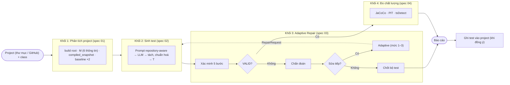
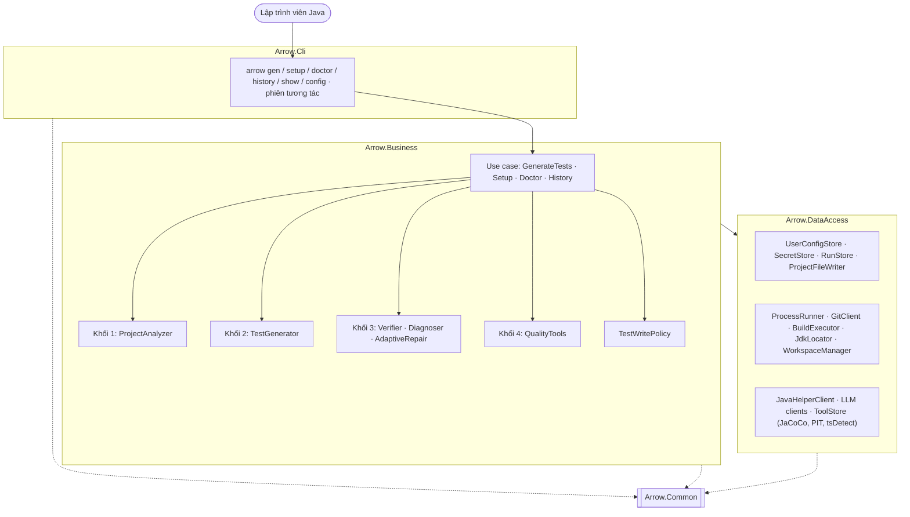
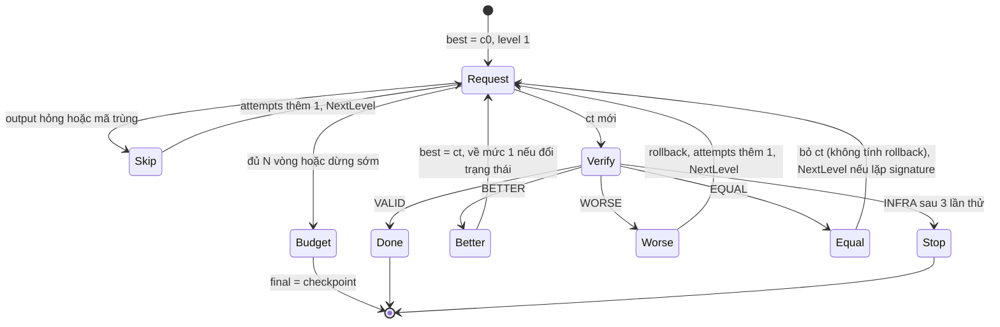

# ARROW Developer CLI: Kiến trúc hệ thống

> **Trạng thái:** bản đề xuất để nhóm duyệt, chưa triển khai. Cập nhật 10/11/2026.
>
> **Bộ tài liệu:**
> - tài liệu này: kiến trúc tổng quan;
> - `specs/P00–P11`: spec chi tiết của từng phần, đọc độc lập được. Khi tài liệu này và P-spec khác nhau thì **P-spec là chuẩn**;
> - `reference/00–05`: spec của nhóm (ký hiệu `Rxx`), là nguồn gốc của thuật toán;
> - `PLAN_CODE.vi.md`: kế hoạch code.
>
> **Quyết định đã chốt (09/11/2026):**
> - Hệ thống **chỉ phục vụ người dùng cuối**, tức lập trình viên Java. Phần chỉ dành cho thực nghiệm không làm.
> - Làm **CLI** (lệnh và tuỳ chọn, có phiên tương tác), không làm app console có menu.
> - **Spec 07 không áp dụng.** Giữ cấu trúc project `Arrow.Cli / Arrow.Business / Arrow.DataAccess / Arrow.Common`.
> - Nền tảng **.NET 10 LTS**.
> - Code đặt ở `D:\Ky9\DoAn\ARROW_Developer_CLI`.
> - **Viết mới theo P-spec, có chọn lọc** (chốt 12/11/2026, thay quyết định ngày 10/11 là chép code). Đối với `D:\Ky9\DoAn\ReportDoAn\ARROW_Framework`, bản cài đặt spec của nhóm:
>   - **giữ nguyên** java-helper, prompt và `tools.lock.json`;
>   - các lớp đọc log và thuật toán thì **viết lại**, tham khảo code cũ khi gặp trường hợp biên;
>   - test và fixture cũ là **bộ đối chiếu**;
>   - phần còn lại (kiến trúc, use case, CLI, cấu hình, lưu trữ) viết mới hoàn toàn.
>
>   Tên lớp giữ như trong tài liệu này (ví dụ `CodeExtractor`, `JavacErrorParser`, `TestResultClassifier`). Chi tiết ở `PLAN_CODE.vi.md` Mục 2.1.
> - **`-Werror`** giữ theo R03 §3.2: rơi vào `UNKNOWN` (chốt 10/11/2026).
> - **Tên file test:** `<CUT>_ArrowTest`, trùng thì `<CUT>_Arrow2Test`, `_Arrow3Test`…, để luôn khớp mẫu `*Test.java` của Surefire. Đây là điểm khác R01 (chốt 10/11/2026; P01 §4.7, P06 §4).
>
> **Căn cứ:** thuật toán của 4 khối theo spec 01–04. Khi tài liệu này lệch với spec ở phần thuật toán thì **spec là chuẩn**. Mục 2 liệt kê phần nào của spec được dùng và phần nào bỏ.

ARROW Developer CLI là công cụ dòng lệnh cho lập trình viên Java. Người dùng chỉ ra một class (CUT, class under test) trong project của mình. Hệ thống làm 5 việc:

1. phân tích project để biết cách build, Java version và test framework (khối 1);
2. dùng LLM sinh unit test (khối 2);
3. xác minh test trên build thật qua 5 bước, tự sửa bằng **Adaptive Repair** khi test lỗi (khối 3);
4. đo chất lượng của bộ test hợp lệ (khối 4);
5. ghi file test vào project **khi người dùng đồng ý**.

## 1. Mục tiêu và phạm vi

**Giá trị cho người dùng.** Người dùng chỉ nhận về test đã đạt **VALID** trên build thật của project:
- compile được;
- được test runner tìm thấy;
- chạy không ném exception lạ;
- mọi assertion đều đúng;
- không làm hỏng test có sẵn.

Đi kèm là số đo coverage, mutation score và test smell.

**Phiên bản đầu (v1):**
- Project Java dùng Maven hoặc Gradle (có hoặc không có wrapper); JUnit 4, JUnit 5 hoặc TestNG.
- Đầu vào: thư mục project trên máy, hoặc link GitHub kèm nhánh, tag hay commit.
- Một class, nhiều class, hoặc cả một package.
- Người dùng tự chọn nhà cung cấp LLM và dùng API key của mình, hoặc Ollama chạy trên máy.
- Chạy trên Windows, Linux và macOS.

**Ngoài phạm vi v1:**
- Kotlin, Scala.
- Extension cho IDE, giao diện web.
- Gợi ý class nên viết test (`arrow suggest`): để giai đoạn sau.
- Sửa code production hay file build của người dùng. Hệ thống **chỉ tạo file test**.

## 2. Dùng spec của nhóm như thế nào

| Spec | Dùng | Bỏ hoặc thay |
|---|---|---|
| 00 Tổng quan | 4 khối, trạng thái xác minh, code hash, quy ước JSON, ghi file nguyên tử, cách ghi log build | Manifest, `experiments/*.json`, ledger, job và hàng đợi, shard, gộp run, `rq2-subset`, `screen`, lệnh `run/analyze/repair/assess/report/control` |
| 01 Khối 1 | Tự dò build root (Mục 4.1 bước 2), build tool, Java version, chọn JDK, dependencies, test framework, M, test path `_ArrowTest` (trùng thì `_Arrow2Test`, khác R01), snapshot, baseline ×2, xoá jar hỏng | Đọc `build_attempts` của manifest, tiêu chí B và `paired_test`. Đầu vào là project của người dùng thay cho manifest (Mục 5.1) |
| 02 Khối 2 | Template, khối M, gọi model qua `ILlmClient`, tách và chuẩn hoá mã, `code_hash`, cache theo `call_id` (để chạy tiếp) | Chỉ dùng quy trình `zero_shot_project_aware` (không làm `zero_shot`, `few_shot`, kiểm tra công bằng RQ1). Không bắt buộc LiteLLM (Mục 7) |
| 03 Khối 3 | Xác minh 5 bước, chẩn đoán, Adaptive Repair, INFRA | Fixed Repair, tập con RQ2, `rq3_only`, xác minh EvoSuite, `needs_rerun.csv` |
| 04 Khối 4 | JaCoCo, PIT (dòng lệnh), tsDetect, phạm vi `<FQN>` và `<FQN>$*` | EvoSuite, báo cáo RQ1–RQ3, chọn N, độ nhạy P, ghép cặp |
| 05 Câu hỏi | Các chốt Q4, Q5, Q7, Q8 | Q1–Q3, Q6 (riêng thực nghiệm) |
| 07 Kiến trúc | — | **Bỏ.** Thay bằng Mục 3.2 |

## 3. Kiến trúc tổng thể

### 3.1 Góc nhìn chức năng: 4 khối



| Khối | Đầu vào | Đầu ra |
|---|---|---|
| 1 | `ProjectTarget` (project, CUT, ref) | `metadata.json` (M), `metadata_prompt.txt`, `baseline.json`, `workspace.json`, `test_classpath.txt`, `compiled_snapshot` |
| 2 | M, source của CUT; hoặc `RepairRequest` | `prompt.json`, `response.json`, `usage.json`, `candidate.java`, `candidate.json` |
| 3 | c0, M, baseline, snapshot, N | `verify_c0.json`, `round_<k>/{request,prompt,response,candidate.java,verify,decision}`, `final.json`, `final.java` |
| 4 | Bộ test cuối nếu VALID | `jacoco.json`, `pit.json`, `tsdetect.json` |
| Ghi | `final.java` VALID và xác nhận của người dùng | File `<CUT>_ArrowTest.java` trong project |

### 3.2 Góc nhìn code: 3 lớp

| Lớp | Project | Chứa |
|---|---|---|
| Trình bày | `Arrow.Cli` | Lệnh và tuỳ chọn (System.CommandLine), phiên tương tác, hiển thị có màu và tiến độ (Spectre.Console), composition root |
| Nghiệp vụ | `Arrow.Business` | Use case (`GenerateTestsUseCase`, …), logic 4 khối, thuật toán sửa, chính sách ghi file |
| Truy cập dữ liệu | `Arrow.DataAccess` | Đọc/ghi file (cấu hình, kết quả, cache, lịch sử), lưu khoá API, và mọi lời gọi ra ngoài: tiến trình (git, Maven/Gradle, Java, java-helper, JaCoCo/PIT/tsDetect) và HTTP tới LLM |
| (Dùng chung) | `Arrow.Common` | Record dữ liệu, enum, quy ước JSON |



**Quy tắc phụ thuộc:**
- `Arrow.Cli → Arrow.Business → Arrow.DataAccess`. Cả ba đều tham chiếu `Arrow.Common`.
- Các lớp gọi nhau qua interface.
- `Arrow.Cli` chỉ nhận lệnh, gọi use case và hiển thị kết quả. Nó không chứa luật nghiệp vụ, không chạy tiến trình, không gọi model.
- Business gọi ra ngoài qua interface của DataAccess. Logic quyết định (chạy lệnh nào, khi nào, đọc kết quả ra sao) nằm ở Business.
- Các phần code thuần được unit test bằng bảng ví dụ của spec, không cần I/O: chẩn đoán lỗi, so sánh checkpoint, chính sách Adaptive.
- **Báo tiến độ:** use case phát sự kiện qua `IProgress<ArrowEvent>`, ví dụ "khối 1 xong" hay "vòng 2: ASSERTION, tốt hơn". `Arrow.Cli` nhận sự kiện và hiển thị. Business không biết gì về màu hay giao diện.

**Interface chính** (giữ tên của spec nơi có thể):

| Interface | Theo | Triển khai |
|---|---|---|
| `IProjectAnalyzer.AnalyzeAsync(ProjectTarget, RunContext, ct)` | spec 01 Mục 8 (`IRepositoryAnalyzer`), đổi đầu vào | `ProjectAnalyzer` |
| `ITestGenerator.GenerateAsync / RepairAsync` | spec 02 Mục 7 | `TestGenerator` |
| `ILlmClient.CompleteAsync(LlmRequest, ct)` | spec 02 Mục 7 | `OpenAiCompatibleClient`, `AnthropicClient`, `ReplayingLlmClient`, `LlmGateway`, `FakeLlmClient` |
| `IVerifier.VerifyAsync(SuiteFiles, TaskContext, VerifyOptions, ct)` | spec 03 Mục 11 | `Verifier` |
| `IFailureDiagnoser.Diagnose(...)` | spec 03 Mục 11 | `FailureDiagnoser` |
| `IRepairPolicy.NextRequest / Apply / CanContinue` | spec 03 Mục 11 | `AdaptiveRepairPolicy` |
| `IRepairRunner.RunChainAsync(...)` | spec 03 Mục 11 | `RepairRunner` |
| `IQualityTool.MeasureAsync(SuiteToMeasure, TaskContext, ct)` | spec 04 Mục 8 | `JacocoTool`, `PitTool`, `TsDetectTool` |
| `IProjectFileWriter.WriteNewAsync(projectRoot, relativePath, content, eol, ct)` | mới (P06 §8) | `ProjectFileWriter` |

## 4. Giao diện dòng lệnh

### 4.1 Lệnh

| Lệnh | Việc làm |
|---|---|
| `arrow` | Mở **phiên tương tác** (Mục 4.2) |
| `arrow gen <class…>` | Sinh test cho một hoặc nhiều class. Tuỳ chọn:<br>• `--project <dir>` (mặc định là thư mục hiện tại);<br>• `--repo <url>` và `--ref <nhánh/tag/commit>`;<br>• `--package <pkg>`;<br>• `--model <tên>`, `--rounds <N>`;<br>• `--no-repair`, `--no-metrics`;<br>• `--yes`, `--dry-run`;<br>• `--jobs <n>`, `--max-tokens <n>`, `--resume <run>`;<br>• `--json`, `--plain`.<br>Chi tiết: P08 §2.2, P07. |
| `arrow inspect <class> [--project <dir> \| --repo <url> --ref <r>]` | Chỉ chạy khối 1, in M, build root, JDK và baseline. Dùng để kiểm tra project được hiểu đúng chưa, và để hỗ trợ người dùng khi gặp lỗi |
| `arrow setup` | Thiết lập lần đầu: chọn nhà cung cấp LLM, nhập API key (ẩn khi gõ), chọn model, gọi thử; tìm JDK và Maven/Gradle; tải công cụ đo |
| `arrow doctor` | Kiểm tra git, các JDK, Maven/Gradle, java-helper, JaCoCo/PIT/tsDetect, kết nối LLM. Mỗi mục thiếu kèm cách sửa |
| `arrow models [list\|test\|add\|default]` | Liệt kê model; gọi thử một lượt; thêm model; đặt model mặc định (P03 §10) |
| `arrow history` / `arrow show <run>` | Danh sách các lần chạy; xem chi tiết một lần chạy, gồm từng vòng sửa |
| `arrow config list\|get\|set\|unset\|path` | Xem và sửa cấu hình (P09 §3.4) |
| `arrow secrets list\|set\|remove` | Quản lý khoá API; khoá không bao giờ truyền qua tham số dòng lệnh (P09 §4) |
| `arrow tools install\|list` | Tải và kiểm tra sha256 của JaCoCo, PIT, tsDetect; java-helper đi kèm bản phát hành (P09 §6) |
| `arrow clean --work\|--runs\|--mirrors` | Dọn dữ liệu cũ (P09 §8) |

**Mã thoát** (để dùng trong script và CI):
- `0`: mọi class đều có test VALID;
- `1`: có class chưa đạt VALID;
- `2`: lỗi cấu hình hoặc môi trường;
- `3`: người dùng huỷ;
- `4`: lỗi nội bộ.

Chi tiết ở P08 §8.

### 4.2 Phiên tương tác

Gõ `arrow` trong thư mục project:

```
D:\MyShop> arrow
 ARROW · LLM unit test generation for Java
 ╭──────────────────────────────────────────────────────╮
 │ project  MyShop (Maven, Java 17, JUnit 5)            │
 │ model    gpt-x · openai-compatible   repair adaptive · N=5 │
 ╰──────────────────────────────────────────────────────╯
arrow> /gen OrderSer▌
   com.myshop.service.OrderService
 ✓ Khối 1  build root . · JDK 17 · baseline 42 test pass ×2
 ✓ Khối 2  c0 sinh xong (1.9k token)
 ▶ Khối 3  c0: COMPILE · cannot find symbol | method
           vòng 1 · mức 1 → COMPILE (signature khác, giữ mức)
           vòng 2 · mức 1 → mã trùng, lên mức 2
           vòng 3 · mức 2 → ASSERTION 4/5 (tốt hơn, checkpoint, về mức 1)
           vòng 4 · mức 1 → VALID ✓
 ✓ Khối 4  line 78% · branch 64% · mutation 61% · smell 0.5
 ? Ghi src/test/java/com/myshop/service/OrderService_ArrowTest.java? (Y/n)
```

- **Lệnh trong phiên:** `/gen`, `/history`, `/show`, `/model`, `/setup`, `/doctor`, `/config`, `/help`, `/exit`. Gõ thẳng lệnh đầy đủ như `gen OrderService --no-metrics` cũng được.
- **Chọn class:** gõ để lọc trong danh sách class của project.
- **Huỷ:** Ctrl+C huỷ lần chạy hiện tại, không thoát phiên.

### 4.3 Hiển thị

- Có màu, có ký hiệu `✓ ✗ ▶ !`, có tiến độ theo từng khối.
- **Tự chuyển sang chữ thuần** (không màu, ký hiệu ASCII `[OK] [X] [!]`) khi output bị chuyển hướng, khi có biến môi trường `NO_COLOR`, hoặc khi có cờ `--plain`.
- `--json` in kết quả cuối dạng JSON để dùng trong CI.

## 5. Danh mục thành phần

### 5.1 Khối 1: Phân tích project (spec 01)

| Thành phần | Lớp | Trách nhiệm |
|---|---|---|
| `ProjectSource` | Business | **Thư mục trên máy:** chép cây làm việc hiện tại (bỏ `target/`, `build/`, `.git/`, `.idea/`) vào `base`. Code của người dùng không bị đụng tới. **Link GitHub:** dùng mirror trong `ARROW_HOME/mirrors/`, `git fetch` đúng `--ref`, rồi `git worktree add --detach` vào `base`. |
| `ClassLocator` | Business | Tìm CUT theo tên ngắn, FQN hoặc đường dẫn file; trùng tên thì cho chọn. `--package` thì chỉ lấy class cụ thể (`kind = class`, không abstract), đúng package, không gồm package con (P01 §3.3). |
| `BuildRootResolver` | Business | Tự dò theo spec 01 Mục 4.1 bước 2: đi lên từ module root tìm thư mục cao nhất có khai báo module (reactor, `-pl <m> -am`); không được thì chạy standalone. Kiểm tra module root. |
| `BuildToolDetector`, `JavaVersionResolver`, `JdkSelector` | Business | Spec 01 Mục 4.2–4.3: dùng wrapper nếu có; đọc effective POM hoặc init script `arrowInfo`; chọn JDK nhỏ nhất đủ mức; biên dịch lỗi hoặc JVM không khởi động thì thử JDK khác. |
| `DependencyResolver`, `TestFrameworkDetector` | Business | Spec 01 Mục 4.4–4.5. Biên dịch và lấy classpath trong **một lần gọi Maven**. |
| `MetadataBuilder` | Business | Dựng M gồm 6 thông tin và `metadata_prompt.txt` (spec 01 Mục 2.1, 5). |
| `TestPathPlanner` | Business | `<test_root>/<package>/<CUT>_ArrowTest.java`. Đã có file thì dùng `_Arrow2Test`, `_Arrow3Test`… để luôn khớp mẫu `*Test.java` của Surefire; kiểm tra tên ngắn không trùng test class nào trong reactor (spec 01 Mục 4.7). |
| `SnapshotBuilder`, `BaselineRunner` | Business | Biên dịch thành `compiled_snapshot`; chạy test của module 2 lần, mỗi lần trên một bản sao mới; phân loại `passing_in_all_runs`, `flaky`, `failing_in_all_runs` (spec 01 Mục 6.1–6.2). |
| `AnalysisCache` | Business | Dùng lại kết quả khối 1 cho các class **cùng module, cùng trạng thái mã nguồn**, khoá bằng hash của cây file. Nhờ vậy sinh test cho nhiều class chỉ chạy baseline một lần. |
| `SurefireReportReader`, `CorruptJarCleaner` | DataAccess / Business | Spec 01 Mục 6.2. |

**Khi baseline hỏng** (không JDK nào biên dịch được, hoặc không tải được dependency):
- dừng **trước khi gọi LLM**;
- giải thích nguyên nhân (mã `B1_*`) và cách sửa: cài thêm JDK, cấu hình proxy Maven, chạy thử `mvn test`, …

### 5.2 Khối 2: Sinh test (spec 02)

| Thành phần | Lớp | Trách nhiệm |
|---|---|---|
| `PromptTemplateStore` | DataAccess | Template nhúng sẵn trong `Arrow.Business` (EmbeddedResource), lấy từ thư mục `prompts/` của nhóm: `generation/system/zero_shot_project_aware.md`, `generation/user/project_aware.md`, `repair/system.md`, `repair/user/level1..3.md`, `repair/failure_summaries.md`. Người dùng ghi đè được bằng thư mục riêng. |
| `PromptBuilder`, `RepositoryConfigurationFormatter` | Business | Điền placeholder, báo lỗi khi thiếu giá trị; khối M dạng chữ; CUT dài hơn 48.000 ký tự thì rút gọn bằng `shrink_source` (spec 02 Mục 2). Mọi prompt sửa đều có khối M đầy đủ (Q4). |
| `LlmGateway` | Business | Giới hạn lượt gọi đồng thời và mỗi phút. Lỗi tạm thời (429, 5xx, mạng, timeout) được gọi lại tối đa 3 lần (20 s, 60 s, 120 s). Lỗi cấu hình (401, 403, 404, hết tiền) thì dừng và chỉ cách sửa. Có ngân sách `--max-tokens` (spec 02 Mục 4.3). |
| `ReplayingLlmClient` + `LlmCacheStore` | Business / DataAccess | Cache **chỉ để chạy tiếp** một lần chạy bị ngắt. Khoá = SHA-256 của `{call_id, model, model_id, params, messages}` (P03 §5), với `call_id` = `gen/<cut>` hoặc `repair/<cut>/round_<k>` (spec 02 Mục 4.4). |
| `CodeExtractor` + `TestGenerator` | Business | Spec 02 Mục 4.5 (P02 §5):<br>1. Bỏ fence và chữ thừa.<br>2. Parse bằng java-helper; không đạt thì `INVALID_OUTPUT` với `no_code`, `parse_error` hoặc `multiple_classes`.<br>3. **Chuẩn hoá** package và tên class `<CUT>_ArrowTest`.<br>4. **Không thêm hay sửa import**.<br>5. Ở mức 3 thì ghép method bằng `splice` và ghi `dropped_methods`.<br>6. `code_hash` tính **sau cùng**. |
| `TestGenerator` | Business | Triển khai `ITestGenerator`; ghi `prompt.json`, `response.json`, `usage.json`, `candidate.*`. |

### 5.3 Khối 3: Adaptive Repair (spec 03)

| Thành phần | Lớp | Trách nhiệm |
|---|---|---|
| `Verifier` | Business | 5 bước (spec 03 Mục 3.1). Mỗi lần xác minh trên **một bản sao mới** của snapshot. Bước 2 dùng lại bản sao của bước 1; bước 5 dùng một bản sao khác. Tên test lấy từ `SuiteFiles.test_fqn`. |
| `JavacErrorParser` | Business | Biểu thức ở Mục 3.2, nhận mọi dạng đường dẫn. Đọc được lỗi bị cụt của maven-compiler-plugin 2.x (tiền tố `error:`, dòng `location` không nhãn). Phân biệt `COMPILE` với `UNKNOWN`. Không tính dòng `AssertionError`, `at …`, `warning:`. |
| `TestResultClassifier` | Business | Tách `RUNTIME` với `ASSERTION` theo danh sách exception assertion. "No runnable methods" là `DISCOVERY`. JVM sập hay `System.exit` là `RUNTIME \| <plugin> \| -` (Mục 3.1, 3.3). |
| `RegressionChecker` | Business | `REGRESSION` khi test baseline fail, khi test baseline **biến mất**, hoặc khi test sinh ra fail lúc chạy cùng module. Bỏ qua test flaky. Test sinh ra không được chạy ở bước 5 thì không tính là regression (Mục 3.4, 15.1). |
| `InfraRetry` | Business | Thử lại đúng bước bị lỗi, tối đa 3 lần, cách nhau 30 s. Hết lượt thì trả `INFRA` với `B3_TIMEOUT`, `B3_DEPENDENCY`, `B3_TOOL_ERROR` hoặc `B3_WORKSPACE`. Người dùng nhận thông báo kèm lệnh chạy lại (Mục 3.5, 10). |
| `FailureDiagnoser` | Business (code thuần) | `state`, `group`, `error_signature` dạng `STATE \| loại \| chi tiết`, `failing_methods`, `error_block` tối đa 60 dòng (Mục 5). |
| `ExtraContextBuilder` | Business | `extra_context` cho mức 2 và mức 3 theo trạng thái; mỗi trạng thái lấy từ nguồn riêng (spec 03 Mục 6.5; tóm tắt ở Mục 6.3 của tài liệu này). |
| `CheckpointComparer` | Business (code thuần) | So bước đạt được → `tests_passed` → `assertion_count` → vòng sớm hơn. Trả `BETTER`, `WORSE`, `EQUAL` (Mục 6.3). |
| `AdaptiveRepairPolicy` | Business (code thuần) | Theo spec 03 Mục 6.4 (tóm tắt ở Mục 6.2). |
| `RepairRunner` | Business | Chạy chain tối đa N vòng; ghi file từng vòng, `final.json`, `final.java`. |

`build_seconds` tính cả thời gian sao chép workspace (spec 03 Mục 3.0 ý 5).

### 5.4 Khối 4: Đo chất lượng (spec 04)

| Thành phần | Trách nhiệm |
|---|---|
| `SuitePreparer` | Trên bản sao mới: ghi file test, rồi biên dịch test và lấy classpath trong một lần gọi. Lỗi thì trả `B4_SUITE_COMPILE`. |
| `JacocoTool` | Gắn agent qua `JAVA_TOOL_OPTIONS` với `includes=<FQN>:<FQN>$*`. Chỉ lấy dòng của đúng CUT và class lồng (`Order`, không lấy `OrderService`). Mẫu số bằng 0 thì ghi `null`. |
| `PitTool` | PIT **dòng lệnh**, không vá `pom.xml`. Tham số: `--targetClasses <FQN>,<FQN>$*`, `--mutators DEFAULTS`, `--threads 1`, classpath qua `--classPathFile`, `--failWhenNoMutations=false`. Cần JDK ≥ 11. Có plugin cho JUnit 5 và TestNG. Có mutant ngoài phạm vi thì trả `B4_PIT_SCOPE`. |
| `TsDetectTool` | Chạy trên thư mục tạm chứa file test và CUT. `density` = số smell / số test method. |

- Hỗ trợ cả Maven và Gradle.
- Một công cụ lỗi không chặn công cụ khác.
- Công cụ được tải bằng `arrow tools install`, kiểm tra sha256 theo `tools.lock.json` nhúng trong bản phát hành.

### 5.5 java-helper

java-helper là chương trình Java 17 nhỏ, chạy trên JavaParser; class trong jar được đọc bằng `URLClassLoader` mà không khởi tạo class. Nó đi kèm bản phát hành dưới dạng `java-helper.jar`. C# gọi qua `JavaHelperClient` (DataAccess) bằng JSON qua stdin/stdout, giữ một tiến trình sống suốt lần chạy. Chi tiết từng lệnh ở P10.

| Lệnh | Dùng ở đâu |
|---|---|
| `ping`, `shutdown` | Kiểm tra và kết thúc tiến trình |
| `parse`, `rename_class` | Khối 2: kiểm tra cú pháp, đặt package và tên class; P06 khi đổi sang `_Arrow<k>Test` |
| `strip_comments_hash` | `code_hash` |
| `shrink_source` | Rút gọn CUT dài |
| `splice_methods` | Ghép method ở mức 3 |
| `method_at_line` | `failing_methods` của lỗi COMPILE |
| `count_assertions`, `list_test_methods` | So checkpoint; `dropped_methods`; đếm test method cho tsDetect |
| `class_api` | `extra_context` cho COMPILE. Danh sách package trong jar do C# tự đọc |
| `method_source`, `called_methods` | `extra_context` cho RUNTIME, ASSERTION, REGRESSION |
| `list_classes` | `ClassLocator`, ô chọn class trong phiên tương tác |

### 5.6 Ghi file test vào project

| Thành phần | Lớp | Trách nhiệm |
|---|---|---|
| `TestWritePolicy` | Business | Quyết định có ghi hay không và ghi vào đâu:<br>• chỉ ghi bộ **VALID**;<br>• đường dẫn là `generated_test_path` của khối 1;<br>• nếu file đã có thì hỏi người dùng ghi thành `_Arrow2Test`, `_Arrow3Test`… (đổi cả tên class trong file cho khớp) hay chỉ lưu trong `runs/`. |
| `ProjectFileWriter` | DataAccess | Ghi file mới. **Không bao giờ ghi đè**; từ chối mọi đường dẫn nằm ngoài project; ghi nguyên tử. |

- **Thứ tự:** hiện đường dẫn và tóm tắt (số test method, các chỉ số), hỏi xác nhận rồi mới ghi. `--yes` bỏ bước hỏi; `--dry-run` chỉ xem, không ghi.
- **Project từ GitHub:** không có chỗ để ghi, nên file test chỉ nằm trong `runs/<run>/`. Hệ thống in đường dẫn của file.
- **Bộ chưa VALID:** không ghi vào project. Bản tốt nhất được lưu trong `runs/` kèm lỗi.
- **Đổi tên khi trùng:** tên trùng được phát hiện ngay ở khối 1 thì test được sinh và xác minh với tên `_Arrow<k>Test` từ đầu. Chỉ khi tên gốc **vừa xuất hiện** trong lúc run chạy thì mới phải đổi tên rồi xác minh lại một lần trước khi ghi (P06 §4.2).

## 6. Khối 3 tóm tắt

### 6.1 Xác minh 5 bước

| Bước | Maven, chạy từ `build_root`: `-f pom.xml [-pl <m> -am]` + cờ chung | Gradle | Không đạt |
|---|---|---|---|
| 1. Compile | `-DskipTests test-compile` | `:<p>:testClasses` | `COMPILE` / `UNKNOWN` |
| 2. Discovery | `-Dtest=<tên ngắn> -Dsurefire.failIfNoSpecifiedTests=false -DfailIfNoTests=false -Dmaven.test.failure.ignore=true test` | `:<p>:test --tests <test_fqn> --continue` | `DISCOVERY` |
| 3. Execution | cùng lần chạy bước 2 | | `RUNTIME` |
| 4. Target pass | cùng lần chạy bước 2 | | `ASSERTION` |
| 5. Module regression | cùng lệnh với baseline, trên một bản sao mới khác | `:<p>:test --continue` | `REGRESSION` |

**Thứ tự trạng thái:** `COMPILE < UNKNOWN < DISCOVERY < RUNTIME < ASSERTION < REGRESSION < VALID`. Ngoài chuỗi này còn `INFRA` và `INVALID_OUTPUT`.

### 6.2 Thuật toán Adaptive



- **Lên mức** khi gặp một trong bốn trường hợp: output hỏng, mã trùng (so với mọi hash đã thấy), `WORSE`, hoặc signature lặp lại. **Về mức 1** chỉ khi bản mới là `BETTER` và đổi trạng thái.
- `NextLevel(level)`: nếu `level < 3` thì là `level + 1`; `NextLevel(3) = 2`.
- **Rollback** chỉ tính cho `WORSE`. Với `EQUAL`, `ct` cũng bị bỏ nhưng không tính là rollback.
- **Mức 3** chỉ dùng khi `best.state` ∈ {COMPILE, RUNTIME, ASSERTION} và có `failing_methods`; nếu không thì vòng đó dùng mức 2.
- **`attempts`:** mỗi phần tử có `round`, `signature`, `first_error`, `change`. Prompt hiện đủ thông tin cho 3 lần thử gần nhất.
- **Mặc định của sản phẩm:** N = 5 (`--rounds`), dừng sớm sau `early_stop_p` = 3 vòng liên tiếp không có bản tốt hơn checkpoint. P phải ≥ 3, vì đi từ mức 1 lên mức 3 cần 2 vòng không tiến triển.

### 6.3 `extra_context` theo trạng thái

| Trạng thái | Nội dung (spec 03 Mục 6.5) | Nguồn |
|---|---|---|
| COMPILE | Chữ ký không private của CUT và của các class trong `symbol`/`location` hoặc trong thông điệp lỗi (`in class X`, `has private access in X`, `X is not public`, `X is abstract`), kể cả class trong jar; danh sách package thật cho lỗi `package does not exist` | java-helper; C# đọc jar |
| UNKNOWN | Khối lỗi build (tối đa 120 dòng) và cấu hình build trong M | Log build, M |
| DISCOVERY | Khung test mẫu đúng framework (JUnit 4, JUnit 5, TestNG) | Template, M |
| RUNTIME | Mã các method trong stack trace; constructor và khởi tạo field của CUT; nhắc dùng mock nếu dự án có Mockito | java-helper, M |
| ASSERTION | Expected/actual; mã các method của CUT mà test fail gọi tới | Báo cáo test, java-helper |
| REGRESSION | Tên và lỗi của test sẵn có bị fail; field `static` và tài nguyên dùng chung | Báo cáo test, java-helper |

## 7. LLM

- **Cách gọi:** chỉ qua `ILlmClient`. Mỗi lượt có 2 message (`system`, `user`), một lượt duy nhất, `temperature 0`.
- **Nhà cung cấp:**
  - **`openai-compatible`**: OpenAI, OpenRouter, Gemini (endpoint tương thích OpenAI), Ollama (`http://localhost:11434/v1`), LiteLLM proxy, vLLM;
  - **`anthropic`**: API Messages.

  Thêm nhà cung cấp mới bằng cách viết thêm một `ILlmClient`.
- **Ollama:** `doctor` kiểm tra `num_ctx` ≥ 40.960 (spec 02 Mục 4.2), vì Ollama mặc định cắt prompt mà không báo lỗi.
- **API key:**
  - nhập trong `arrow setup`, ẩn ký tự khi gõ;
  - lưu bằng DPAPI (mã hoá) trên Windows; trên Linux/macOS là file quyền 600, v1 chưa mã hoá thêm (P09 §4.1);
  - biến môi trường được ưu tiên;
  - không bao giờ ghi khoá vào log hay kết quả, chỉ hiện 4 ký tự cuối.
- **Quyền riêng tư:** source của CUT và khối M được gửi tới nhà cung cấp LLM. Hệ thống báo rõ ở lần thiết lập đầu. Ollama là lựa chọn nếu muốn code không rời khỏi máy.
- **Chi phí:**
  - mỗi lần chạy báo số token, và chi phí nếu đã khai báo giá;
  - chạy từ 5 class trở lên thì hiện ước tính và hỏi trước;
  - `--max-tokens` giới hạn ngân sách.

## 8. Dữ liệu, cấu hình và lưu trữ

```text
ARROW_HOME  (%LOCALAPPDATA%\arrow  hoặc  ~/.arrow)
  config.json                  cấu hình người dùng (provider, model, JDK, Maven/Gradle, mặc định)
  secrets/                     API key đã mã hoá
  tools/                       java-helper.jar, JaCoCo, PIT, tsDetect (theo tools.lock.json)
  logs/arrow-<yyyyMMdd>.log    log của công cụ
  history.jsonl                mỗi run một dòng
  mirrors/<host>/<owner>/<repo>.git
  work/<run_id>/               base, compiled_snapshot, các bản sao xác minh (tự xoá)
  runs/<run_id>/
    run.json                   project, ref, lệnh, phiên bản arrow, thời gian, trạng thái từng class
    events.jsonl               sự kiện tiến độ (P07 §10)
    llm_cache/
    targets/<cut_fqn>/
      block1/  metadata.json  metadata_prompt.txt  baseline.json  workspace.json  test_classpath.txt  outcome.json  logs/
      block2/  prompt.json  response.json  usage.json  candidate.java  candidate.json
      block3/  verify_c0.json  round_<k>/…  final.json  final.java
      block4/  jacoco.json  pit.json  tsdetect.json  outcome.json  logs/
      apply.json               quyết định ghi file vào project (P06 §6)
      result.json              tóm tắt cho người dùng (P07 §6)
<project>/.arrow.json          (tuỳ chọn) cấu hình riêng của project
```

**Thứ tự ưu tiên cấu hình** (tầng sau ghi đè tầng trước):
1. mặc định nhúng sẵn;
2. `ARROW_HOME/config.json`;
3. `.arrow.json` của project;
4. biến môi trường;
5. tuỳ chọn dòng lệnh.

**Quy ước:**
- JSON là UTF-8 không BOM, xuống dòng LF, tên trường snake_case; ghi nguyên tử.
- Schema của `verify.json`, `decision.json`, `final.json` theo spec 03, bỏ các trường chỉ dành cho thực nghiệm (`mechanism`, `run_order`, `rq3_only`).
- Log build theo spec 00 Mục 6: dòng đầu là lệnh, thư mục và JDK; dòng cuối là mã thoát và thời gian; log lớn hơn 5 MB thì chỉ giữ 2 MB đầu và 2 MB cuối.
- Lần chạy bị ngắt thì `arrow gen` hỏi có chạy tiếp không. Các class đã xong được giữ; lượt gọi LLM đã có trong cache không tốn tiền lại.

## 9. Mã lỗi

Giữ mã của spec nhóm, bỏ các mã chỉ dành cho thực nghiệm. Danh sách đầy đủ kèm gợi ý sửa nằm ở mục "Mã lỗi" của từng spec P01–P10.

| Khối | Mã |
|---|---|
| 1 | `B1_BUILD_ROOT_NOT_FOUND`, `B1_URL_HAS_CREDENTIALS`, `B1_AUTH_REQUIRED`, `B1_CLONE_FAILED`, `B1_COMMIT_MISSING`, `B1_CUT_MISSING`, `B1_CUT_AMBIGUOUS`, `B1_CUT_NOT_TESTABLE`, `B1_MODULE_MISMATCH`, `B1_BUILD_TOOL_MISSING`, `B1_JDK_MISSING`, `B1_DEPENDENCY_RESOLUTION`, `B1_BASELINE_BUILD_FAILED`, `B1_BASELINE_TIMEOUT`, `B1_TEST_NAME_EXHAUSTED`, `B1_WORKSPACE` |
| 2 | `B2_INVALID_OUTPUT`, `B2_TEMPLATE_INVALID`, `B2_LLM_UNAVAILABLE`, `B2_LLM_CONFIG`, `B2_WRONG_MODEL`, `B2_TOKEN_BUDGET` (mới, thay `B2_CALL_LIMIT`) |
| 3 | `B3_TIMEOUT`, `B3_DEPENDENCY`, `B3_TOOL_ERROR`, `B3_WORKSPACE` |
| 4 | `B4_JACOCO_FAILED`, `B4_PIT_FAILED`, `B4_TSDETECT_FAILED`, `B4_PIT_SCOPE`, `B4_SUITE_COMPILE` |
| Ghi file | `W_TARGET_OUTSIDE_PROJECT`, `W_PROJECT_CHANGED`, `W_REVERIFY_FAILED`, `W_TARGET_EXISTS`, `W_IO` |
| Cấu hình | `CFG_HOME_PATH`, `CFG_PARSE`, `CFG_INVALID`, `CFG_NEWER_SCHEMA`, `CFG_SECRET_IN_PROJECT`, `CFG_NO_MODEL`, `CFG_SECRET_MISSING`, `CFG_TOOL_MISSING`, `CFG_TOOL_CHECKSUM`, `CFG_DISK_FULL` |
| java-helper | `JH_JDK_MISSING`, `JH_START_FAILED`, `JH_TIMEOUT`, `JH_VERSION_MISMATCH`, `JH_INPUT_TOO_LARGE` |
| Use case, CLI | `GEN_NO_TARGETS`, `GEN_RESUME_MISMATCH`, `GEN_RESUME_NOT_FOUND`, `CLI_ARGS`, `CLI_NO_TTY`, `CLI_INTERNAL` |

Mỗi mã có một câu giải thích và một gợi ý cách sửa bằng tiếng Việt. Câu giải thích hiện cho người dùng, không chỉ ghi vào log.

## 10. Môi trường cần có

Người dùng cần có:
- **git**;
- **JDK** phù hợp với project (8, 11, 17 hoặc 21);
- **JDK 17+** để chạy java-helper;
- **JDK 11+** để chạy PIT;
- **Maven hoặc Gradle**, hoặc wrapper có sẵn trong project.

`arrow setup` tự tìm các công cụ này. `arrow doctor` kiểm tra lại và hướng dẫn cài phần còn thiếu.

## 11. Yêu cầu phi chức năng

| Yêu cầu | Cách đáp ứng |
|---|---|
| An toàn với code người dùng | Mọi build và đo chạy trên bản sao; chỉ tạo file mới; hỏi trước khi ghi; không ghi đè; không ghi ra ngoài project |
| Đúng thuật toán | Bảng ví dụ của spec 03 (Mục 7, 14, 15) là unit test |
| Tái lập | Bản sao mới cho mỗi lần xác minh; `temperature 0`; mọi quyết định ghi vào `decision.json` |
| Minh bạch | Lưu prompt, câu trả lời, log build và từng vòng sửa; xem lại bằng `arrow show` |
| Hiệu năng | clonefile/reflink; `AnalysisCache` dùng lại khối 1 cho cùng module; giữ java-helper sống; `--jobs` |
| Dễ dùng | `setup` lần đầu; thông báo lỗi có cách sửa; phiên tương tác; chế độ chữ thuần và `--json` cho CI |
| Mở rộng | Thêm nhà cung cấp LLM qua `ILlmClient`; thêm công cụ đo qua `IQualityTool` |

## 12. Đóng gói và phát hành

- **Nền tảng:** .NET 10 LTS (hỗ trợ tới 11/2028).
- **Hai cách cài:**
  1. `dotnet tool install -g <PackageId>`;
  2. file chạy độc lập cho win-x64, linux-x64, osx-arm64.

  Cả hai đều kèm `java-helper.jar`. Các công cụ đo được tải bằng `arrow tools install`.
- **Không bật trimming/AOT**, vì System.Text.Json reflection và Spectre.Console không hỗ trợ đầy đủ.
- **Mã nguồn:** `D:\Ky9\DoAn\ARROW_Developer_CLI`, đưa lên GitHub `Duc-Chinh1907/Arrow_Developer`.
- **CI:** GitHub Actions để build .NET và java-helper, chạy test và tạo bản phát hành.
- **Visual Studio 2022 (17.14) không build được .NET 10.** Dùng Visual Studio 2026, VS Code hoặc dòng lệnh.

## 13. Câu hỏi mở cho nhóm

1. **N = 5 và `early_stop_p` = 3** làm mặc định. Có thể chỉnh lại sau khi có số liệu pilot của nhóm.
2. **Tên lệnh `arrow`** (có thể trùng công cụ khác) và tên gói khi phát hành.
3. **Telemetry:** đề xuất không có.
4. **Giấy phép mã nguồn.**
