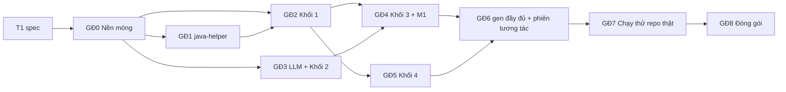

# Kế hoạch code ARROW Developer CLI

> **Trạng thái:** bản đề xuất, chưa code. Cập nhật 12/11/2026: đổi từ "chép code `ARROW_Framework`" sang **viết mới có chọn lọc** (Mục 2.1).
>
> **Phạm vi:** **chỉ hệ thống cho người dùng cuối**, tức lập trình viên Java. Không làm chế độ thực nghiệm: không có manifest, Fixed Repair, EvoSuite, báo cáo RQ, shard hay pilot.
>
> **Căn cứ:**
> - [ARCHITECTURE.vi.md](ARCHITECTURE.vi.md);
> - spec sản phẩm `specs/P00…P11`;
> - thuật toán của 4 khối theo spec nhóm `reference/01…05` (ký hiệu `Rxx`).
>
> **Đã chốt:**
> - .NET 10 LTS.
> - Làm CLI có phiên tương tác và có màu.
> - Giữ cấu trúc `Arrow.Cli / Arrow.Business / Arrow.DataAccess / Arrow.Common`.
> - Code ở `D:\Ky9\DoAn\ARROW_Developer_CLI`.
> - **Viết mới theo P-spec, có chọn lọc** (chốt 12/11/2026):
>   - giữ nguyên java-helper, prompt và `tools.lock.json` của `ARROW_Framework`;
>   - code cũ chỉ để tham khảo, test cũ dùng làm bộ đối chiếu (Mục 2.1).
> - Một người code (Chính), làm lần lượt GĐ0 → GĐ8 (Mục 7).
> - `-Werror` **giữ theo R03 §3.2**: rơi vào `UNKNOWN`, không đổi (chốt 10/11/2026).

## 1. Kết quả cuối cùng

Lập trình viên cài `arrow`, đứng trong project Java của mình rồi gõ:

```
arrow setup                      # lần đầu: chọn LLM, nhập khoá, tìm JDK/Maven, tải công cụ
arrow gen OrderService           # sinh, xác minh, sửa, đo, hỏi rồi ghi OrderService_ArrowTest.java
arrow                            # hoặc làm việc trong phiên tương tác, kiểu Claude Code
```

Hệ thống chỉ ghi test đã **VALID** trên build thật. Nó không bao giờ sửa code hay file build của người dùng, và không bao giờ ghi đè file có sẵn.

## 2. Hiện trạng và việc cần có trước

### 2.1 Viết mới, dùng `ARROW_Framework` có chọn lọc

`D:\Ky9\DoAn\ReportDoAn\ARROW_Framework` là bản cài đặt C# của nhóm, làm theo spec 00–07: `net8.0`, tên project theo spec 07, thiết kế cho thực nghiệm (manifest, pipeline, ledger). Phần sản phẩm cần chiếm khoảng 11.000 dòng code và 5.000 dòng test.

**Quyết định (chốt 12/11/2026): viết mới theo P-spec, chỉ giữ những phần không phụ thuộc kiến trúc.**

| Phần của `ARROW_Framework` | Cách dùng | Lý do |
|---|---|---|
| `tools/java-helper` (Java, 12 lệnh cộng `shutdown`, có JUnit test) | **Giữ nguyên**, chỉ thêm `list_classes` và các loại assertion mới | Chương trình riêng, gọi qua JSON, không phụ thuộc kiến trúc C# |
| `prompts/` (chỉ `zero_shot_project_aware` và `repair/*`) | **Giữ nguyên** | Là dữ liệu đã được nhóm chốt |
| `tools/tools.lock.json` | **Giữ nguyên**, bỏ EvoSuite | Là dữ liệu |
| 5 fixture trong `tests/fixtures/` | **Chép nguyên** | Là dữ liệu test |
| Lớp đọc log và thuật toán: `JavacErrorParser`, `TestResultClassifier`, `SignatureBuilder`, `FailureDiagnoser`, `CheckpointComparer`, `AdaptiveRepairPolicy`, `ResultParsers`, `EffectivePomReader`, `MavenDependencyListParser`, `GradleProbe` (init script), `BaselineEvaluator`, `CodeExtractor` | **Viết lại theo spec**, mở code cũ để tham khảo khi gặp trường hợp biên | Nhiều trường hợp biên đã được giải; viết lại để khớp interface mới |
| Unit test và integration test C# của khối 1–4 | **Bộ đối chiếu**: viết lại theo interface mới, giữ nguyên đầu vào và kết quả mong đợi (P11 §4) | Bảo đảm code mới làm đúng như code cũ |
| Mọi phần còn lại: `Arrow.Models`, `Arrow.DataAccess`, `External` (process, build, git, LLM, tools), `Pipeline`, `Arrow.UI`, EvoSuite, báo cáo RQ | **Không dùng**. Viết mới theo P-spec, hoặc bỏ hẳn nếu chỉ dành cho thực nghiệm | Khác kiến trúc 3 lớp, cấu hình và luồng chạy của sản phẩm |

**Quy tắc khi tham khảo:**
- Chỉ đọc. Không sửa, không build trong thư mục `ARROW_Framework`.
- Không đọc `litellm.config.local.yaml` hay `machine.local.json`, vì có khoá.
- Không chép nguyên file `.cs`. Có thể chép một biểu thức chính quy hay một bảng hằng số, kèm comment ghi nguồn (`// from ARROW_Framework/<file>`).
- Khi code cũ và P-spec khác nhau thì **P-spec đúng**. Ghi lại chỗ khác trong mô tả PR.

### 2.2 Việc cần có trước khi code

| # | Việc | Trạng thái |
|---|---|---|
| T1 | Spec P00–P11 | **Xong** (10/11/2026), nằm trong `docs/specs/`, mỗi spec đọc độc lập được |
| T2 | Template prompt | **Có**: `ARROW_Framework/prompts/` |
| T3 | Phiên bản công cụ đo | **Chốt**: theo `ARROW_Framework/tools/tools.lock.json`, bỏ EvoSuite |
| T4 | Bộ repo thật để kiểm chứng | **Có nguồn**: rút 10–20 repo theo seed cố định từ `D:\Ky9\DoAn\ARROW\preflight_manifest\*\strict_eligible_manifest.jsonl`, chia đều Maven/Gradle, JUnit 4/5/TestNG, Java 8–21 |
| T5 | Model thật | Endpoint `https://api.teamorouter.com/v1` (tương thích OpenAI). Khoá API chỉ đọc từ biến môi trường hoặc kho khoá, **không ghi vào repo**. Thêm một máy có Ollama nếu được |
| T6 | `-Werror` | **Chốt**: theo R03 §3.2, rơi vào `UNKNOWN` |

## 3. Cách làm

**Git:**
- Repo GitHub `Duc-Chinh1907/Arrow_Developer`, làm trong `ARROW_Developer_CLI`.
- Nhánh `main` được bảo vệ. Mỗi việc làm trên một nhánh `gd<n>/<việc>`, gộp qua PR có CI xanh.
- Không commit khoá API, `runs/`, `work/`.

**Dùng `ARROW_Framework`:** theo Mục 2.1. java-helper, prompt, `tools.lock.json` và fixture được chép vào repo ở commit riêng, ghi rõ nguồn và ngày chép.

**Bộ đối chiếu:** mỗi khối viết mới đều kèm các test đối chiếu, viết lại từ test cũ của khối đó, giữ nguyên đầu vào và kết quả mong đợi. Khối chỉ được coi là xong khi các test này xanh.

**Thứ tự trong mỗi giai đoạn:**
1. hợp đồng dữ liệu;
2. test;
3. sửa hoặc viết code;
4. integration test trên fixture;
5. demo bằng lệnh CLI.

**Test không tốn tiền:** mọi test tự động dùng `FakeLlmClient`. Chỉ smoke test chạy tay mới gọi model thật.

**Dựng lát cắt dọc sớm:** cuối GĐ4 đã có `arrow gen` chạy hết từ đầu đến cuối (mốc M1).

**Hoàn thành một việc khi có đủ:**
- code và test cùng nằm trong một PR;
- CI xanh trên Windows và Ubuntu;
- không còn cảnh báo trình biên dịch mới;
- mã lỗi mới đã có câu giải thích và gợi ý sửa trong `ErrorCatalog`;
- spec đã được cập nhật nếu hành vi khác spec.

## 4. Cấu trúc repo đích

```text
ARROW_Developer_CLI/
  ARROW.slnx  global.json (SDK 10.0.404)  Directory.Build.props  Directory.Packages.props
  .editorconfig  .gitignore  README.md  LICENSE
  src/
    Arrow.Common/        records, enums, ArrowEvent, ErrorCatalog, Json
    Arrow.DataAccess/    Process, Git, Build, Workspace, JavaHelper, Llm clients, Tools, Storage, Secrets
    Arrow.Business/      Analysis (K1), Generation (K2), Repair (K3), Quality (K4), Apply, UseCases
                         Prompts/ (template nhúng sẵn, từ ARROW_Framework/prompts)
    Arrow.Cli/           Commands, Interactive, Rendering, Program.cs, CompositionRoot
  tests/
    Arrow.Business.Tests/  Arrow.DataAccess.Tests/  Arrow.Cli.Tests/  Arrow.IntegrationTests/
    fixtures/            5 fixture của ARROW_Framework + 4 fixture mới (P11 §2)
  tools/
    java-helper/         (từ ARROW_Framework, thêm lệnh list_classes)
    tools.lock.json      (từ ARROW_Framework, bỏ EvoSuite)
  docs/
  .github/workflows/  ci.yml  release.yml
```

**Chia lớp** theo ARCHITECTURE §3.2:
- logic quyết định nằm ở `Arrow.Business`;
- chạy tiến trình, HTTP và file nằm ở `Arrow.DataAccess`.

Ví dụ: `ProcessRunner`, `GitClient`, `JavaHelperClient` và các LLM client nằm ở DataAccess; `LlmGateway` và `ReplayingLlmClient` nằm ở Business.

**Package**, khoá phiên bản trong `Directory.Packages.props`:
- System.CommandLine 2.0.x;
- Spectre.Console;
- Microsoft.Extensions.DependencyInjection;
- xUnit v3 (gói `xunit.v3`, chốt 12/11/2026), chạy trên Microsoft.Testing.Platform: `global.json` đặt `"test": { "runner": "Microsoft.Testing.Platform" }` (SDK 10 không cho xUnit v3 4.x chạy qua VSTest), nên không cần `Microsoft.NET.Test.Sdk` hay `xunit.runner.visualstudio`. Lệnh chạy: `dotnet test --solution ARROW.slnx`.
  - project test chưa có test nào thì tạm đặt `--ignore-exit-code 8` (không có test nào chạy), gỡ khi có test đầu tiên;
  - test thiếu công cụ hay JDK dùng `Assert.Skip`/`Assert.SkipUnless` để báo **bị bỏ qua**, không âm thầm pass (`baseline-arrow-framework.md` Mục 6);
  - khi viết lại test cũ (xUnit 2.9): `IAsyncLifetime` trả `ValueTask`, project test là chương trình chạy được (`OutputType=Exe`), token huỷ lấy từ `TestContext.Current.CancellationToken`.

## 5. Các giai đoạn

Cỡ việc: **S** = vài ngày, **M** = khoảng 1 tuần, **L** = 2 tuần trở lên (một người).



Sơ đồ trên là phụ thuộc giữa các giai đoạn. Vì chỉ một người code, thứ tự thực tế là GĐ0 → GĐ1 → … → GĐ8, lần lượt (Mục 7).

---

### GĐ0. Nền móng (M) · spec P00, P08 (phần khung), P09, P11

**Việc:**
1. **Đo code nền để làm bộ đối chiếu** (nửa ngày):
   - chép `ARROW_Framework` sang một thư mục tạm (không build trong thư mục của nhóm), build bằng SDK 10, chạy unit test và integration test;
   - ghi vào `docs/baseline-arrow-framework.md`:
     - số test pass;
     - test nào hỏng;
     - test nào cần Maven, Gradle hay JDK nào;
     - **danh sách test sẽ viết lại làm test đối chiếu** cho từng khối.

   Không chép code C# nào sang repo.
2. **Repo:**
   - `git init`, `.gitignore` (gồm `runs/`, `work/`, `docs.zip`, `.claude/settings.local.json`), `.editorconfig`, đưa lên GitHub;
   - `global.json` ghim SDK `10.0.404` với `rollForward: latestPatch` (máy dev đã cài bản này ngày 11/11/2026; bản vá mới hơn trong dải 10.0.4xx vẫn dùng được);
   - `Directory.Build.props`: `net10.0`, bật `Nullable` và `TreatWarningsAsErrors`;
   - solution mới với 4 project `Arrow.Common`, `Arrow.DataAccess`, `Arrow.Business`, `Arrow.Cli`, và 4 project test (Mục 4);
   - `ArchitectureTests`: Cli không tham chiếu DataAccess (trừ `CompositionRoot`), không có tham chiếu ngược.
3. **Chép phần giữ nguyên** (Mục 2.1), mỗi phần một commit ghi rõ nguồn và ngày:
   - `prompts/` (chỉ template sản phẩm dùng) → `src/Arrow.Business/Prompts/`;
   - `tools/tools.lock.json`, bỏ EvoSuite;
   - 5 fixture → `tests/fixtures/`.

   java-helper chép ở GĐ1.
4. **`Arrow.Common`:**
   - record dùng chung: `ProjectTarget`, `CutInfo`, `TargetResult`, `RunInfo`;
   - `ArrowEvent`;
   - `ErrorCatalog` (mã lỗi, câu giải thích, gợi ý sửa; nạp từ tài nguyên nhúng);
   - quy ước JSON (P00 §5).
5. **`Arrow.DataAccess`:**
   - `ArrowHome`;
   - `UserConfigStore`: cấu hình 5 tầng (P09 §3);
   - `SecretStore`: DPAPI trên Windows, file quyền 600 trên Linux/macOS, biến môi trường được ưu tiên;
   - `RunStore` theo P09 §5;
   - `Redactor`;
   - `AtomicFile`;
   - `ProcessRunner`: giết cả cây tiến trình khi huỷ hoặc timeout; log theo P00 §5.
6. **`Arrow.Cli`, phần khung:**
   - System.CommandLine với `--version`, `--help`, `--plain`, `--json`, `--verbose`;
   - `Renderer` có màu (Spectre) và chữ thuần, tự chọn theo `IsOutputRedirected`, `NO_COLOR`, `--plain`;
   - mã thoát 0–4 (P08 §8);
   - `arrow config list|get|set|unset|path`, `arrow secrets list|set|remove`.
7. **4 fixture mới:** `maven-no-tests`, `maven-testng`, `maven-wrapper-junit5`, `maven-existing-arrowtest` (P11 §2).
8. **CI:** `ci.yml` build và chạy test trên `windows-latest` và `ubuntu-latest`, cài JDK 8, 11, 17, 21, Maven và Gradle.

**Xong khi:**
- CI xanh;
- `arrow --help`, `arrow config set/list` và `arrow secrets set --stdin` chạy được;
- khoá thử `sk-test-SECRET-123` không xuất hiện trong output hay file nào.

---

### GĐ1. java-helper (S) · spec P10

**Việc:**
1. **Chép nguyên** `tools/java-helper` (12 lệnh cộng `shutdown`, kèm JUnit test) vào `tools/java-helper`, một commit riêng. Chạy `mvn verify` để chắc mọi test xanh trước khi sửa.
2. **Thêm lệnh** `list_classes` (P10 §4.13). `ClassLocator` và ô chọn class cần lệnh này.
3. **`class_api`:** bổ sung test cho class có static initializer ném exception. Danh sách package trong jar test do C# tự đọc, nên không cần thêm lệnh (P10 §4.10, P04 §6.5).
4. **Cập nhật `count_assertions` theo R03 §3.6 bản mới** (P10 §4.8). Code hiện tại chỉ đếm `verify(…)` gọi trực tiếp hoặc qua `Mockito.`. Cần đếm thêm:
   - `inOrder.verify(…)`;
   - `verifyNoInteractions`, `verifyNoMoreInteractions`, `verifyZeroInteractions`;
   - BDD `then(mock).should…()` và `then(actual).is…()`;
   - MockMvc `andExpect(…)`;
   - `thrown.expect…(…)`.

   Mỗi loại một JUnit test.
5. **`JavaHelperClient`, viết mới** ở DataAccess (P10 §5):
   - một tiến trình sống trong run;
   - pool theo `--jobs`;
   - tự khởi động lại một lần;
   - timeout cho từng lệnh;
   - kiểm tra phiên bản.
6. Nâng `Main.VERSION` lên `1.1.0`. Build jar, ghi sha256 vào `tools.lock.json`. Bản phát hành nhúng sẵn jar này.

**Xong khi:** `mvn verify` của java-helper xanh; C# gọi được `list_classes` và `parse` trên mọi file `.java` của 9 fixture; các test C# của P10 §7 xanh.

---

### GĐ2. Khối 1 (L) · spec P01

**Việc (viết mới theo P01, tham khảo `ARROW_Framework/src/Arrow.Service/Block1`):**
1. **`ProjectSource`:**
   - thư mục trên máy: chép cây làm việc với bộ lọc của P01 §3.1, tính `source_tree_hash`;
   - GitHub: mirror, phân giải ref, `fetch --depth 1`, `worktree add`.
2. **`ClassLocator`:** tên ngắn, FQN, đường dẫn; xử lý trùng tên; gợi ý tên gần giống; `--package`.
3. **Phân tích build** (P01 §4):
   - `BuildRootResolver`: reactor `-pl -am`, nếu không được thì standalone;
   - `BuildToolDetector`: ưu tiên wrapper, dự phòng khi wrapper lỗi;
   - `JavaVersionResolver`: effective POM, hoặc init script `arrow-info.gradle` (tham khảo `GradleProbe`);
   - `JdkSelector`: theo mức khai báo, nếu không có thì JDK 17, nếu không có nữa thì JDK lớn nhất; dự phòng theo thứ tự tăng dần; đổi JDK khi JVM không khởi động;
   - `DependencyResolver`: biên dịch và lấy classpath trong một lần gọi Maven (tham khảo `MavenDependencyListParser`);
   - `TestFrameworkDetector`.
4. **`MetadataBuilder`:** M gồm 6 thông tin và `metadata_prompt.txt` (P01 §5).
5. **`TestPathPlanner`:** `_ArrowTest`, trùng thì `_Arrow<k>Test`; đọc mẫu tên test của Surefire/Gradle để cảnh báo (P01 §4.7).
6. **`SnapshotBuilder`, `BaselineRunner`:**
   - `compiled_snapshot`;
   - baseline 2 lần, mỗi lần trên bản sao mới;
   - đọc báo cáo XML (tham khảo `BaselineEvaluator`);
   - xoá jar hỏng.
7. **`AnalysisCache`:** các CUT cùng module trong một run dùng chung snapshot và baseline.
8. **Lệnh:**
   - `arrow inspect <class> [--project|--repo --ref]`;
   - `arrow doctor` bản đầu: git, các JDK, Maven/Gradle, java-helper.

**Test:**
- **đối chiếu:** viết lại các test khối 1 của `ARROW_Framework` (dò build root, chọn JDK, đọc effective POM, đọc danh sách dependency, đánh giá baseline), giữ nguyên đầu vào và kết quả mong đợi;
- unit test theo P01 §11;
- integration test trên 9 fixture, kiểm tra **thư mục gốc không đổi** (so hash trước và sau).

**Xong khi:** `arrow inspect` đúng trên 9 fixture và trên 3 repo thật. Thời gian khối 1 được đo và ghi vào PR.

---

### GĐ3. LLM và khối 2 (M) · spec P02, P03

**Việc (viết mới theo P02, P03):**
1. **LLM** (P03):
   - `OpenAiCompatibleClient` (tham khảo phần gửi HTTP và gọi lại của `LiteLlmClient`): dùng cho OpenAI, OpenRouter, teamorouter, Gemini qua endpoint tương thích, Ollama, LiteLLM;
   - `AnthropicClient`;
   - `LlmGateway`: tốc độ, số lượt đồng thời, ngân sách `--max-tokens`, kiểm tra tiền tố model;
   - `ReplayingLlmClient`: cache theo `call_id` = `gen/<cut>` hoặc `repair/<cut>/round_<k>`;
   - `FakeLlmClient`: file luật, theo P11 §3;
   - ước tính chi phí.
2. **Khối 2** (P02):
   - `PromptTemplateStore`: template nhúng, kiểm tra placeholder, ghi đè bằng thư mục riêng;
   - `PromptBuilder`, chỉ quy trình `zero_shot_project_aware`;
   - `CodeExtractor`: tham khảo bản cũ cho các trường hợp fence và chữ thừa;
   - chuẩn hoá tên qua java-helper;
   - ghép method ở mức 3;
   - `code_hash`;
   - `TestGenerator`.
3. **Lệnh:**
   - `arrow setup`, phần LLM: chọn provider, nhập khoá (ẩn khi gõ), chọn model, gọi thử, cảnh báo quyền riêng tư;
   - `arrow models`, `arrow models test|add|default`;
   - `doctor` thêm mục kết nối LLM và `num_ctx` của Ollama.

**Test:**
- **đối chiếu:** viết lại các test khối 2 cũ (`CodeExtractor`, `PromptBuilder`), giữ nguyên đầu vào và kết quả mong đợi;
- HTTP giả cho `OpenAiCompatibleClient` và `AnthropicClient`: 200; 429 rồi 200; 401; 500 bốn lần (hết 3 lượt gọi lại, P03 §4); sai model id; `finish_reason = length`;
- smoke chạy tay với teamorouter (khoá lấy từ biến môi trường).

**Xong khi:** `arrow setup` rồi `arrow models test` chạy được với model thật; khoá API không có trong bất kỳ file nào dưới `ARROW_HOME`.

---

### GĐ4. Khối 3 và mốc M1 (L) · spec P04

**Việc (viết mới theo P04, tham khảo `ARROW_Framework/src/Arrow.Service/Block3`):**
1. **Xác minh 5 bước:** `Verifier` (bản sao mới cho mỗi lần xác minh; bước 2 dùng lại bản sao của bước 1, bước 5 dùng bản sao khác), `InfraRetry`.
2. **Phân loại:**
   - `JavacErrorParser`: biểu thức 3 dạng đường dẫn; **lỗi bị cụt của maven-compiler-plugin 2.x** (R03 §3.2 bước 5, P04 §3.3): bỏ tiền tố `error:`, nhận dòng `[ERROR]  class X` không nhãn làm `location`;
   - `TestResultClassifier`;
   - `RegressionChecker`;
   - `-Werror` rơi vào `UNKNOWN`, đúng R03 §3.2.
3. **Chẩn đoán:**
   - `FailureDiagnoser`, `SignatureBuilder`: signature, `error_block`, `first_error`;
   - `ExtraContextBuilder`: lấy cả class nêu trong thông điệp lỗi, gồm `x has private access in X`, `X is not public in …`, `X is abstract; cannot be instantiated` (R03 §6.5, P04 §6.5).
4. **Thuật toán:**
   - `CheckpointComparer`;
   - `AdaptiveRepairPolicy`: code thuần;
   - `RepairRunner`: ghi `decision.json`, `final.json`.

   Mặc định N = 5 (`--rounds`), `early_stop_p` = 3; `--no-repair` thì chỉ xác minh c0.
5. **Mốc M1, lát cắt dọc:** `GenerateTestsUseCase` bản tối thiểu (một class, khối 1 → 2 → 3, chưa đo chất lượng). `arrow gen <class> --no-metrics` in kết quả từng vòng; nếu VALID thì hỏi rồi ghi file bằng bản đơn giản của `ProjectFileWriter` có chặn ghi đè.

**Test:**
- **đối chiếu:** viết lại các test khối 3 cũ: phân loại, signature, so sánh checkpoint, bảng R03 §7 phần Adaptive, các ví dụ Q5, R03 §14–15;
- **bổ sung:**
  - EQUAL không tính là rollback;
  - mã trùng được so với mọi hash đã thấy;
  - dừng sớm sau 3 vòng không tiến triển;
  - log mẫu của maven-compiler-plugin 2.x ra `COMPILE | cannot find symbol | -`, `location = class Bounds`, và `extra_context` có API của `Bounds`;
- E2E với `FakeLlmClient`: chain đi đúng O8 → O3 → O4 → O7 → O1 như R03 §14.5.

**Xong khi:** mốc M1. Trên fixture `maven-verify-junit4`, chạy `arrow gen <class> --no-metrics --yes` với `FakeLlmClient` tạo được `<CUT>_ArrowTest.java` và build pass. Cùng lệnh đó với model thật cho VALID ít nhất trên một fixture.

---

### GĐ5. Khối 4 (M) · spec P05, P09 (phần công cụ)

**Việc (viết mới theo P05, P09 §6):**
1. **`ToolStore`** và `arrow tools install|list`:
   - tải thẳng qua HTTPS từ Maven Central, hoặc từ `ARROW_MAVEN_MIRROR`;
   - kiểm tra sha256 theo `tools.lock.json`; sai sha256 thì xoá file vừa tải.

   Không dùng Maven của máy để tải, để người dùng chỉ có Gradle vẫn dùng được.
2. **`SuitePreparer`:** bản sao mới; ghi file test; biên dịch và lấy classpath trong một lần gọi.
3. **`JacocoTool`, `PitTool`, `TsDetectTool`:**
   - phạm vi `<FQN>` và `<FQN>$*`;
   - classpath PIT, gồm `junit-platform-launcher` kiểm tra bằng `.sha1`;
   - chọn JDK cho PIT;
   - đọc kết quả (tham khảo `ResultParsers`).
4. Ghi `jacoco.json`, `pit.json`, `tsdetect.json` và `block4/outcome.json` cho bộ cuối VALID. Một công cụ lỗi không chặn công cụ khác.

**Test:**
- **đối chiếu:** viết lại các test đọc kết quả cũ (CSV JaCoCo, `mutations.xml`, CSV tsDetect);
- unit test theo P05 §10;
- đo trên 4 fixture (Maven JUnit 4, Maven đa module JUnit 5, Gradle JUnit 5, Maven TestNG).

**Xong khi:** đo được cả 3 chỉ số trên 4 fixture.

---

### GĐ6. Hoàn thiện `arrow gen` và phiên tương tác (L) · spec P06, P07, P08

**Việc:**
1. **`GenerateTestsUseCase` bản đầy đủ** (P07):
   - nhiều class, `--package`, `--jobs`;
   - `AnalysisCache`;
   - ước tính chi phí và hỏi khi chạy từ 5 class trở lên;
   - `--max-tokens`;
   - phát `ArrowEvent`;
   - `result.json` cho từng class.
2. **Chạy tiếp:** run bị ngắt thì lần `arrow gen` sau hỏi có chạy tiếp không. Class đã có `result.json` được giữ; lượt gọi LLM có trong cache không tốn tiền lại.
3. **Ghi file** (P06): `TestWritePolicy` và `ProjectFileWriter`:
   - chỉ ghi bộ VALID;
   - không ghi đè, tăng hậu tố;
   - **xác minh lại** sau khi đổi tên;
   - chặn đường dẫn ra ngoài project;
   - `--yes`, `--dry-run`;
   - project từ GitHub thì chỉ lưu trong `runs/`.
4. **Hiển thị** (P08): tiến độ theo khối; bảng kết quả; `--json`; Ctrl+C huỷ an toàn.
5. **Phiên tương tác `arrow`:**
   - banner thông tin project;
   - lệnh `/gen /history /show /model /setup /doctor /config /help /exit`;
   - ô chọn class gõ để lọc, dùng `list_classes`;
   - Ctrl+C huỷ lần chạy hiện tại mà không thoát phiên.
6. **`arrow history`, `arrow show <run>`.**
7. **`arrow setup` bản đầy đủ:** tự tìm JDK và Maven/Gradle, tải công cụ, chạy `doctor` ở cuối.

**Test:**
- **Unit:** `TestWritePolicy`; ước tính chi phí; mã thoát.
- **CLI:** snapshot output ở chế độ `--plain` và `--json`.
- **E2E với `FakeLlmClient`:**
  - 3 class trên `maven-multi-junit5`, `--jobs 2`: baseline chỉ chạy một lần cho mỗi module;
  - huỷ giữa chừng rồi chạy tiếp: kết quả giống lần chạy không bị huỷ;
  - chạy `gen` hai lần cho cùng một class: lần hai hỏi rồi tạo `_Arrow2Test`, file lần một không đổi.

**Xong khi:** người mới, trên một máy sạch có JDK và Maven, làm được trọn `arrow setup` → `arrow` → `/gen` → ghi file mà không cần đọc tài liệu ngoài phần `--help`.

---

### GĐ7. Chạy thử trên repo thật (M)

**Việc:**
1. Rút 10–20 repo từ `strict_eligible_manifest.jsonl` (T4) bằng một script có seed cố định; ghi danh sách vào `docs/validation-set.json`.
2. Chạy `arrow gen` trên mỗi repo, 2–3 class mỗi repo, với teamorouter và với Ollama nếu có.
3. Ghi bảng kết quả vào `docs/validation.md`: tỷ lệ class đạt VALID, số vòng trung bình, thời gian và token mỗi class, các lỗi hay gặp.
4. Sửa lỗi phát hiện được. Mỗi lỗi có test hồi quy, ưu tiên thêm fixture nhỏ tái hiện lỗi.
5. Rà lại `ErrorCatalog` và `doctor`.

**Xong khi:**
- không còn lỗi làm hỏng project người dùng hay ghi sai chỗ;
- mọi lần chạy thất bại đều có mã lỗi và gợi ý;
- nhóm đã xem và đồng ý với bảng `validation.md`.

---

### GĐ8. Đóng gói và phát hành (S) · spec P11

**Việc:**
1. **Gói `dotnet tool`:** `PackAsTool`, `ToolCommandName=arrow`, `PackageId` (chốt tên).
2. **Bản chạy độc lập:** `PublishSingleFile`, self-contained cho win-x64, linux-x64, osx-arm64. Không bật trimming/AOT.
3. Nhúng `java-helper.jar` và `tools.lock.json` vào cả hai.
4. **`release.yml`:** khi có tag `v*` thì build, test, đóng gói, tạo GitHub Release. Đẩy lên NuGet: hỏi nhóm trước.
5. **Tài liệu:** README (cài → `setup` → `gen`), trang xử lý sự cố, ghi chú quyền riêng tư khi dùng LLM.

**Xong khi:** trên một máy sạch, cài từ GitHub Release rồi chạy được `arrow setup` và `arrow gen` trên một fixture.

## 6. Mốc

| Mốc | Sau GĐ | Nhóm thấy được |
|---|---|---|
| M0 | 0 | Repo, CI xanh, `arrow --help`, `arrow config`, `arrow secrets` |
| M1 | 4 | **Demo**: `arrow gen` sinh, xác minh, sửa và ghi test cho một class |
| M2 | 6 | Bản đủ tính năng: đo chất lượng, nhiều class, phiên tương tác, lịch sử, chạy tiếp |
| M3 | 7 | Bảng kết quả trên repo thật |
| M4 | 8 | Bản phát hành v1 |

## 7. Phân công

**Một người code toàn bộ** (Chính, chốt 11/11/2026). Vì vậy các giai đoạn làm **lần lượt**, không song song:

| Thứ tự | Giai đoạn | Cỡ | Cộng dồn (ước lượng) |
|---|---|---|---|
| 1 | GĐ0 nền móng | M | ~1 tuần |
| 2 | GĐ1 java-helper (chép nguyên, bổ sung) | S | ~1,5 tuần |
| 3 | GĐ2 khối 1 (viết mới) | L | ~3,5 tuần |
| 4 | GĐ3 LLM, khối 2 (viết mới) | M | ~4,5 tuần |
| 5 | GĐ4 khối 3 (viết mới) → **M1** | L | ~6,5 tuần |
| 6 | GĐ5 khối 4 (viết mới) | M | ~7,5 tuần |
| 7 | GĐ6 `gen` đầy đủ, phiên tương tác | L | ~10 tuần |
| 8 | GĐ7 chạy thử repo thật | M | ~11 tuần |
| 9 | GĐ8 đóng gói | S | ~11,5–12 tuần |

Viết mới (Mục 2.1) dài hơn phương án chép code cũ khoảng 2 tuần, chủ yếu ở GĐ2, GĐ4 và GĐ5.

GĐ1 làm trước GĐ2 vì `ClassLocator` cần `list_classes`. GĐ5 làm sau M1 để có demo sớm.

**Phần của các thành viên khác:**
- review tài liệu trước GĐ0;
- xem demo và góp ý ở mỗi mốc (M0–M4, Mục 6);
- ở GĐ7, có thể giúp chạy thử trên máy của mình để có thêm môi trường (Windows, Linux, máy có Ollama).

## 8. Rủi ro

| Rủi ro | Cách giảm |
|---|---|
| Viết lại làm sót trường hợp biên mà code cũ đã xử lý | Test đối chiếu viết lại từ test cũ (Mục 3); mở code cũ khi viết các lớp đọc log; chạy thử trên repo thật từ cuối GĐ2 |
| Test cũ không chạy được trên .NET 10, nên không có kết quả để đối chiếu | GĐ0 bước 1 đo trước; test nào hỏng thì ghi trong `baseline-arrow-framework.md` và lấy kết quả mong đợi từ spec |
| Nhóm sửa java-helper, prompt hay `tools.lock.json` sau khi đã chép | Ghi ngày và hash của bản đã chép; khi nhóm sửa thì đối chiếu và chép lại |
| Nhóm sửa spec thuật toán (R01–R04) | Đồng bộ `reference/` và P-spec như đã làm với R03 ngày 10/11; thêm test cho điểm mới |
| Build của project thật rất đa dạng | 9 fixture; `inspect` trên repo thật ngay cuối GĐ2; `ErrorCatalog` có gợi ý sửa |
| Máy người dùng thiếu JDK hoặc Maven, Maven đứng sau proxy | `setup` và `doctor` kiểm tra; báo `B1_JDK_MISSING` trước khi gọi LLM |
| Chạy chậm | clonefile/reflink; `AnalysisCache`; java-helper giữ sống; đo thời gian từ GĐ2 |
| `-Werror` làm repair kém chính xác (rơi vào `UNKNOWN`) | Theo đúng R03 như đã chốt; ghi riêng các ca này trong `validation.md` để nhóm xem lại sau |
| Tốn tiền LLM của người dùng | Ước tính và hỏi trước; `--max-tokens`; dừng sớm; cache khi chạy tiếp |
| Ghi nhầm vào project người dùng | Chỉ `ProjectFileWriter` được ghi; test hash thư mục fixture; không có tuỳ chọn ghi đè |
| Lộ khoá API | Chỉ lưu trong `SecretStore` hoặc biến môi trường; `Redactor` lọc log; test kiểm tra không có khoá trong `runs/` |
| Chỉ một người code, dễ trễ hạn | Làm lát cắt dọc sớm (M1 sau ~6,5 tuần); GĐ6 là phần lớn nhất, nếu trễ thì cắt bớt phiên tương tác (giữ lệnh `gen` đầy đủ) |
| Visual Studio 2022 không build được .NET 10 | Dùng Visual Studio 2026, VS Code hoặc dòng lệnh |
