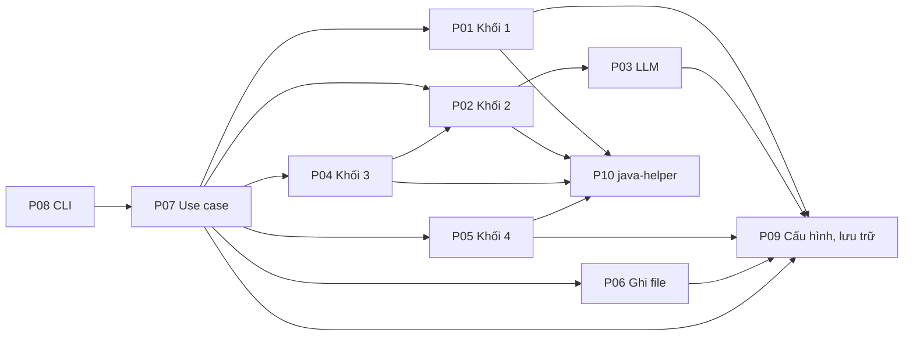
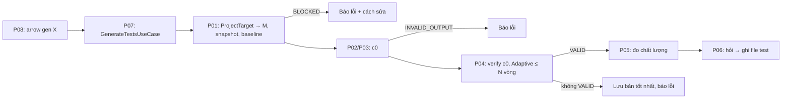

# P00. Tổng quan bộ spec ARROW Developer CLI

**Trạng thái:** bản đề xuất, chưa code. Lập ngày 09/11/2026, cập nhật 10/11/2026 theo R03 bản mới.

## 1. Bộ spec dùng để làm gì

Mỗi spec mô tả một phần của hệ thống, đủ chi tiết để một người code độc lập:
- đầu vào, đầu ra;
- hành vi;
- hợp đồng dữ liệu;
- mã lỗi;
- interface C#;
- tiêu chí nghiệm thu.

Thuật toán đã có trong spec của nhóm thì **không chép lại**. Spec sản phẩm chỉ trỏ tới đúng mục, và ghi rõ chỗ nào khác.

**Quy ước tham chiếu:**
- `Rxx §y`: spec của nhóm, mục y, nằm trong `docs/reference/` (ví dụ `R03 §6.4` là `reference/03-adaptive-repair.md`, Mục 6.4);
- `Pxx §y`: spec sản phẩm trong `docs/specs/`.

Khi `Pxx` và `Rxx` khác nhau, **`Pxx` thắng** ở phần sản phẩm (đầu vào, giao diện, lưu trữ). Phần thuật toán thì **`Rxx` thắng**, trừ khi `Pxx` ghi rõ "khác R".

## 2. Danh sách spec

| Spec | Nội dung | Lớp chính | Giai đoạn code |
|---|---|---|---|
| P00 | Tổng quan, khái niệm, quy ước chung, mã lỗi | — | 0 |
| P01 | Khối 1: phân tích project, snapshot, baseline | Business | 2 |
| P02 | Khối 2: prompt, tách và chuẩn hoá mã test | Business | 3 |
| P03 | LLM: nhà cung cấp, gateway, cache, ngân sách | Business, DataAccess | 3 |
| P04 | Khối 3: xác minh 5 bước, chẩn đoán, Adaptive Repair | Business | 4 |
| P05 | Khối 4: JaCoCo, PIT, tsDetect | Business | 5 |
| P06 | Ghi file test vào project | Business, DataAccess | 6 |
| P07 | Use case: một hoặc nhiều class, tiến độ, chạy tiếp | Business | 6 |
| P08 | CLI: lệnh, phiên tương tác, hiển thị, mã thoát | Cli | 0 (khung), 6 |
| P09 | Cấu hình, khoá API, lưu trữ, công cụ ngoài | DataAccess | 0, 5 |
| P10 | java-helper: giao thức và lệnh | Java + DataAccess | 1 |
| P11 | Kiểm thử, fixture, CI, đóng gói | — | 0, 8 |

## 3. Khái niệm

| Khái niệm | Nghĩa | Định danh |
|---|---|---|
| Project | Mã nguồn người dùng chỉ ra: một thư mục, hoặc repo GitHub ở một ref | `project_id` = tên thư mục hoặc `<owner>/<repo>` |
| CUT | Class cần sinh test | FQN, ví dụ `com.acme.shop.OrderService` |
| Run | Một lần gọi `arrow gen`, có thể gồm nhiều CUT | `run_id` = `<yyyyMMdd-HHmmss>-<4 ký tự ngẫu nhiên>` |
| Target | Một CUT trong một run | `(run_id, cut_fqn)` |
| c0 | Test do khối 2 sinh lần đầu | — |
| Round | Một vòng sửa; c0 là vòng 0 | 1…N |
| Checkpoint (`best`) | Bản tốt nhất tới hiện tại | — |
| M | Repository Metadata, gồm 6 thông tin (R01 §2.1) | — |
| Snapshot | Bản sao project đã biên dịch, chưa chạy test (R01 §2.3) | — |
| Final suite | Bộ test cuối của một CUT; chỉ bộ VALID được đo và được ghi vào project | — |

**Trạng thái xác minh:** `COMPILE < UNKNOWN < DISCOVERY < RUNTIME < ASSERTION < REGRESSION < VALID` (R03 §6.3).

Ngoài chuỗi này còn các kết quả:
- `INFRA`: lỗi hạ tầng;
- `INVALID_OUTPUT`: model không trả về mã dùng được;
- `BLOCKED`: project không dùng được, ví dụ baseline hỏng; thay cho `EXCLUDED` của R00.

## 4. Luồng tổng

## 5. Quy ước chung

**JSON:**
- UTF-8 không BOM, xuống dòng LF, tên trường `snake_case`, enum viết HOA (`"COMPILE"`, `"INVALID_OUTPUT"`);
- **ngoại lệ:** các giá trị mà spec ghi chữ thường vẫn viết thường: `kind` của nguồn (`"local"`, `"git"`), `kind` của class (`"class"`, `"enum"`…), `stop_reason` (`"valid"`…), `decision` của P06 (`"written"`…);
- enum không bao giờ ghi bằng số; khoá của từ điển giữ nguyên, không đổi sang `snake_case`;
- chữ tiếng Việt ghi thẳng, không thoát thành `\uXXXX`;
- C# dùng `System.Text.Json` với `JsonNamingPolicy.SnakeCaseLower` và `JsonStringEnumConverter(JsonNamingPolicy.SnakeCaseUpper)`; giá trị chữ thường dùng `[JsonStringEnumMemberName]`. Cài đặt ở `Arrow.Common.Json.ArrowJson`.

**Ghi file nguyên tử:** ghi `<file>.tmp`, flush, rồi đổi tên đè (`File.Move(tmp, path, overwrite: true)`). Áp dụng cho mọi file kết quả và cấu hình.

**Đường dẫn:**
- trong JSON, mọi đường dẫn thuộc project tính từ **gốc project**, dùng `/`;
- đường dẫn tuyệt đối chỉ dùng cho JDK, công cụ và `ARROW_HOME`.

**Log lệnh ngoài** (R00 §6):
- mỗi lệnh có một file log;
- dòng đầu ghi lệnh, thư mục và JDK;
- dòng cuối ghi mã thoát, thời gian, có timeout hay không;
- log lớn hơn 5 MB thì chỉ giữ 2 MB đầu và 2 MB cuối.

**Bí mật:** khoá API không bao giờ xuất hiện trong log, file kết quả hay output, kể cả với `--json`. Chỉ hiện 4 ký tự cuối, ví dụ `...2a4b`.

**Thời gian:** ghi theo UTC, định dạng ISO 8601, chính xác tới giây, có hậu tố `Z` (ví dụ `2026-11-10T07:25:30Z`). Khoảng thời gian ghi bằng giây (`*_seconds`, số thực).

**Huỷ:** mọi hàm bất đồng bộ nhận `CancellationToken`. Khi bị huỷ thì giết cả cây tiến trình con và dọn bản sao workspace.

## 6. Mã lỗi

Mã viết HOA, có tiền tố. Mỗi mã có một câu giải thích và một **gợi ý sửa bằng tiếng Việt**, đặt trong `ErrorCatalog` (Common). CLI in hai câu này cho người dùng.

- Catalog nhúng sẵn hai ngôn ngữ, `ErrorCatalog.vi.json` và `ErrorCatalog.en.json`, chọn theo `ui.language` (P09); ngôn ngữ khác thì dùng tiếng Việt.
- Câu có thể chứa chỗ trống `{tên}` (ví dụ `Cài JDK {jdk}`), điền từ tham số của `ArrowException`. Hai ngôn ngữ phải có cùng tập chỗ trống. Thiếu tham số thì giữ nguyên `{tên}` để dễ thấy lỗi.
- Nơi phát lỗi có thể đưa câu mô tả riêng cho lần lỗi đó (ví dụ lỗi biên dịch đầu tiên); câu này thay câu giải thích của catalog, còn gợi ý vẫn lấy từ catalog.
- Kết quả ghi vào file và in ra có dạng `{ "code", "message", "hint", "log" }` (`ErrorInfo`, P07 §6).

| Tiền tố | Spec | Ví dụ |
|---|---|---|
| `B1_` | P01 | `B1_BASELINE_BUILD_FAILED` |
| `B2_` | P02, P03 | `B2_INVALID_OUTPUT`, `B2_LLM_CONFIG` |
| `B3_` | P04 | `B3_TIMEOUT` |
| `B4_` | P05 | `B4_PIT_FAILED` |
| `W_` | P06 | `W_TARGET_OUTSIDE_PROJECT` |
| `CFG_` | P09 | `CFG_NO_MODEL`, `CFG_TOOL_MISSING` |
| `JH_` | P10 | `JH_START_FAILED` |
| `GEN_` | P07 | `GEN_NO_TARGETS`, `GEN_RESUME_MISMATCH` |
| `CLI_` | P08 | `CLI_ARGS`, `CLI_INTERNAL` |

Danh sách đầy đủ nằm trong mục "Mã lỗi" của từng spec.

## 7. Phần của spec nhóm không làm

| Spec nhóm | Không làm |
|---|---|
| R00 | Manifest, `experiments/*.json`, `machine.local.json`, ledger, job và hàng đợi theo khối, shard, gộp run, các lệnh `run`, `analyze`, `screen`, `rq2-subset`, `repair`, `assess`, `report`, `control`, `rerun-list` |
| R01 | `TaskRecord`, `build_attempts`, tiêu chí B (`paired_test`, `B1_PAIRED_TEST_NOT_PASSING`, `B1_MANIFEST_INVALID`), `revision_*` |
| R02 | Quy trình `zero_shot` và `few_shot`, kiểm tra công bằng RQ1, bắt buộc LiteLLM, `B2_CALL_LIMIT` |
| R03 | Fixed Repair, tập con RQ2, `rq3_only`, xen kẽ Fixed/Adaptive, xác minh EvoSuite, `needs_rerun.csv` |
| R04 | EvoSuite, báo cáo RQ1–RQ3, chọn N, độ nhạy P, ghép cặp, `B4_EVOSUITE_*`, `B4_REPORT_MISMATCH` |
