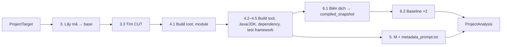

# P01. Khối 1: Phân tích project

**Mục đích:** từ project của người dùng và một CUT, khối 1 làm 5 việc:
1. dựng bản sao làm việc mà không đụng vào code gốc;
2. xác định đúng cách build (build root, module, build tool, JDK);
3. phân tích **6 thông tin cấu hình** thành Repository Metadata **M**;
4. tạo `compiled_snapshot`, tức bản sao đã biên dịch, chưa chạy test;
5. chạy **baseline**, tức test sẵn có của module, hai lần.

Khối 3 dùng M để dựng prompt, và dùng baseline để phát hiện regression.

**Lớp:** `Arrow.Business/Analysis` (quyết định), `Arrow.DataAccess` (git, chép file, chạy Maven/Gradle/Java, đọc báo cáo XML).

**Nguồn gốc:**
- thuật toán theo R01 (§4.1 bước 2–4, §4.2–4.7, §6.1–6.2);
- code **viết mới** theo spec này (PLAN §2.1). Khi gặp trường hợp biên thì tham khảo `ARROW_Framework/src/Arrow.Service/Block1` (`BuildRootRule`, `JdkSelector`, `EffectivePomReader`, `MavenModuleScanner`, `MavenDependencyListParser`, `GradleProbe`, `BaselineEvaluator`, `MetadataPromptRenderer`), và dùng test của nó làm bộ đối chiếu.



## 1. Phạm vi

| Có | Không |
|---|---|
| Thư mục trên máy, repo GitHub (https) có ref | Repo SVN, file zip |
| Maven (≥ 3.6.3 khuyến nghị; cũ hơn thì dùng plugin bản cũ), Gradle (≥ 6), có hoặc không có wrapper | Ant, Bazel, sbt |
| Java 8–21 (JDK 8, 11, 17, 21 trên máy) | Kotlin, Scala, Groovy |
| JUnit 4, JUnit 5 (có hoặc không vintage), TestNG | Spock, Cucumber |
| Một CUT, nhiều CUT, cả package (dùng chung kết quả, Mục 7) | Manifest, tiêu chí B, `build_attempts` |

## 2. Đầu vào

### 2.1 `ProjectTarget`

```csharp
public sealed record ProjectTarget(
    ProjectSourceKind Kind,        // LocalDirectory | GitRepository
    string Location,               // thư mục tuyệt đối, hoặc URL https của repo
    string? GitRef,                // chỉ khi GitRepository: nhánh, tag hoặc SHA; null = nhánh mặc định
    string CutQuery);              // tên ngắn, FQN, hoặc đường dẫn file .java (tương đối với gốc project hoặc tuyệt đối)
```

### 2.2 Cấu hình dùng (P09 §3.2)

| Khoá | Dùng ở |
|---|---|
| `java.jdk_homes` | Mục 4.3 |
| `java.maven_path`, `java.gradle_path`, `java.git_path` | Mục 3, 4.2 |
| `verification.step_timeout_seconds` (900) | Mọi lệnh build |
| `verification.baseline_runs` (2) | Mục 6.2 |
| `verification.infra_attempts` (3), `verification.infra_wait_seconds` (30) | Lỗi hạ tầng |

### 2.3 `RunContext`

Gồm `run_id`, đường dẫn `work/<run_id>/`, `RunHandle` (P09 §5), `CancellationToken`, `IProgress<ArrowEvent>`.

## 3. Lấy mã nguồn

### 3.1 Thư mục trên máy

1. **Tìm gốc project.**
   - `Location` có file build (`pom.xml`, `build.gradle`, `build.gradle.kts`, `settings.gradle`, `settings.gradle.kts`): gốc là `Location`.
   - Nếu không thì đi lên các thư mục cha, tối đa 5 cấp, tìm thư mục cao nhất **liên tiếp** có file build.
   - Vẫn không có, nhưng thư mục con (tối đa 6 cấp) có file build, ví dụ repo chỉ có `lib/pom.xml`: gốc là `Location`.
   - Không có thì `BLOCKED`, `B1_BUILD_ROOT_NOT_FOUND`.
2. **Chép cây làm việc** vào `work/<run_id>/base`, gồm cả thay đổi chưa commit.
   - **Bỏ qua thư mục:** `.git/`, `target/`, `build/`, `out/`, `bin/` (chỉ khi nằm cạnh `src/`), `.gradle/`, `.idea/`, `.vscode/`, `node_modules/`, `.arrow-work/`.
   - **Bỏ qua file:** `*.class`, `*.log`.
   - Symlink: chép thành link nếu đích nằm trong project; bỏ qua (kèm cảnh báo) nếu đích nằm ngoài.
   - Ghi `source_tree_hash` = SHA-256 của danh sách đã sắp xếp `(đường dẫn tương đối, kích thước, thời gian sửa)` các file đã chép.
3. **Không bao giờ** chạy build, ghi hay xoá gì trong thư mục gốc của người dùng. Chỉ P06 được ghi vào đó.
4. **Thông tin git** (chỉ để hiển thị): nếu gốc project nằm trong một git repo thì lấy `git_commit` = `git rev-parse HEAD` và `dirty` = `git status --porcelain` khác rỗng. Không có git thì cả hai là `null`.
5. Project lớn hơn 2 GB sau khi lọc: hỏi trước khi chép (P08 §4); không tương tác thì chép luôn và in cảnh báo.

### 3.2 Repo GitHub

1. **Kiểm tra URL:** chỉ nhận `https://` (`github.com` hoặc host git khác). Bỏ `.git` ở cuối nếu có. URL có chứa thông tin đăng nhập (`https://user:token@…`) thì **báo lỗi** `B1_URL_HAS_CREDENTIALS`, không chạy.
2. **Mirror:** `ARROW_HOME/mirrors/<host>/<owner>/<repo>.git`. Chưa có thì `git init --bare` rồi `git remote add origin <url>`.
3. **Phân giải ref:**
   - `GitRef` là SHA 40 ký tự hex: dùng luôn.
   - `GitRef = null`: `git ls-remote --symref origin HEAD` để lấy nhánh mặc định.
   - Ngược lại: `git ls-remote origin <ref>`, lấy theo thứ tự `refs/heads/<ref>`, `refs/tags/<ref>^{}` (tag có chú thích), `refs/tags/<ref>`.
   - Không tìm được: `BLOCKED`, `B1_COMMIT_MISSING`.
   - SHA ngắn (7–39 ký tự) thì báo lỗi kèm gợi ý dùng SHA đầy đủ.
4. **Tải:** `git fetch --depth 1 origin <sha>`.
   - Lỗi mạng: thử lại, tổng 3 lần, chờ 10 s rồi 30 s. Vẫn lỗi thì `INFRA`, `B1_CLONE_FAILED`.
   - Server từ chối fetch theo SHA: thử `git fetch origin` không giới hạn độ sâu; vẫn không có commit thì `BLOCKED`, `B1_COMMIT_MISSING`.
5. **Checkout:** `git worktree add --detach work/<run_id>/base <sha>`, kiểm tra `git rev-parse HEAD` = `<sha>`. Xong run thì `git worktree remove --force`.
6. **Repo private:** dùng credential helper sẵn có của git trên máy. ARROW không hỏi, không lưu token. Cần đăng nhập mà không có thì `git` báo lỗi xác thực → `BLOCKED`, `B1_AUTH_REQUIRED`.
7. **Môi trường git:** `GIT_TERMINAL_PROMPT=0` để git không chờ nhập mật khẩu; `core.longpaths=true` trên Windows.

### 3.3 Tìm CUT (`ClassLocator`)

1. **Danh sách source root** của mọi module. Lấy theo thứ tự:
   - `<module>/src/main/java` của mọi thư mục có file build trong project (tối đa 6 cấp);
   - các thư mục source khai báo khác, đọc ở bước 4.4 cho module đã chọn.
2. **Danh sách class:** java-helper `list_classes` (P10) trên mọi source root, gồm `fqn`, `kind`, `path`, `is_abstract`. Kết quả được giữ trong run.
3. **Khớp `CutQuery`:**
   - **Đường dẫn file `.java`:** lấy class top-level của file đó.
   - **Có dấu `.`:** khớp FQN chính xác.
   - **Tên ngắn:** khớp tên đơn giản, phân biệt hoa thường; không có thì khớp không phân biệt hoa thường.
4. **Kết quả khớp:**
   - **0 kết quả:** `BLOCKED`, `B1_CUT_MISSING`, kèm tối đa 5 tên gần giống (khoảng cách Levenshtein ≤ 2, hoặc chứa chuỗi đã gõ).
   - **Đúng 1 kết quả:** dùng luôn.
   - **Nhiều kết quả:** trả `AmbiguousCut` với danh sách FQN để CLI cho chọn. Không chọn được (P08 §4.3) thì `B1_CUT_AMBIGUOUS`.
5. **Kiểm tra loại:**

| `kind` | Xử lý |
|---|---|
| `class` cụ thể | Chạy |
| `class` abstract, `enum`, `record` | Chạy, in cảnh báo `[!]` vì khó test trực tiếp |
| `interface`, `annotation` | `BLOCKED`, `B1_CUT_NOT_TESTABLE` |
| Class lồng | Không chọn được làm CUT. Gợi ý dùng class ngoài |
| File trong test root | `BLOCKED`, `B1_CUT_NOT_TESTABLE` |

6. **`--package <pkg>`:** mọi class top-level có `kind = class`, không abstract, có package đúng bằng `<pkg>` (không gồm package con), sắp theo FQN. Không có class nào thì `B1_CUT_MISSING`.

## 4. Phân tích

### 4.1 Build root, bộ chọn module, module root

**Module root** = thư mục chứa source root của CUT. Mặc định là cha của `src/main/java`; nếu dùng source root khai báo thì là thư mục chứa file build gần nhất của nó.

**Build root và bộ chọn**, theo R01 §4.1 bước 2 (tham khảo `DetectPlans` của `ARROW_Framework`). Thử lần lượt, dừng ở cách đầu tiên biên dịch test được:
1. **Reactor:** đi lên từ module root tới gốc project, lấy thư mục **cao nhất** liên tiếp có file build và có khai báo thư mục con trên đường đi là module (Maven `<modules>`, có đệ quy; Gradle `include` trong `settings.gradle(.kts)`).
   - Maven: chạy từ thư mục đó với `-pl <đường dẫn module tương đối> -am`.
   - Gradle: `:<project path>`; project chứa CUT là project có thư mục là tiền tố dài nhất của source root.
   - `build_root_source = "detected:reactor"`.
2. **Standalone:** chạy ngay trong module root, không có `-pl`. Gradle thì dùng project gốc `:`. `build_root_source = "detected:standalone"`.
3. Cả hai không biên dịch được với mọi JDK (Mục 4.3): `BLOCKED`, `B1_BASELINE_BUILD_FAILED`.

**Kiểm tra:**
- `standalone`: module root phải bằng build root;
- `reactor`: module root phải bằng build root cộng đường dẫn trong `-pl`.

Không khớp thì `BLOCKED`, `B1_MODULE_MISMATCH`, ghi cả hai đường dẫn.

Mọi lệnh Maven/Gradle về sau (baseline, khối 3, khối 4) đều chạy **từ build root, với đúng bộ chọn module này**.

### 4.2 Build tool và chương trình build

1. **File build ở build root:**
   - `pom.xml` → Maven;
   - `build.gradle(.kts)` hoặc `settings.gradle(.kts)` → Gradle;
   - có cả hai thì chọn Maven và in cảnh báo.
2. **Chương trình build:**
   - có wrapper (`mvnw`/`mvnw.cmd`, `gradlew`/`gradlew.bat`) ở build root, hoặc ở gốc project nếu build root không có, thì dùng wrapper;
   - nếu không thì dùng `java.maven_path`/`java.gradle_path`, hoặc `mvn`/`gradle` trong `PATH`;
   - không có thì `BLOCKED`, `B1_BUILD_TOOL_MISSING`.
3. **Wrapper:**
   - trên macOS/Linux được đặt quyền chạy trong bản sao;
   - lưu **tương đối với gốc project**, để chạy được trên mọi bản sao;
   - lệnh đầu tiên chạy bằng wrapper mà lỗi (không tải được bản phân phối, không tương thích JDK): thử lại bằng chương trình của máy, ghi `wrapper_fallback: true`.
4. **Phiên bản:** `mvn -v` / `gradle -v` với JDK đã chọn.

### 4.3 Java version và chọn JDK (R01 §4.3)

1. **Mức Java khai báo**, lấy giá trị đầu tiên có:
   - **Maven:** effective POM của module, chạy một lần gọi riêng **trước khi biên dịch**:
     `mvn <cờ chung> [-pl m -am] org.apache.maven.plugins:maven-help-plugin:3.4.1:effective-pom -Doutput=<file trong work/>` (Maven cũ hơn 3.6.3 dùng bản `3.2.0`).
     - Có `-am` thì file có nhiều `<project>`; project đích là project có `target/` hoặc `src/main/java` nằm ngay trong module root.
     - Thứ tự đọc: `maven.compiler.release` → `maven.compiler.source` → `release`/`source` của `maven-compiler-plugin` → `java.version`. Bỏ qua giá trị chưa nội suy (`${…}`).
   - **Gradle:** init script `arrow-info.gradle` của ARROW, chạy task `arrowInfo` trước khi biên dịch. Task in `java.toolchain.languageVersion`, nếu không có thì `sourceCompatibility`, kèm thư mục project, source/test dirs và dependency khai báo.
   - Quy về số major: `1.7` → 7, `1.8` → 8, `11` → 11.
   - Lệnh effective POM hay `arrowInfo` lỗi: không dừng, ghi `missing_reasons.java`.
2. **Chọn JDK** trong các JDK có trên máy (8, 11, 17, 21), theo `JdkSelector`:
   - **có mức khai báo:** JDK nhỏ nhất có major ≥ mức đó (mức < 8 thì coi là 8). Không có JDK nào đủ thì dùng JDK lớn nhất và in cảnh báo. `jdk_choice_reason = "declared"`;
   - **không có mức khai báo:** JDK 17 nếu có, không thì JDK lớn nhất. `jdk_choice_reason = "default"`.
3. **Dự phòng:**
   - Biên dịch lỗi vì lỗi biên dịch: thử lần lượt các JDK còn lại theo thứ tự tăng dần. JDK nào được thì dùng, ghi `jdk_choice_reason = "fallback:<các JDK đã thử>"`.
   - **JVM chạy test không khởi động được** với JDK đã chọn (R01 §4.3 bước 5): lần baseline đầu không có test nào trong báo cáo, **và** log có một trong các dấu hiệu `stack size specified is too small`, `Could not create the Java Virtual Machine`, `Error occurred during initialization of VM`, `Unrecognized VM option`, `The forked VM terminated without properly saying goodbye`. Khi đó biên dịch lại bằng JDK kế tiếp và chạy baseline lại.
4. **Không có JDK nào trên máy:** `BLOCKED`, `B1_JDK_MISSING`, gợi ý cài JDK `<mức khai báo hoặc 17>`.

### 4.4 Dependencies và classpath (R01 §4.4)

1. **Dependency trực tiếp:**
   - Maven: `dependencies` trong effective POM của module;
   - Gradle: các cấu hình `implementation`, `api`, `compileOnly`, `testImplementation`, `testRuntimeOnly`, do init script in ra.
2. **Đã phân giải và classpath test.** Maven chạy **trong cùng một lần gọi** với `test-compile`, vì Maven chỉ phân giải module anh em từ reactor khi chúng được build trong cùng lần gọi:

```
mvn -f pom.xml [-pl <m> -am] <cờ chung> -DskipTests test-compile
    org.apache.maven.plugins:maven-dependency-plugin:3.8.1:list -DincludeScope=test -DoutputAbsoluteArtifactFilename=true -DoutputFile=arrow-deps.txt -DappendOutput=false
    org.apache.maven.plugins:maven-dependency-plugin:3.8.1:build-classpath -Dmdep.includeScope=test -Dmdep.outputFile=arrow-cp.txt
```

   - Maven cũ hơn 3.6.3 dùng plugin bản `3.1.2`.
   - Đọc file của **module đích**.
   - Gradle: init script in `testRuntimeClasspath` của project đích.
3. **Ghi file:**
   - `dependencies_resolved.txt`;
   - `test_classpath.txt`: jar ngoài ghi đường dẫn tuyệt đối; thư mục class của module anh em ghi **tương đối với gốc workspace**.
4. **Chia nhóm:** `direct` (scope compile, runtime, provided) và `test` (scope test).
5. **Lỗi tải dependency:**
   - lỗi mạng hay timeout: thử 3 lần; vẫn lỗi thì `INFRA`, `B1_DEPENDENCY_RESOLUTION`;
   - artifact không tồn tại (`Could not find artifact`): `BLOCKED`, cùng mã, gợi ý kiểm tra repository riêng hay `settings.xml` của người dùng.
6. **`settings.xml` và proxy:** Maven dùng `~/.m2/settings.xml` của người dùng như bình thường, nên mirror hay proxy công ty vẫn có hiệu lực. ARROW không ghi đè file này.

### 4.5 Test framework (R01 §4.5)

| Dấu hiệu trong dependency scope test | `name` |
|---|---|
| `org.junit.jupiter:*`, không có `junit-vintage-engine` | `junit5` |
| `org.junit.jupiter:*` và `junit-vintage-engine` | `junit5`, `vintage: true` |
| `junit:junit` | `junit4` |
| `org.testng:testng` | `testng` |

- **Có nhiều framework:** đếm `import org.junit.jupiter`, `import org.junit.` (không phải jupiter) và `import org.testng` trong các file của test root module; chọn bên nhiều nhất. Không có file test nào thì ưu tiên `junit5`, rồi `junit4`, rồi `testng`.
- **Không có dấu hiệu nào:** `name = null`, `missing_reason = "no test framework dependency"`, in cảnh báo. Khối 2 khi đó để model tự chọn, và rất có thể sẽ ra `COMPILE` vì thiếu thư viện. Gợi ý người dùng thêm JUnit vào project.
- **Ghi thêm:**
  - thư viện mock: `mockito-*`, `easymock`, `jmockit`, `powermock-*`;
  - thư viện assertion: `assertj-core`, `hamcrest*`, `truth`.

### 4.6 Cấu trúc project

1. **Danh sách module:** Maven `<modules>` (đệ quy), Gradle `include`.
2. **`target_module`:** đường dẫn module chứa CUT, tính từ gốc project.
3. **`packages`:** các package có file `.java` trong source root, tối đa 30, ưu tiên package của CUT và các package cha/con của nó.

### 4.7 Đường dẫn source, test và tên file test

1. **`source_root`:** `cut_path` bỏ phần `<package path>/<File>.java`.
2. **`test_root`:**
   - Maven: `testSourceDirectory` trong effective POM;
   - Gradle: `sourceSets.test.java.srcDirs` (thư mục đầu tiên);
   - mặc định: `<module_root>/src/test/java`.
3. **Tên file test** (`TestPathPlanner`), chốt ngày 10/11/2026, **khác R01 §4.7**:
   - lần đầu: `<CUT>_ArrowTest`;
   - nếu `<test_root>/<pkg path>/<tên>.java` **đã có trong project của người dùng**, hoặc tên ngắn trùng một test class bất kỳ trong reactor, thì dùng **`<CUT>_Arrow<k>Test`** với k = 2, 3, …, tối đa 99, ví dụ `OrderService_Arrow2Test`;
   - kết quả là `generated_test_path`, `generated_test_fqn` và `name_index` (k; lần đầu là 1);
   - tới k = 99 vẫn trùng thì `BLOCKED`, `B1_TEST_NAME_EXHAUSTED`.

   **Vì sao không dùng `_ArrowTest2` như R01:**
   - mọi tên đều kết thúc bằng `Test`, nên khớp mẫu mặc định của Surefire (`**/*Test.java`) và Gradle;
   - nhờ vậy `mvn test` của người dùng vẫn chạy file này sau khi được ghi;
   - `_ArrowTest2` thì không khớp, nên test sẽ không bao giờ được chạy.

   **Chạy test theo tên:** khối 3 luôn chạy bằng tên chỉ định (`-Dtest=<tên ngắn>`, Gradle `--tests <fqn>`), lấy từ `test_fqn`, nên tên nào cũng chạy được ở bước 2–4.

   **Trùng với file có sẵn:** khi `name_index > 1`, hệ thống chỉ ghi file sau khi người dùng chọn. P06 §4 mô tả câu hỏi: ghi thành `_Arrow<k>Test` hay chỉ lưu trong `runs/`.

4. **Mẫu tên test của project** (`surefire_includes`):
   - Maven: đọc `<includes>` và `<excludes>` của `maven-surefire-plugin` trong effective POM của module. Không khai báo thì mặc định là `**/Test*.java`, `**/*Test.java`, `**/*Tests.java`, `**/*TestCase.java`;
   - Gradle: đọc bộ lọc `include`/`exclude` của task `test` qua init script. Không có thì coi như chạy mọi class.

   Ghi vào M (`build_tool.test_includes`, `build_tool.test_excludes`). Nếu `generated_test_path` **không khớp** các mẫu này:
   - ghi `name_matches_test_includes: false` vào `paths`;
   - P06 in cảnh báo `[!] mvn test của project sẽ không tự chạy file này (mẫu tên test: <mẫu>)`.

   Ở bước 5 (P04), test sinh ra không được chạy cùng module thì **không** tính là regression (R03 §3.4).

## 5. Repository Metadata (M)

### 5.1 `metadata.json`

Mọi đường dẫn tính từ **gốc project**, dùng `/`.

```json
{
  "source": { "kind": "local", "path_name": "MyShop", "url": null, "git_commit": "ab12…", "dirty": true },
  "build_tool": { "kind": "maven", "version": "3.9.9", "wrapper": true, "wrapper_fallback": false,
                  "build_root": ".", "build_mode": "reactor", "build_file": "pom.xml", "reactor_module": "shop-core",
                  "build_root_source": "detected:reactor",
                  "test_includes": ["**/Test*.java", "**/*Test.java", "**/*Tests.java", "**/*TestCase.java"], "test_excludes": [] },
  "java": { "declared": "17", "declared_source": "maven.compiler.release", "major": 17, "jdk_major": 17, "jdk_choice_reason": "declared" },
  "dependencies": {
    "direct": [ { "group": "com.google.guava", "artifact": "guava", "version": "33.0.0-jre", "scope": "compile" } ],
    "test":   [ { "group": "org.junit.jupiter", "artifact": "junit-jupiter", "version": "5.10.2", "scope": "test" },
                { "group": "org.mockito", "artifact": "mockito-core", "version": "5.11.0", "scope": "test" } ],
    "resolved_count": 41
  },
  "test_framework": { "name": "junit5", "version": "5.10.2", "vintage": false, "mocking": ["org.mockito:mockito-core:5.11.0"], "assertion_libs": [], "evidence": "dependency org.junit.jupiter:junit-jupiter (test)" },
  "project_structure": { "multi_module": true, "modules": ["shop-api", "shop-core"], "target_module": "shop-core",
                         "module_root": "shop-core", "packages": ["com.myshop", "com.myshop.service"] },
  "paths": { "source_root": "shop-core/src/main/java", "test_root": "shop-core/src/test/java",
             "cut_path": "shop-core/src/main/java/com/myshop/service/OrderService.java",
             "generated_test_path": "shop-core/src/test/java/com/myshop/service/OrderService_ArrowTest.java",
             "generated_test_fqn": "com.myshop.service.OrderService_ArrowTest",
             "name_index": 1, "name_matches_test_includes": true },
  "cut": { "fqn": "com.myshop.service.OrderService", "simple_name": "OrderService", "package": "com.myshop.service",
           "kind": "class", "source_sha256": "…" },
  "missing_reasons": {}
}
```

- M chứa đúng **6 thông tin** của Đóng góp 1: `build_tool`, `java`, `dependencies`, `test_framework`, `project_structure`, `paths`.
- `mocking` và `assertion_libs` ghi toạ độ `group:artifact:version`, để `metadata_prompt.txt` in được phiên bản (`Mockito 5.11.0`). `source.url` chỉ có với repo GitHub.
- `source` và `cut` là thông tin kèm theo, không thuộc 6 thông tin đó.
- Nhóm nào không xác định được thì là `null`, lý do ghi trong `missing_reasons`.

### 5.2 `metadata_prompt.txt`

Khối M dạng chữ, sinh bằng `MetadataPromptRenderer`, rồi điền vào `{{repository_configuration}}` của prompt (P02):

```
- Build tool: Maven 3.9.9 (module shop-core, multi-module project, build root .)
- Java version: 17 (compile with JDK 17; do not use language features or APIs newer than Java 17)
- Test framework: JUnit 5 (5.10.2); mocking: Mockito 5.11.0; assertions: none beyond JUnit
- Dependencies (direct): com.google.guava:guava:33.0.0-jre, … (tối đa 25 dòng, ưu tiên thư viện test)
- Project structure: modules shop-api, shop-core; CUT package com.myshop.service
- Source path: shop-core/src/main/java
- Test path: shop-core/src/test/java/com/myshop/service/OrderService_ArrowTest.java
```

## 6. Snapshot và baseline

**Cờ build chung** (giống nhau cho mọi khối, ghi vào `workspace.json`):

| Công cụ | Cờ |
|---|---|
| Maven | `-f pom.xml` (chạy từ build root), `-B -ntp -Dstyle.color=never`. Tắt checkstyle, spotless, formatter, impsort, license, rat, jacoco của dự án, pmd, cpd, spotbugs, enforcer, javadoc, gpg bằng các thuộc tính `-D…skip=true` tương ứng. Windows thêm `-Dsurefire.useManifestOnlyJar=false` |
| Gradle | `--no-daemon --console=plain -Dorg.gradle.configuration-cache=false -Dorg.gradle.unsafe.configuration-cache=false`; loại các task `checkstyle*`, `spotless*` nếu có |
| JVM | `JAVA_TOOL_OPTIONS = -Dfile.encoding=UTF-8 -Duser.language=en -Duser.country=US -Duser.timezone=UTC` |

### 6.1 Biên dịch và snapshot

1. Chép `base` sang `work/<run_id>/build-<module hash>`.
2. Biên dịch và lấy classpath trong một lần gọi (lệnh ở Mục 4.4 bước 2); Gradle chạy `:<p>:testClasses` rồi init script.
3. Lỗi biên dịch thì thử JDK khác (Mục 4.3 bước 3).
4. Xong thì đổi tên thư mục thành `snapshot-<module hash>`, tức `compiled_snapshot`, **chưa chạy test nào**.
5. Từ đây, mọi lần chạy test (baseline, mỗi lần xác minh ở khối 3, mỗi lần đo ở khối 4) đều làm trên **một bản sao mới** của snapshot này.

### 6.2 Baseline

1. **Mỗi lần chạy:** tạo bản sao mới của snapshot rồi chạy
   - Maven: `-DfailIfNoTests=false -Dsurefire.failIfNoSpecifiedTests=false -Dmaven.test.failure.ignore=true test` (kèm bộ chọn module);
   - Gradle: `:<p>:test --continue`, init script đặt `ignoreFailures = true`.

   Sau đó đọc báo cáo XML của mọi module trong reactor rồi xoá bản sao.
2. **File báo cáo được đọc:** chỉ `TEST-*.xml` nằm ngay trong `surefire-reports/` hoặc `test-results/<task>/`; bỏ `junitreports/` của TestNG.
   - Tên class lấy từ `classname` nếu là tên class Java hợp lệ, nếu không thì lấy theo `<testsuite>`.
   - Class lồng thuộc về class ngoài.
3. **Phân loại**, sau `baseline_runs` lần chạy:
   - pass ở mọi lần → `passing_in_all_runs`;
   - pass ở một số lần → `flaky`;
   - fail ở mọi lần → `failing_in_all_runs`.
4. **Module không có test:** danh sách rỗng, vẫn `OK`. In `[!] Module chưa có test sẵn; bước 5 chỉ kiểm tra test mới`.
5. **Có test fail sẵn:** vẫn `OK`. In cảnh báo kèm số test fail. Các test này không được dùng để kết luận regression.
6. **Jar hỏng trong cache:** javac báo `error reading <jar>; zip END header not found` (hoặc `error in opening zip file`) cho jar trong `~/.m2/repository` hay `~/.gradle/caches`. Khi đó xoá đúng các jar đó và coi là lỗi hạ tầng để thử lại.
7. **Lỗi hạ tầng** (timeout, tải dependency, công cụ không chạy): thử 3 lần, cách nhau 30 s. Vẫn lỗi thì `INFRA`, `B1_BASELINE_TIMEOUT` hoặc `B1_DEPENDENCY_RESOLUTION`.

### 6.3 `baseline.json`

```json
{
  "runs": 2,
  "commands": { "compile": ["mvnw", "-f", "pom.xml", "-pl", "shop-core", "-am", "…", "-DskipTests", "test-compile"],
                "module_test": ["mvnw", "-f", "pom.xml", "-pl", "shop-core", "-am", "…", "test"] },
  "working_dir": ".",
  "passing_in_all_runs": ["com.myshop.service.CartTest#addsItem", "…"],
  "flaky": [],
  "failing_in_all_runs": [],
  "durations_seconds": { "copy": 3.1, "compile": 22.4, "module_test": [30.1, 28.7] }
}
```

### 6.4 `workspace.json`

```json
{
  "base": "work/20261110-142530-k3f9/base",
  "compiled_snapshot": "work/20261110-142530-k3f9/snapshot-3f1a",
  "source_tree_hash": "sha256:…",
  "jdk_major": 17, "jdk_home": "C:/Program Files/Eclipse Adoptium/jdk-17.0.12",
  "build_tool": "maven", "executable": "mvnw.cmd", "executable_in_repo": true,
  "build_root": ".", "build_mode": "reactor", "build_root_source": "detected:reactor",
  "maven_module_selector": ["-pl", "shop-core", "-am"], "gradle_project": null,
  "common_flags": ["-B", "-ntp", "…"], "init_scripts": []
}
```

## 7. Dùng lại kết quả khối 1 (`AnalysisCache`)

Nhiều CUT trong **một run** dùng chung kết quả:

| Phần | Dùng chung khi |
|---|---|
| `base`, `source_tree_hash` | Cùng run (luôn luôn) |
| Build root, build tool, JDK, effective POM, dependency, classpath, test framework, `compiled_snapshot`, baseline | Cùng **module root** |
| `cut`, `paths.cut_path`, `generated_test_*`, `metadata_prompt.txt` | Không bao giờ: tính riêng cho từng CUT |

- **Khoá:** `(source_tree_hash, module_root)`.
- **Chạy song song** (`--jobs`): CUT đầu tiên của một module làm khối 1; các CUT sau của module đó chờ kết quả này (`SemaphoreSlim` theo khoá), không làm lại.
- **Giữa các run:** không cache (v1).
- **File:** mỗi CUT có `metadata.json`, `metadata_prompt.txt`, `outcome.json` riêng. Các file dùng chung chỉ ghi ở CUT đầu tiên của module; các CUT sau có `block1/shared_from.txt` (P09 §5.2).

## 8. Thứ tự ghi và kết quả

**Thứ tự ghi:**
1. `metadata.json`;
2. `metadata_prompt.txt`;
3. `dependencies_resolved.txt`, `test_classpath.txt`;
4. snapshot;
5. `workspace.json`;
6. `baseline.json`;
7. **cuối cùng** `outcome.json`.

Khi chạy tiếp (P07 §5), khối 1 chỉ được coi là xong khi có `outcome.json`. Nếu chưa có thì xoá `block1/` cùng snapshot dở dang và làm lại.

**`outcome.json`:**

```json
{ "outcome": "OK", "code": null, "message": null, "hint": null, "log": null, "seconds": 61.2 }
{ "outcome": "BLOCKED", "code": "B1_BASELINE_BUILD_FAILED",
  "message": "Không biên dịch được module shop-core với JDK 17, 8, 11, 21",
  "hint": "Chạy \"mvn -q test-compile\" trong project để xem lỗi đầy đủ",
  "first_error": "[ERROR] …/OrderService.java:[3,24] package javax.annotation does not exist",
  "log": "block1/logs/compile-jdk17.log", "seconds": 95.0 }
```

**`ProjectAnalysis`:**

```csharp
public sealed record ProjectAnalysis(
    BlockOutcome Outcome,              // OK | BLOCKED | INFRA, kèm code, message, hint, first_error, log
    RepositoryMetadata? Metadata,      // Mục 5.1
    Baseline? Baseline,                // Mục 6.3
    WorkspaceInfo? Workspace,          // Mục 6.4
    CutInfo? Cut,                      // fqn, simple_name, package, kind, cut_path, generated_test_path, generated_test_fqn
    IReadOnlyList<string> Warnings);   // cảnh báo [!] để CLI in
```

**Sự kiện tiến độ** (`ArrowEvent`, P07 §10):
`B1.Checkout`, `B1.Locate`, `B1.Plan` (build root, JDK), `B1.Compile` (kèm JDK đang thử), `B1.Baseline` (lần i/2), `B1.Done` hoặc `B1.Blocked`.

## 9. Mã lỗi

| Mã | Kết quả | Khi nào | Gợi ý cho người dùng |
|---|---|---|---|
| `B1_BUILD_ROOT_NOT_FOUND` | BLOCKED | Không thấy file build | Chạy trong thư mục project Maven/Gradle, hoặc dùng `--project` |
| `B1_URL_HAS_CREDENTIALS` | BLOCKED | URL có `user:token@` | Bỏ thông tin đăng nhập khỏi URL; dùng credential helper của git |
| `B1_AUTH_REQUIRED` | BLOCKED | Repo private, git không đăng nhập được | Đăng nhập GitHub bằng `gh auth login` hoặc Git Credential Manager |
| `B1_CLONE_FAILED` | INFRA | Lỗi mạng khi tải repo (3 lần) | Kiểm tra mạng, proxy (`git config --global http.proxy`) |
| `B1_COMMIT_MISSING` | BLOCKED | Không tìm được ref hoặc commit | Kiểm tra tên nhánh hoặc tag; dùng SHA đầy đủ |
| `B1_CUT_MISSING` | BLOCKED | Không tìm được class | In tên gần giống; dùng FQN hoặc đường dẫn file |
| `B1_CUT_AMBIGUOUS` | BLOCKED | Nhiều class cùng tên, không chọn được | Dùng FQN |
| `B1_CUT_NOT_TESTABLE` | BLOCKED | Interface, annotation, class lồng, hoặc file nằm trong test root | Chọn class cài đặt |
| `B1_MODULE_MISMATCH` | BLOCKED | Không xác định được module chứa CUT | In hai đường dẫn để kiểm tra |
| `B1_BUILD_TOOL_MISSING` | BLOCKED | Không có wrapper, cũng không có Maven/Gradle trên máy | Cài Maven/Gradle, hoặc chạy `arrow setup` |
| `B1_JDK_MISSING` | BLOCKED | Không có JDK nào | Cài JDK `<n>`, rồi chạy `arrow setup` |
| `B1_DEPENDENCY_RESOLUTION` | INFRA / BLOCKED | Không tải được dependency | Chạy `mvn -q dependency:resolve` để xem lỗi; kiểm tra `settings.xml`, proxy |
| `B1_BASELINE_BUILD_FAILED` | BLOCKED | Không JDK nào biên dịch được | In lỗi đầu tiên; chạy `mvn -q test-compile` trên máy |
| `B1_BASELINE_TIMEOUT` | INFRA | Build hoặc test quá `step_timeout_seconds` (3 lần) | Tăng `verification.step_timeout_seconds` |
| `B1_TEST_NAME_EXHAUSTED` | BLOCKED | Đã có `_ArrowTest` tới `_Arrow99Test` | Xoá bớt các file test cũ do ARROW sinh |
| `B1_WORKSPACE` | INFRA | Không chép hay xoá được workspace (đĩa, quyền, đường dẫn dài) | Kiểm tra dung lượng trống; đặt `ARROW_HOME` ngắn hơn |

## 10. Interface

```csharp
public interface IProjectAnalyzer                         // Business
{
    // Không ném lỗi cho project hỏng: trả Outcome = BLOCKED / INFRA. Chỉ ném OperationCanceledException.
    Task<ProjectAnalysis> AnalyzeAsync(ProjectTarget target, RunContext run, CancellationToken ct);

    Task<IReadOnlyList<ClassCandidate>> ListClassesAsync(ProjectTarget target, string? packageName, CancellationToken ct);
}

public interface IProjectSource                           // DataAccess
{
    Task<SourceCheckout> CheckoutAsync(ProjectTarget target, string destination, CancellationToken ct);  // Mục 3.1–3.2
    Task CleanupAsync(SourceCheckout checkout, CancellationToken ct);
}

public interface IBuildExecutor                           // DataAccess
{
    Task<BuildResult> RunAsync(BuildCommand command, string workingDir, int jdkMajor, TimeSpan timeout, string logFile, CancellationToken ct);
}

public interface IWorkspaceManager                        // DataAccess
{
    Task<string> CloneAsync(string source, string destination, CancellationToken ct);   // clonefile / reflink / copy
    Task DeleteAsync(string path, CancellationToken ct);
}
```

## 11. Kiểm thử

**Unit:**
- Phân giải ref: nhánh, tag có và không có chú thích, SHA đầy đủ, SHA ngắn (lỗi), không có ref.
- URL có thông tin đăng nhập bị từ chối.
- Bộ lọc khi chép thư mục; `source_tree_hash` ổn định khi đổi thứ tự liệt kê file.
- `ClassLocator`: tên ngắn, FQN, đường dẫn; trùng tên; khớp không phân biệt hoa thường; gợi ý tên gần giống; interface bị từ chối; `--package`.
- Tự dò build root: reactor, standalone, build root là thư mục con, module ngoài reactor.
- `JdkSelector`: có và không có mức khai báo; thiếu JDK đủ mức; thứ tự dự phòng.
- Đọc mức Java từ effective POM mẫu (nhiều `<project>`) và từ output `arrowInfo`.
- Test framework: một framework, nhiều framework, không có framework.
- `TestPathPlanner`: `_ArrowTest`, `_Arrow2Test` khi đã có file, `_Arrow3Test` khi đã có cả hai; trùng tên trong reactor; tới k = 99 thì `B1_TEST_NAME_EXHAUSTED`.
- Mẫu tên test: đọc `<includes>`/`<excludes>` của Surefire từ effective POM; mặc định khi không khai báo; `name_matches_test_includes` đúng/sai.
- `BaselineEvaluator`: pass, flaky, fail; `classname` là tên method (Surefire 3 với JUnit 5); bỏ `junitreports/`.
- Khoá `AnalysisCache`; chạy song song hai CUT cùng module thì khối 1 chỉ chạy một lần.

**Integration** (P11 §2):

| Fixture | Kỳ vọng |
|---|---|
| `maven-verify-junit4` | standalone, JUnit 4, baseline đúng số test trong `README` |
| `maven-subdir-junit4` | build root `lib/`; `BrokenTest` nằm trong `failing_in_all_runs` |
| `maven-multi-junit5` | `shop-core` chạy reactor với `-pl shop-core -am`; `samples/standalone` chạy standalone |
| `maven-small-stack` | JDK được đổi khi JVM không khởi động (nếu máy có lỗi đó), không thì giữ JDK |
| `gradle-junit5` | Gradle, project `:core`, Java 17 |
| `maven-no-tests` | baseline rỗng, `OK` |
| `maven-wrapper-junit5` | `wrapper: true` |
| `maven-existing-arrowtest` | `generated_test_path` kết thúc bằng `_Arrow2Test.java`, `name_index = 2` |

Mọi integration test so hash thư mục fixture trước và sau: **không đổi**.

**Nghiệm thu:**
- `arrow inspect` đúng trên 9 fixture.
- `arrow inspect --repo https://github.com/gephi/graphstore EdgeTypeStore` (hoặc một repo khác trong bộ kiểm chứng) in đúng M và baseline; thời gian khối 1 được ghi lại.
