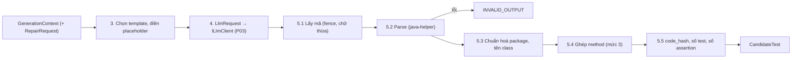

# P02. Khối 2: Sinh test

**Mục đích:** dựng prompt từ mã nguồn CUT, Repository Metadata M và chỉ dẫn; gọi model qua lớp LLM (P03); rồi tách mã test từ câu trả lời thành **Candidate Unit Test (T)** đã chuẩn hoá. Kết quả là T hợp lệ, hoặc `INVALID_OUTPUT` kèm lý do.

Khối 2 có hai chế độ:

| Chế độ | Gọi từ | Chỉ dẫn | Kết quả |
|---|---|---|---|
| `GENERATE` | P07, sau khối 1 | Template sinh test **repository-aware** (`zero_shot_project_aware`) | c0 |
| `REPAIR` | P04 (vòng sửa) | Template sửa theo mức 1, 2 hoặc 3, dựng từ `RepairRequest` | ct của vòng t |

**Lớp:** `Arrow.Business/Generation`. Template nhúng trong `Arrow.Business/Prompts/`. Gọi model qua `ILlmClient` (P03).

**Nguồn gốc:**
- thuật toán theo R02 §1–5;
- code **viết mới** theo spec này (PLAN §2.1); tham khảo `ARROW_Framework/src/Arrow.Service/Block2` (`PromptBuilder`, `CodeExtractor`) khi gặp trường hợp biên;
- template **giữ nguyên** từ `ARROW_Framework/prompts/` (là dữ liệu, không phải code).



## 1. Phạm vi

| Có | Không |
|---|---|
| Quy trình `zero_shot_project_aware` khi sinh | `zero_shot`, `few_shot`, so sánh quy trình (thực nghiệm RQ1) |
| Prompt sửa mức 1, 2, 3 (Adaptive) | Prompt của Fixed Repair |
| Template nhúng sẵn; người dùng có thể ghi đè bằng thư mục riêng | Sửa template trong lúc chạy |
| Mỗi lượt gọi là một lượt hỏi–đáp đơn (system + user) | Hội thoại nhiều lượt, gọi tool |
| Chuẩn hoá package, tên class; ghép method ở mức 3 | Thêm hay sửa import, sửa logic test |

## 2. Đầu vào

### 2.1 `GenerationContext`

```csharp
public sealed record GenerationContext(
    string RunId,
    string CutFqn,
    RepositoryMetadata Metadata,       // P01 §5.1
    string MetadataPrompt,             // metadata_prompt.txt, P01 §5.2
    string CutSource,                  // mã nguồn CUT nguyên văn, đọc từ base
    ModelSettings Model,               // P03 §2: tên, provider, model_id, params, giá
    string ResultDir);                 // thư mục ghi file của lượt này (Mục 6)
```

### 2.2 `RepairRequest` (P04 tạo ra)

```json
{
  "cut_fqn": "com.myshop.service.OrderService",
  "round": 3, "level": 2, "requested_level": 3,
  "state": "COMPILE",
  "base_code": "package com.myshop.service; … class OrderService_ArrowTest { … }",
  "base_round": 1,
  "error_block": "OrderService_ArrowTest.java:[13,6] cannot find symbol\n  symbol: method calcTotal(long)\n  location: class com.myshop.service.OrderService\n…",
  "extra_context": "Constructors and methods of com.myshop.service.OrderService:\n  public OrderService(OrderRepository repo)\n  public long totalPrice(long orderId)\n…",
  "failed_attempts": [
    { "round": 2, "signature": "COMPILE | cannot find symbol | method",
      "first_error": "cannot find symbol: method calcTotal(long) in class com.myshop.service.OrderService",
      "change": "-        long total = service.getTotal(1L);\n+        long total = service.calcTotal(1L);" }
  ],
  "rewrite_methods": []
}
```

Khối 2 **không** quyết định mức hay nội dung `extra_context`. Nó chỉ dựng prompt từ request. Ý nghĩa và cách tính từng trường nằm ở P04.

## 3. Dựng prompt

### 3.1 Template

Mỗi lượt gọi có **2 message**:
- `system`: chỉ dẫn cố định cho việc sinh hoặc việc sửa;
- `user`: dữ liệu của lượt đó.

| File (trong `Prompts/`) | Vai trò | Dùng khi |
|---|---|---|
| `generation/system/zero_shot_project_aware.md` | system | GENERATE |
| `generation/user/project_aware.md` | user | GENERATE |
| `repair/system.md` | system | REPAIR, mọi mức |
| `repair/user/level1.md` | user | REPAIR mức 1 |
| `repair/user/level2.md` | user | REPAIR mức 2 (và khi mức 3 không áp dụng được) |
| `repair/user/level3.md` | user | REPAIR mức 3 |
| `repair/failure_summaries.md` | dữ liệu | Câu mô tả lỗi theo trạng thái, điền vào `{{failure_summary}}` |

**Định dạng file template:**
- Phần đầu nằm giữa hai dòng `---` gồm `id`, `version`, `role`, `used_by`, `placeholders`. Phần này **không** gửi cho model.
- Phần còn lại là nội dung message, có các chỗ trống `{{tên}}`.

**Kiểm tra khi nạp** (lúc khởi động `gen`):
- mọi `{{…}}` trong nội dung phải có trong `placeholders` và ngược lại;
- mỗi file phải có `id` đúng như bảng trên.

Sai thì báo `B2_TEMPLATE_INVALID`, không chạy.

**Ghi đè bằng thư mục riêng:**
- `prompts.override_dir` (P09) trỏ tới một thư mục có cùng cấu trúc. File nào có trong thư mục đó thì thay bản nhúng; file nào không có thì giữ bản nhúng.
- File ghi đè cũng phải qua kiểm tra trên, và **phải có cùng tập placeholder** với bản nhúng.
- Có ghi đè thì in `[!] Dùng template tuỳ chỉnh: <danh sách file>`.

**Ghi nhận:** `id`, `version` và sha256 của **từng file** đã dùng được ghi vào `run.json` (`prompts_sha256`) và vào `prompt.json` của từng lượt.

### 3.2 Giá trị của các placeholder

| Placeholder | Có trong | Giá trị |
|---|---|---|
| `cut_fqn` | mọi user | FQN của CUT |
| `cut_path` | mọi user | `paths.cut_path` (tính từ gốc project) |
| `cut_source` | mọi user | Mã nguồn CUT, qua bước rút gọn (Mục 3.3) |
| `test_package` | mọi user | `cut.package`; chuỗi rỗng nếu CUT ở package mặc định |
| `test_class_name` | mọi user | Tên ngắn của `paths.generated_test_fqn`, ví dụ `OrderService_ArrowTest` hoặc `OrderService_Arrow2Test` |
| `repository_configuration` | mọi user | Nội dung `metadata_prompt.txt` (P01 §5.2), **đầy đủ** ở cả GENERATE và mọi mức REPAIR (chốt Q4) |
| `failure_summary` | REPAIR | Dòng của `repair/failure_summaries.md` ứng với `request.state` |
| `error_block` | REPAIR | `request.error_block` |
| `test_source` | REPAIR | `request.base_code` (mã của checkpoint) |
| `extra_context` | REPAIR mức 2, 3 | `request.extra_context`; rỗng thì điền `(none)` |
| `failed_attempts` | REPAIR mức 2, 3 | Dựng từ `request.failed_attempts` theo Mục 3.4; rỗng thì điền `(none)` |
| `failing_methods` | REPAIR mức 3 | `request.rewrite_methods`, mỗi dòng một tên, đầu dòng có `- ` |

- Thiếu giá trị cho một placeholder mà template cần: báo `B2_TEMPLATE_INVALID`, không gửi.
- Giá trị được chèn nguyên văn. Không thoát ký tự, vì template đã đặt mã trong khối ```` ```java ````.

### 3.3 Rút gọn CUT dài

1. `CutSource` không quá 48.000 ký tự: giữ nguyên (`source_truncation = "none"`).
2. Dài hơn: gọi java-helper `shrink_source` với `max_chars = 48000` (P10 §4.5). Kết quả `truncation` là `comments_removed` hoặc `signatures_only`.
3. Ghi `source_truncation` vào `prompt.json`. Có rút gọn thì phát sự kiện `B2.SourceTruncated` để CLI in `[!]`.

### 3.4 Dựng `{{failed_attempts}}`

Theo R03 §6.4:
- **3 lần thử gần nhất** hiện đủ `signature`, `first_error`, `change`;
- **các lần cũ hơn** chỉ hiện một dòng `round` và `signature`.

```
Approaches that already failed (do not repeat them):
- Round 1 · COMPILE | cannot find symbol | method
- Round 2 · COMPILE | cannot find symbol | method
  First error: cannot find symbol: method calcTotal(long) in class com.myshop.service.OrderService
  Changed code:
    -        long total = service.getTotal(1L);
    +        long total = service.calcTotal(1L);
- Round 3 · duplicate code (same as round 2)
  Changed code:
    -        long total = service.getTotal(1L);
    +        long total = service.calcTotal(1L);
```

- Thứ tự theo `round` tăng dần.
- `first_error` hoặc `change` rỗng thì bỏ dòng tương ứng.
- Mỗi dòng của `change` thụt 4 dấu cách.

## 4. Gọi model

```csharp
var request = new LlmRequest(
    CallId:   mode == Generate ? $"gen/{cutFqn}" : $"repair/{cutFqn}/round_{round}",
    Model:    model.Name,
    Messages: [ new("system", systemText), new("user", userText) ],
    Params:   model.Params);
```

- **`call_id`** là định danh duy nhất của lượt gọi trong run. Cache dùng nó làm một phần khoá (P03 §5), nên hai vòng khác nhau không bao giờ dùng chung câu trả lời, kể cả khi prompt giống hệt nhau.
- **Tham số** lấy nguyên văn từ cấu hình model (P03 §2), giống nhau cho mọi lượt.
- **Lỗi:**
  - lỗi cấu hình (`B2_LLM_CONFIG`, `B2_WRONG_MODEL`) và hết ngân sách (`B2_TOKEN_BUDGET`): ném `ArrowException` lên use case, use case dừng run;
  - lỗi tạm thời đã gọi lại đủ số lần (`B2_LLM_UNAVAILABLE`): ném lên, use case đánh dấu CUT đó là `INFRA`.

## 5. Tách mã từ câu trả lời

Làm theo R02 §4.5, theo đúng thứ tự. Mỗi thao tác được ghi vào `normalization`.

### 5.1 Lấy mã (`CodeExtractor`, code thuần)

1. Mặc định coi **cả câu trả lời là mã**, vì output contract yêu cầu mã thuần, không fence.
2. Có fence ```` ```java ```` hoặc ```` ``` ````: lấy **khối đầu tiên có khai báo kiểu top-level** (`class`, `interface`, `enum`, `record`), ghi `"fence removed"`.
   - Fence mở mà không đóng (output bị cắt): bỏ dòng fence, xét phần còn lại.
3. Cắt chữ thừa **trước** dòng `package`, `import` hoặc khai báo kiểu đầu tiên, và **sau** dấu `}` đóng kiểu đó. Ghi `"prose trimmed"`.
   - Không có `}` đóng (mã bị cắt): giữ tới hết, để bước 5.2 báo lỗi.
4. Sau bước 3 mà không còn ký tự nào khác khoảng trắng, hoặc không có khai báo kiểu nào: `INVALID_OUTPUT`, `invalid_reason = "no_code"`.

### 5.2 Kiểm tra cú pháp

Gọi java-helper `parse` (P10 §4.2):

| Kết quả | Xử lý |
|---|---|
| `parsed = false` | `INVALID_OUTPUT`, `invalid_reason = "parse_error"`, ghi `error` của parser |
| Có nhiều hơn một kiểu top-level | `INVALID_OUTPUT`, `invalid_reason = "multiple_classes"` |
| Đúng một kiểu top-level | Tiếp tục |

Chỉ có **ba** lý do `INVALID_OUTPUT`: `no_code`, `parse_error`, `multiple_classes`. Sai package hay sai tên class **không** làm candidate bị loại: chúng được chuẩn hoá ở bước 5.3.

### 5.3 Chuẩn hoá tên

Gọi java-helper `rename_class` (P10 §4.3) với `new_name = test_class_name` và `package = test_package`:
- thêm hoặc sửa `package` cho đúng package của CUT;
- đổi tên class chính cùng mọi tham chiếu tới tên cũ trong file;
- bỏ khai báo `package` hay `import` bị lặp nguyên dòng. Bước này do `CodeExtractor` làm (code thuần), trước khi gọi `rename_class`.

Ghi các thao tác vào `normalization`, ví dụ `"package: added"`, `"class: OrderServiceTest → OrderService_ArrowTest"`.

**Không** thêm hay sửa import, **không** sửa logic test. Lỗi do model gây ra là lỗi thật của candidate, để khối 3 phát hiện và sửa.

### 5.4 Ghép method (chỉ REPAIR mức 3)

Khi `rewrite_methods` khác rỗng: gọi java-helper `splice_methods` (P10 §4.6) với
- `base = request.base_code`;
- `response` = mã đã chuẩn hoá ở bước 5.3;
- `methods = rewrite_methods`.

Kết quả:
- mã ghép là mã của candidate;
- `dropped` ghi vào `dropped_methods`;
- ghi `normalization`: `"splice: replaced <n>, dropped <m>, added imports <k>"`.

### 5.5 Số liệu của candidate

Trên mã **cuối cùng**, sau mọi bước chuẩn hoá và ghép:

| Trường | Cách tính |
|---|---|
| `code_hash` | java-helper `strip_comments_hash` (P10 §4.4): SHA-256 của mã đã bỏ comment và thu khoảng trắng, dạng `sha256:<hex>` |
| `test_method_count` | java-helper `list_test_methods` (P10 §4.7) |
| `assertion_count` | java-helper `count_assertions` (P10 §4.8) |

`code_hash` **phải** tính sau bước ghép ở 5.4, vì khối 3 so `seen_hash` trên chính bản đã ghép (R03 §6.4).

### 5.6 Câu trả lời bị cắt

`finish_reason = "length"`: vẫn xử lý bình thường theo 5.1–5.5, thường sẽ ra `parse_error`. Ghi `finish_reason` vào `candidate.json`, và phát sự kiện `B2.Truncated` để CLI gợi ý tăng `max_tokens` của model.

## 6. Đầu ra

Thư mục:
- GENERATE: `targets/<cut>/block2/`;
- REPAIR: `targets/<cut>/block3/round_<k>/`.

| File | Nội dung | Ghi khi |
|---|---|---|
| `prompt.json` | `call_id`, `messages`, `params`, `templates` (`id`, `version`, `sha256` mỗi file), `source_truncation` | **Trước** khi gọi model |
| `response.json` | Body gốc của API (P03 §3), đã qua `Redactor` | Sau khi gọi |
| `usage.json` | P03 §7 | Sau khi gọi |
| `candidate.java` | Mã đã chuẩn hoá. Không có khi `INVALID_OUTPUT` | Sau bước 5 |
| `candidate.json` | Dưới đây | Sau bước 5 |

```json
{
  "cut_fqn": "com.myshop.service.OrderService",
  "mode": "REPAIR", "round": 3, "level": 2,
  "model": "gpt-x",
  "valid_output": true, "invalid_reason": null, "parse_error": null,
  "test_fqn": "com.myshop.service.OrderService_ArrowTest",
  "test_path": "shop-core/src/test/java/com/myshop/service/OrderService_ArrowTest.java",
  "code_hash": "sha256:9f3c…", "test_method_count": 6, "assertion_count": 11,
  "normalization": ["prose trimmed", "class: OrderServiceTests → OrderService_ArrowTest"],
  "dropped_methods": [], "finish_reason": "stop"
}
```

```csharp
public sealed record CandidateTest(
    bool ValidOutput, string? InvalidReason, string? Code,
    string TestFqn, string TestPath, string? CodeHash,
    int TestMethodCount, int AssertionCount,
    IReadOnlyList<string> Normalization, IReadOnlyList<string> DroppedMethods, string? FinishReason);

public sealed record GenerationResult(CandidateTest Candidate, LlmUsage Usage, PromptRecord Prompt);
```

## 7. Mã lỗi

| Mã | Kết quả | Khi nào | Gợi ý |
|---|---|---|---|
| `B2_INVALID_OUTPUT` | Candidate không hợp lệ, không phải INFRA | `no_code`, `parse_error`, `multiple_classes` | Ở c0: thử lại, hoặc đổi model. Trong chain: P04 tính là một vòng và lên mức |
| `B2_TEMPLATE_INVALID` | Dừng trước khi chạy | Template thiếu hoặc thừa placeholder, sai `id`, file ghi đè sai | Sửa hoặc xoá thư mục `prompts.override_dir` |

Các mã `B2_LLM_*`, `B2_WRONG_MODEL`, `B2_TOKEN_BUDGET` thuộc P03.

**c0 `INVALID_OUTPUT`:**
- **không** vào khối 3, vì không có mã để sửa (R02 §6);
- kết quả của CUT là `INVALID_OUTPUT`;
- CLI gợi ý chạy lại hoặc đổi model.

## 8. Interface

```csharp
public interface ITestGenerator
{
    Task<GenerationResult> GenerateAsync(GenerationContext context, CancellationToken ct);
    Task<GenerationResult> RepairAsync(GenerationContext context, RepairRequest request, CancellationToken ct);
}

public interface IPromptTemplateStore      // DataAccess
{
    PromptTemplate Get(string id);          // đã bỏ phần đầu file, kèm version, sha256, placeholders
    IReadOnlyList<PromptTemplate> All();
}
```

**Sự kiện tiến độ:** `B2.Prompt` (số ký tự, có rút gọn không), `B2.Calling`, `B2.Response` (token, thời gian, `finish_reason`), `B2.Candidate` (hợp lệ hay không, `normalization`).

## 9. Kiểm thử

**Unit:**
- Nạp template: bỏ phần đầu file; `placeholders` thừa hoặc thiếu; sai `id`; ghi đè từng file; ghi đè sai tập placeholder.
- Điền placeholder cho GENERATE và REPAIR mức 1, 2, 3; thiếu giá trị thì báo lỗi.
- `{{failed_attempts}}`: 0, 1, 3, 5 lần thử; 3 lần gần nhất có đủ chi tiết; lần cũ hơn chỉ có signature.
- `CodeExtractor`: mã thuần; có fence `java`; fence trơn; fence không đóng; chữ thừa trước và sau; chỉ có chữ; mã bị cắt.
- Phân loại `INVALID_OUTPUT` qua `parse` giả: `no_code`, `parse_error`, `multiple_classes`.
- Chuẩn hoá: sai package, thiếu package, sai tên class có tham chiếu bên trong, import lặp.
- Mức 3: ghép method, `dropped_methods`.
- `code_hash` tính sau khi ghép.
- `call_id` đúng dạng cho GENERATE và REPAIR.
- Không có import nào được thêm (so trước và sau).

**Integration** (java-helper thật, `FakeLlmClient`):
- `GenerateAsync` trên `maven-verify-junit4`: đủ 5 file đầu ra, mã đã chuẩn hoá compile được (kiểm tra bằng khối 3).
- `RepairAsync` mức 3 với câu trả lời chỉ có 1/2 method lỗi: 1 method được thay, 1 method bị bỏ.

**Nghiệm thu:** smoke với model thật (P11 §1) sinh c0 cho 2 class của fixture. `prompt.json` có đủ khối M, và không có khoá API.

## 10. Ví dụ

**GENERATE: câu trả lời có fence và tên class sai.**

Câu trả lời của model:

````
Here is the test:
```java
package com.myshop.service;
import org.junit.jupiter.api.Test;
import static org.junit.jupiter.api.Assertions.*;
class OrderServiceTest {
  @Test void totalIsZeroForEmptyOrder() { assertEquals(0, new OrderService(new InMemoryRepo()).totalPrice(1L)); }
}
```
Hope this helps.
````

Kết quả:
- `normalization = ["fence removed", "prose trimmed", "class: OrderServiceTest → OrderService_ArrowTest"]`;
- `valid_output = true`, `test_method_count = 1`, `assertion_count = 1`.

Import thiếu của `InMemoryRepo` (nếu có) **không** được thêm. Khối 3 sẽ báo `COMPILE` và sửa ở vòng sau.

**REPAIR mức 3:**
- `rewrite_methods = ["totalPriceAddsTax", "rejectsNull"]`;
- câu trả lời chỉ có `totalPriceAddsTax` (sửa xong) và thêm helper `newOrder()`.

Kết quả:
- `totalPriceAddsTax` được thay;
- `rejectsNull` bị bỏ (`dropped_methods = ["rejectsNull"]`);
- `newOrder()` được thêm;
- mọi method khác của checkpoint giữ nguyên từng ký tự;
- `code_hash` tính trên bản đã ghép.
