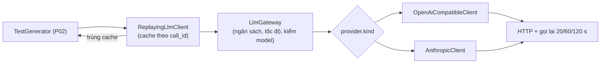

# P03. Lớp gọi LLM

**Mục đích:** P03 là **cách duy nhất** hệ thống gọi model. Lớp này làm các việc sau:
- chuẩn hoá yêu cầu;
- gửi tới nhà cung cấp người dùng đã chọn;
- gọi lại khi lỗi tạm thời;
- phân loại lỗi cấu hình;
- kiểm tra đúng model;
- giới hạn tốc độ và ngân sách token;
- lưu cache để chạy tiếp mà không tốn tiền lại;
- ghi số liệu token và chi phí.

**Lớp:**
- `Arrow.DataAccess/Llm`: HTTP client của từng nhà cung cấp;
- `Arrow.Business/Llm`: `LlmGateway`, `ReplayingLlmClient`, ước tính chi phí;
- `FakeLlmClient` dùng cho test (P11 §3).

**Nguồn gốc:**
- R02 §4 (LLM Abstraction Layer);
- code **viết mới** theo spec này (PLAN §2.1); tham khảo `LlmGateway`, `ReplayingLlmClient`, `FakeLlmClient` và `LiteLlmClient` trong `ARROW_Framework/src/Arrow.Service/External`.

Sản phẩm **không bắt buộc** LiteLLM: người dùng gọi thẳng endpoint của nhà cung cấp.



## 1. Phạm vi

| Có | Không |
|---|---|
| `openai-compatible`: OpenAI, OpenRouter, teamorouter, Gemini (endpoint tương thích OpenAI), Ollama, LiteLLM proxy, vLLM, LM Studio | SDK riêng của từng hãng |
| `anthropic`: Messages API | Azure OpenAI dạng deployment (v1 chưa làm) |
| Một lượt hỏi–đáp (system + user), không stream | Stream, gọi tool, hội thoại nhiều lượt |
| Cache trong một run, để chạy tiếp | Cache dùng chung giữa các run |
| Ngân sách token, ước tính chi phí | Thanh toán, theo dõi số dư |

## 2. Cấu hình model và provider

Lấy từ P09 §3.2:

```csharp
public sealed record ModelSettings(
    string Name,                          // tên ngắn người dùng đặt, ví dụ "gpt-x"
    ProviderSettings Provider,
    string ModelId,                       // tên model ở provider, ví dụ "gpt-4.1-mini", "claude-…", "qwen3-coder:30b"
    IReadOnlyDictionary<string, JsonElement> Params,   // temperature, max_tokens, seed, reasoning_effort, …
    Price? PriceUsdPerMillion,            // input, output; null = không tính chi phí
    string? ExpectedModelIdPrefix);       // null = không kiểm tra

public sealed record ProviderSettings(string Name, ProviderKind Kind, Uri BaseUrl, string? SecretRef);
```

**Tham số mặc định**, khi người dùng không đặt:
- `temperature = 0`;
- `max_tokens = 16384`.

Mọi lượt gọi trong một run dùng **cùng** tham số. Không có tham số nào thay đổi theo vòng sửa.

**Không âm thầm bỏ tham số.** Provider từ chối một tham số (HTTP 400) thì báo `B2_LLM_CONFIG`, in nguyên thông điệp lỗi của provider, và gợi ý `arrow config unset llm.models.<tên>.params.<khoá>`.

**Gợi ý `base_url` trong `arrow setup`:**

| Lựa chọn | `kind` | `base_url` | Khoá |
|---|---|---|---|
| OpenAI | `openai-compatible` | `https://api.openai.com/v1` | Cần |
| OpenAI-compatible (tự nhập) | `openai-compatible` | Ví dụ `https://api.teamorouter.com/v1` | Cần |
| OpenRouter | `openai-compatible` | `https://openrouter.ai/api/v1` | Cần |
| Gemini | `openai-compatible` | `https://generativelanguage.googleapis.com/v1beta/openai` | Cần |
| Ollama trên máy | `openai-compatible` | `http://localhost:11434/v1` | Không |
| Anthropic | `anthropic` | `https://api.anthropic.com` | Cần |

## 3. Gửi yêu cầu

### 3.1 `LlmRequest`, `LlmResponse`

```csharp
public sealed record LlmRequest(string CallId, string Model, IReadOnlyList<LlmMessage> Messages,
                                IReadOnlyDictionary<string, JsonElement> Params);
public sealed record LlmMessage(string Role, string Content);           // "system" | "user"

public sealed record LlmResponse(
    string CallId, string Content, string? FinishReason,                 // "stop" | "length" | khác
    string ModelId,                                                      // model id provider trả về
    int PromptTokens, int CompletionTokens,
    double LatencySeconds, int Attempts,                                 // Attempts = số lần gửi (1 = không gọi lại)
    bool Replayed,                                                       // true khi lấy từ cache (Mục 5)
    JsonElement RawBody);                                                // body gốc, cho response.json
```

### 3.2 `openai-compatible`

- **Gửi:** `POST {base_url}/chat/completions`.
- **Header:**
  - `Content-Type: application/json`;
  - `Authorization: Bearer <khoá>`, khi có khoá;
  - `User-Agent: arrow-cli/<version>`.
- **Body:**

```json
{ "model": "<model_id>",
  "messages": [ { "role": "system", "content": "…" }, { "role": "user", "content": "…" } ],
  "temperature": 0, "max_tokens": 16384, "…các params khác, nguyên văn…": null,
  "stream": false }
```

- **Đọc kết quả:**
  - `content` = `choices[0].message.content`. Là mảng các phần thì nối các phần `text`;
  - `finish_reason` = `choices[0].finish_reason`;
  - `ModelId` = `model`;
  - số token lấy từ `usage.prompt_tokens` và `usage.completion_tokens`. Không có `usage` thì ước tính bằng số ký tự / 4 và ghi `usage_estimated: true`.
- **`choices` rỗng hoặc `content` null:** coi là câu trả lời rỗng. P02 sẽ phân loại thành `no_code`.

### 3.3 `anthropic`

- **Gửi:** `POST {base_url}/v1/messages`.
- **Header:**
  - `x-api-key: <khoá>`;
  - `anthropic-version: 2023-06-01`;
  - `content-type: application/json`.
- **Body:**

```json
{ "model": "<model_id>", "system": "<nội dung system>",
  "messages": [ { "role": "user", "content": "<nội dung user>" } ],
  "max_tokens": 16384, "temperature": 0 }
```

- **Đọc kết quả:**
  - `content` = nối mọi phần tử `type = "text"` của `content[]`;
  - `finish_reason`: `stop_reason` là `end_turn` hay `stop_sequence` → `stop`; là `max_tokens` → `length`; giá trị khác giữ nguyên;
  - `ModelId` = `model`;
  - số token từ `usage.input_tokens` và `usage.output_tokens`.

### 3.4 Timeout và huỷ

- **Timeout một lần gửi:** `llm.request_timeout_seconds` (mặc định 300 s).
- **Huỷ:** `CancellationToken` huỷ yêu cầu HTTP ngay lập tức.
- **Kết nối:** `HttpClient` dùng chung trong run (`SocketsHttpHandler`, `PooledConnectionLifetime` 2 phút). Proxy hệ thống được dùng mặc định (`HTTPS_PROXY`).

**Khác với bản đầu của spec (ghi ngày 13/11/2026, khi viết code):**
- `LlmResponse` có thêm `UsageEstimated` (cho `usage_estimated`) và `CostUsd` (do `LlmGateway` điền, để cache giữ nguyên chi phí của lần gọi thật).
- `ILlmClientFactory.Create` nhận thêm `IProgress<ArrowEvent>?` để phát `LLM.Retry`, `LLM.Replayed`, `LLM.BudgetWarning`.
- Thông điệp lỗi của client đã gồm gợi ý của từng loại lỗi (bảng Mục 4), vì `ErrorCatalog` chỉ có một gợi ý chung cho `B2_LLM_CONFIG`.
- Các mã 4xx khác ngoài 408 và 429 (ví dụ 413, 422) cũng là lỗi cấu hình, không gọi lại.

## 4. Phân loại lỗi và gọi lại

| Tình huống | Loại | Xử lý |
|---|---|---|
| HTTP 429, 500, 502, 503, 504, 529; lỗi mạng; timeout | Tạm thời | Gọi lại tối đa **3 lần** (tổng 4 lần gửi), chờ **20 s, 60 s, 120 s**. Có header `Retry-After` (≤ 300 s) thì chờ theo header. Hết lượt thì `B2_LLM_UNAVAILABLE`: P07 đánh dấu CUT đó là `INFRA` |
| HTTP 400 (sai tham số, sai model, prompt quá dài) | Cấu hình | Không gọi lại. `B2_LLM_CONFIG` kèm thông điệp của provider. Dừng run |
| HTTP 401, 403 | Cấu hình | `B2_LLM_CONFIG`, gợi ý `Khoá API sai hoặc hết hạn: arrow secrets set <ref>`. Dừng run |
| HTTP 402 hoặc thông điệp có `insufficient_quota`, `billing` (với **mọi** mã HTTP, kể cả 429: OpenAI báo hết hạn mức bằng 429) | Cấu hình | `B2_LLM_CONFIG`, gợi ý `Tài khoản hết tiền hoặc hết hạn mức`. Dừng run |
| HTTP 404 | Cấu hình | `B2_LLM_CONFIG`, gợi ý kiểm tra `base_url` và `model_id`. Dừng run |
| Body không phải JSON hoặc thiếu trường bắt buộc | Tạm thời | Gọi lại như hàng đầu tiên. Hết lượt thì `B2_LLM_UNAVAILABLE` |

- Mỗi lần gửi lỗi được ghi một dòng vào log của run: `call_id`, lần thứ mấy, mã HTTP, 200 ký tự đầu của thông điệp (đã qua `Redactor`).
- Lần gửi lỗi **không** tính là một vòng sửa.
- Số lần gửi ghi vào `usage.json` (`attempts`).

**"Dừng run"** nghĩa là:
- P07 không bắt đầu lượt gọi mới nào;
- các CUT đã xong được giữ nguyên;
- CUT đang chạy được đánh dấu chưa xong, để chạy tiếp được sau khi sửa cấu hình (P07 §5);
- CLI in lỗi và lệnh chạy tiếp.

## 5. Cache để chạy tiếp (`ReplayingLlmClient`)

Cache **chỉ** dùng để **phát lại một lượt gọi đã hoàn thành** khi chạy tiếp một run bị ngắt (Ctrl+C, mất mạng, lỗi cấu hình đã sửa). Nó **không bao giờ** thay cho một lượt gọi mới (R02 §4.4).

- **Khoá cache** = SHA-256 của JSON chuẩn hoá `{call_id, model, model_id, params, messages}`. JSON chuẩn hoá nghĩa là khoá được sắp theo thứ tự chữ cái, không có khoảng trắng thừa, và số viết dạng ngắn nhất.
  - `call_id` có dạng `gen/<cut_fqn>` hoặc `repair/<cut_fqn>/round_<k>`.
  - Vì vậy hai vòng khác nhau **không bao giờ** dùng chung một mục cache, kể cả khi prompt giống hệt nhau từng chữ.
- **Nơi lưu:** `runs/<run_id>/llm_cache/<khoá>.json`, gồm `LlmResponse` đầy đủ và `stored_at`. Ghi nguyên tử, và chỉ ghi khi lượt gọi **thành công** (HTTP 200, đọc được kết quả).
- **Phát lại:**
  - trả `LlmResponse` đã lưu với `Replayed = true`;
  - **giữ nguyên** `latency_seconds`, số token, `cost_usd` và `model_id` của lần gọi thật;
  - không tính vào ngân sách lần nữa (Mục 6).
- **Đổi model, tham số hay template giữa hai lần chạy:** khoá khác, nên không trúng cache, và gọi model thật.
- Cache của một run bị xoá cùng run đó (`arrow clean --runs`).

## 6. Giới hạn (`LlmGateway`)

| Giới hạn | Khoá cấu hình | Quy tắc |
|---|---|---|
| Lượt gọi đồng thời | `llm.max_concurrent` (2) | `SemaphoreSlim` dùng chung cho cả run |
| Lượt gọi mỗi phút | `llm.rpm_limit` (60) | Cửa sổ trượt 60 s. Đủ số lượt thì chờ, với bước chờ từ 50 ms tới 1 s |
| Ngân sách token của run | `run.max_tokens` / `--max-tokens` | **Trước** mỗi lượt gọi (không tính lượt phát lại): nếu `tokens_in + tokens_out` đã dùng ≥ ngân sách thì báo `B2_TOKEN_BUDGET` và dừng run. Lượt đang chạy được phép xong, nên có thể vượt ngân sách nhiều nhất bằng một lượt |
| Đúng model | `expected_model_id_prefix` | Sau mỗi câu trả lời: `ModelId` phải bắt đầu bằng tiền tố, hoặc chứa `/<tiền tố>`, không phân biệt hoa thường. Sai thì báo `B2_WRONG_MODEL` và dừng run. Không đặt tiền tố thì không kiểm tra, nhưng `model_id` trả về vẫn được ghi vào `usage.json` và `run.json` |

## 7. Số liệu và chi phí

**`usage.json`** của mỗi lượt gọi:

```json
{ "call_id": "repair/com.myshop.service.OrderService/round_3",
  "model": "gpt-x", "model_id": "gpt-4.1-mini-2025-04-14", "provider_host": "api.teamorouter.com",
  "prompt_tokens": 6120, "completion_tokens": 1830, "usage_estimated": false,
  "finish_reason": "stop", "latency_seconds": 4.2, "attempts": 1,
  "cost_usd": 0.00538, "replayed": false }
```

**Chi phí:** `cost_usd = prompt_tokens × input / 1e6 + completion_tokens × output / 1e6`. Không có giá thì `cost_usd = null`, không ghi 0.

**Ước tính trước khi chạy** (cho P07 §4):
- `prompt_tokens_gen` ≈ (độ dài system + user của prompt sinh) / 4;
- `completion_tokens` ≈ `min(max_tokens, 3000)`;
- `prompt_tokens_repair` ≈ `prompt_tokens_gen` + 2.000.

**Mỗi class:**
- **kỳ vọng** = 1 lượt sinh + `min(N, 3)` lượt sửa;
- **tối đa** = 1 + N lượt.

CLI in cả hai con số, kèm chi phí nếu có giá: `~45k token (tối đa ~120k)`.

## 8. Ollama

`arrow doctor` và `arrow models test` với provider có `base_url` là `localhost:11434`:

1. **Kiểm tra model:** `GET http://localhost:11434/api/tags` để biết Ollama đang chạy và có `model_id`. Không có thì gợi ý `ollama pull <model_id>`.
2. **Kiểm tra cửa sổ ngữ cảnh:** `POST /api/show {"model": "<model_id>"}`, đọc `num_ctx` trong `parameters`. Nhỏ hơn **40.960** thì cảnh báo, vì Ollama mặc định **cắt prompt mà không báo lỗi** (R02 §4.2). Gợi ý cách sửa: tạo Modelfile có `PARAMETER num_ctx 40960`, hoặc đặt biến môi trường `OLLAMA_CONTEXT_LENGTH=40960` rồi khởi động lại Ollama.

## 9. Quyền riêng tư

**Dữ liệu được gửi** tới nhà cung cấp trong mỗi lượt gọi:
- mã nguồn CUT;
- khối M (tên dependency, đường dẫn, Java version);
- mã test;
- khối lỗi build hay test (đã bỏ đường dẫn tuyệt đối của workspace);
- `extra_context`: chữ ký và mã nguồn của các class khác trong project, chữ ký class của thư viện.

**Không bao giờ gửi:**
- khoá API của provider khác;
- nội dung file ngoài project;
- biến môi trường;
- tên máy hay tên người dùng.

`arrow setup` in rõ điều này và hỏi đồng ý (P08 §2.5). Dùng Ollama thì code không rời khỏi máy.

## 10. Lệnh `arrow models`

| Lệnh | Việc |
|---|---|
| `arrow models` | Bảng: tên, provider, host, `model_id`, tham số, giá, khoá (`...xxxx` hoặc `không cần`), mặc định |
| `arrow models test [<tên>]` | Gửi prompt cố định `Reply with exactly: OK`, `max_tokens = 16`. In nội dung, `model_id` trả về (`✓`/`✗` theo tiền tố), token, thời gian, chi phí. Lỗi thì in mã và gợi ý (Mục 4) |
| `arrow models add` | Như bước 1–2 của `arrow setup` |
| `arrow models default <tên>` | Đặt `llm.default_model` |

## 11. Mã lỗi

| Mã | Kết quả | Gợi ý |
|---|---|---|
| `B2_LLM_UNAVAILABLE` | CUT là `INFRA` | Mạng hoặc provider đang lỗi. Chạy lại sau bằng `arrow gen --resume <run>` |
| `B2_LLM_CONFIG` | Dừng run | Theo bảng Mục 4: khoá, tiền, `base_url`, `model_id`, tham số |
| `B2_WRONG_MODEL` | Dừng run | Endpoint trả về model khác (`<model_id>` thay vì `<tiền tố>`). Kiểm tra `model_id` hoặc bỏ `expected_model_id_prefix` |
| `B2_TOKEN_BUDGET` | Dừng run | Đã dùng hết `--max-tokens`. Tăng ngân sách rồi chạy tiếp |

## 12. Interface

```csharp
public interface ILlmClient
{
    Task<LlmResponse> CompleteAsync(LlmRequest request, CancellationToken ct);   // ném ArrowException với mã Mục 11
}

public interface ILlmClientFactory                // Business: dựng chuỗi Replaying → Gateway → provider cho một run
{
    ILlmClient Create(ModelSettings model, RunHandle run, LlmLimits limits);
}

public interface ILlmCostEstimator
{
    CostEstimate Estimate(ModelSettings model, IReadOnlyList<PromptSizeHint> targets, int rounds);
}
```

**Sự kiện tiến độ:**
- `LLM.Retry`: lần thứ mấy, sẽ chờ bao lâu, lý do; CLI in `! gọi lại sau 20 s (HTTP 429)`;
- `LLM.Replayed`;
- `LLM.BudgetWarning`: khi đã dùng 80% ngân sách.

## 13. Kiểm thử

**Unit, với HTTP giả** (`HttpMessageHandler` giả):
- `openai-compatible`: 200; `content` dạng mảng; không có `usage`; 429 có `Retry-After` rồi 200; 500 bốn lần thành `B2_LLM_UNAVAILABLE` với các lần chờ 20/60/120 s (dùng `TimeProvider` giả); 400, 401, 402, 404; timeout; body hỏng.
- `anthropic`: 200 với nhiều phần text; `stop_reason = max_tokens` thành `length`; 529 rồi 200.
- `LlmGateway`: ngân sách (dừng đúng lúc, lượt phát lại không tính); rpm; số lượt đồng thời; kiểm tra tiền tố model (`gpt-4.1-mini` khớp `openai/gpt-4.1-mini-2025…`).
- `ReplayingLlmClient`: khoá ổn định khi đổi thứ tự tham số; **khác** giữa hai `call_id` cùng prompt; phát lại giữ token, thời gian và chi phí gốc; không lưu khi lỗi.
- Chi phí: có và không có giá; ước tính.
- `Redactor`: header `Authorization` và `x-api-key` không xuất hiện trong log.

**Integration:** Ollama, nếu máy CI có, gắn `[Trait("Category","Ollama")]`, không bắt buộc.

**Smoke chạy tay** (P11 §1):
- `arrow models test` với teamorouter (khoá đặt trong `ARROW_SECRET_TEAMO`);
- sinh c0 cho 2 class;
- ngắt giữa chừng rồi chạy tiếp: lượt đã xong được phát lại, `replayed: true`, token và chi phí không đổi.

**Nghiệm thu:** `arrow setup` → `arrow models test` chạy được với một provider tương thích OpenAI và với Ollama. Tìm khoá thật trong `ARROW_HOME` không ra kết quả nào (P11 §4).
