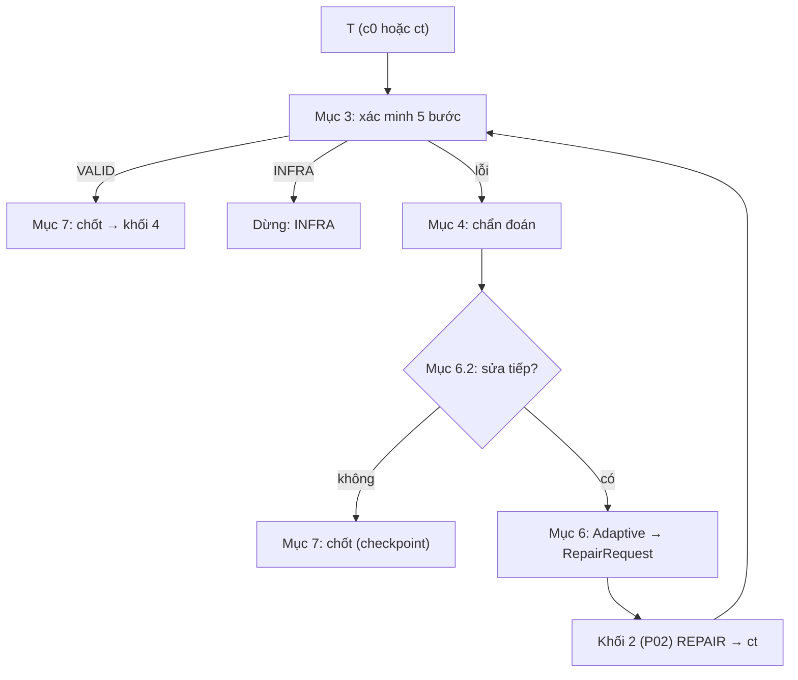

# P04. Khối 3: Xác minh và Adaptive Repair

**Mục đích:** khối 3 làm 4 việc với candidate T:
1. **xác minh qua 5 bước** trên build thật của project;
2. đạt VALID thì chuyển sang khối 4;
3. chưa đạt thì **chẩn đoán lỗi**, quyết định có sửa tiếp không, dựng yêu cầu sửa gửi về khối 2 rồi xác minh bản mới;
4. hết lượt sửa thì **chốt bộ test**.

Thuật toán sửa là **Adaptive Repair**: giữ checkpoint, đổi mức prompt theo tiến triển, phát hiện lỗi lặp và mã trùng, rollback khi bản mới tệ hơn.

**Lớp:** `Arrow.Business/Repair`. Gồm:
- `Verifier`, `FailureDiagnoser`, `SignatureBuilder`, `ExtraContextBuilder`;
- `CheckpointComparer`, `AdaptiveRepairPolicy`, `RepairRunner`;
- `JavacErrorParser`, `TestResultClassifier`.

Chạy lệnh build qua `IBuildExecutor`, sao chép qua `IWorkspaceManager` (P01 §10).

**Nguồn gốc:**
- thuật toán theo R03 §3–8 và §14–15;
- code **viết mới** theo spec này (PLAN §2.1), không có Fixed Repair, tập con RQ2, `mechanism`, `run_order` hay `rq3_only`. Các lớp đọc log và thuật toán (`JavacErrorParser`, `TestResultClassifier`, `SignatureBuilder`, `CheckpointComparer`, `AdaptiveRepairPolicy`) tham khảo `ARROW_Framework/src/Arrow.Service/Block3`, và test của nó được mang sang làm bộ đối chiếu.



## 1. Phạm vi

| Có | Không |
|---|---|
| Xác minh 5 bước cho candidate của ARROW | Xác minh bộ test EvoSuite |
| Adaptive Repair, N vòng (mặc định 5), dừng sớm (mặc định P = 3) | Fixed Repair, so sánh hai cơ chế, tập con RQ2 |
| Thử lại lỗi hạ tầng | Danh sách `needs_rerun.csv` |
| Xác minh lại một lần khi P06 đổi tên file (`_Arrow<k>Test`) | Sửa code production hay file build |

## 2. Đầu vào

| Đầu vào | Nguồn |
|---|---|
| `CandidateTest` c0 (hoặc ct) | P02 |
| M, `baseline.json`, `workspace.json`, `test_classpath.txt` | P01 |
| `N` = `repair.rounds` (1–10, mặc định 5); `early_stop_p` (≥ 3 hoặc `null`, mặc định 3); `repair.enabled` | P09, `--rounds`, `--no-repair` |
| `step_timeout_seconds` (900), `infra_attempts` (3), `infra_wait_seconds` (30) | P09 |
| `ITestGenerator`, `IJavaHelper` | P02, P10 |

```csharp
public sealed record SuiteFiles(
    string TestFqn,                                   // com.myshop.service.OrderService_ArrowTest
    IReadOnlyDictionary<string, string> Files,        // đường dẫn tính từ gốc project → nội dung (1 file với candidate ARROW)
    IReadOnlyList<string> ExtraTestClasspath);        // luôn rỗng trong sản phẩm

public sealed record TaskContext(
    RunHandle Run, string CutFqn, RepositoryMetadata Metadata, Baseline Baseline, WorkspaceInfo Workspace,
    string CutSource, string TargetDir);              // targets/<cut>/
```

## 3. Xác minh 5 bước (`Verifier`)

### 3.1 Workspace sạch cho mỗi lần xác minh

1. **Mỗi lần xác minh** (c0 và mỗi vòng sửa) chạy trên **bản sao mới** của `compiled_snapshot` (P01 §6.1), tức mã đã biên dịch và **chưa chạy test nào**. Không dùng lại workspace của vòng trước, vì test vòng trước có thể đã xoá resource, ghi file hay đổi cấu hình.
2. Ghi mọi file của `SuiteFiles` vào bản sao, rồi chạy các bước ở Mục 3.2.
3. **Bước 2 dùng lại bản sao vừa biên dịch ở bước 1**, vì bản sao đó chưa chạy test nào. **Bước 5 dùng một bản sao mới khác**, nên nó không thấy file do lần chạy bước 2 để lại.
4. Xong lần xác minh, kể cả khi lỗi: chép log và XML cần giữ vào thư mục của vòng, rồi **xoá** bản sao. Có `run.keep_workspaces` thì giữ.
5. **Sao chép:** clonefile trên macOS APFS, reflink trên Linux, nếu không được thì copy thường. **Thời gian sao chép được tính vào `build_seconds`.**

### 3.2 Năm bước

Mọi lệnh chạy **từ `build_root`**, dùng đúng chương trình build, JDK, cờ chung và bộ chọn module của `workspace.json` (P01 §6.4). Ký hiệu:
- `<Tên>` là tên ngắn của `test_fqn`, ví dụ `OrderService_ArrowTest`;
- `[sel]` là `-pl <m> -am` ở chế độ reactor, không có ở chế độ standalone.

| Bước | Maven | Gradle | Đạt khi | Không đạt |
|---|---|---|---|---|
| 1. Compile | `-f pom.xml [sel] <cờ chung> -DskipTests test-compile` | `:<p>:testClasses` | Mã thoát 0 | `COMPILE` hoặc `UNKNOWN` (Mục 3.3) |
| 2. Discovery | `-f pom.xml [sel] <cờ chung> -Dtest=<Tên> -Dsurefire.failIfNoSpecifiedTests=false -DfailIfNoTests=false -Dmaven.test.failure.ignore=true test` | `:<p>:test --tests <test_fqn> --continue` (init script đặt `ignoreFailures = true`) | Báo cáo XML có ≥ 1 test method của class `test_fqn` | `DISCOVERY` |
| 3. Execution | (cùng lần chạy bước 2) | | Không test method nào lỗi bằng exception không phải assertion | `RUNTIME` |
| 4. Target pass | (cùng lần chạy bước 2) | | Mọi test method pass | `ASSERTION` |
| 5. Module regression | `-f pom.xml [sel] <cờ chung> -DfailIfNoTests=false -Dsurefire.failIfNoSpecifiedTests=false -Dmaven.test.failure.ignore=true test`, **cùng lệnh với baseline** (P01 §6.2; R03 §3.1 không ghi cờ `failIfNoSpecifiedTests` nhưng cờ này vô hại khi không có `-Dtest`), trên bản sao mới khác | `:<p>:test --continue` | Mục 3.5 | `REGRESSION` |

- Đạt cả 5 bước thì `VALID`.
- Hỏng ở bước nào thì dừng ở bước đó, và **trạng thái lấy theo bước hỏng đầu tiên**.
- `-Dsurefire.failIfNoSpecifiedTests=false` để các module anh em trong reactor (không có class `<Tên>`) không báo lỗi "No tests matching".
- Có `-am` thì bước 5 cũng chạy test của module anh em, đúng như baseline. Hai bên dùng chung danh sách so sánh nên kết quả nhất quán.
- **Lệnh chạy riêng ở bước 2 thất bại** mà không có báo cáo của class `test_fqn`, và không phải thông báo "không tìm thấy test" (`No tests found for given includes`, `No tests were executed`). Ví dụ JVM chạy test bị sập hay test gọi `System.exit`. Khi đó trạng thái là `RUNTIME`, signature `RUNTIME | <plugin hoặc task lỗi> | -`.

### 3.3 COMPILE hay UNKNOWN (bước 1)

1. **Tìm dòng lỗi javac** trong log bằng biểu thức (nhận được đường dẫn macOS, `/D:/…` của Maven trên Windows, `D:\…` của Gradle trên Windows):

   ```
   ^(?:\[ERROR\]\s+)?(?<file>(?:/?[A-Za-z]:)?[^:\[\]\r\n]*?\.java):(?:\[(?<line>\d+),(?<col>\d+)\]|(?<line2>\d+):\s*error:)\s*(?<msg>.*)$
   ```

   Kèm các dòng `symbol:` / `location:` ngay sau.
   - **maven-compiler-plugin 2.x** (R03 §3.2 bước 5) in lỗi bị cụt:
     - thông điệp có tiền tố `error:`, ví dụ `X.java:[65,44] error: cannot find symbol`. Bỏ tiền tố này trước khi quy loại javac và ghi `message`;
     - mất dòng `symbol:`, nên `symbol` để trống;
     - dòng `location:` còn lại không có nhãn, ví dụ `[ERROR]  class Bounds`. Dòng nằm ngay sau dòng lỗi, có dạng `[ERROR]` + khoảng trắng + `class|interface|enum|record <Tên>`, thì nhận là `location`.
2. **Có ít nhất một lỗi javac trong file test sinh ra** (so theo tên file) → `COMPILE`.
3. **Build thất bại mà không có lỗi javac nào trong file sinh ra** → `UNKNOWN`.
4. **Không tính là lỗi javac:** dòng chứa `AssertionError`, dòng stack trace (`at …`), dòng cảnh báo `warning:`.
   - Hệ quả, chốt 10/11/2026: project bật **`-Werror`** mà test sinh ra có cảnh báo thì kết quả là **`UNKNOWN`** (đúng R03), không phải `COMPILE`.

### 3.4 Phân loại kết quả chạy test (bước 2–4, `TestResultClassifier`)

1. Đọc mọi `TEST-*.xml` của class sinh ra (cách đọc như P01 §6.2). Bỏ `()` ở cuối tên method (Gradle với JUnit 5).
2. **Tên exception** của một test lỗi: lấy thuộc tính `type` nếu là tên class Java hợp lệ; nếu không (một số plugin ghi thông điệp vào `type`) thì lấy tên exception ở dòng đầu stack trace, hoặc ở dòng `Caused by:` đầu tiên.
3. **Exception assertion**, gồm:
   - `java.lang.AssertionError`, `org.opentest4j.AssertionFailedError`, `org.junit.ComparisonFailure`, `junit.framework.AssertionFailedError`, `org.opentest4j.MultipleFailuresError`;
   - mọi lớp trong `org.assertj.core.error.*`, `org.mockito.exceptions.verification.*`;
   - assertion của `org.hamcrest.*`;
   - lỗi của `assertThrows` hay `@Test(expected=…)` ("Expected … to be thrown").
4. **Không test method nào được chạy**, hoặc JUnit 4 báo `initializationError` kèm "No runnable methods" → `DISCOVERY`.
5. **Có ít nhất một method lỗi bằng exception không phải assertion**, hoặc class lỗi khi khởi tạo → `RUNTIME`.
6. **Mọi method lỗi đều là exception assertion** → `ASSERTION`.
7. **`tests_passed`** = số test method của class sinh ra pass ở lần chạy riêng.

### 3.5 Module regression (bước 5, `RegressionChecker`)

Kết quả là `REGRESSION` khi xảy ra một trong ba trường hợp:
- (a) một test trong `baseline.passing_in_all_runs` bị **fail**;
- (b) một test đó **biến mất** khỏi báo cáo, tức không được chạy;
- (c) **chính test sinh ra** pass khi chạy riêng nhưng **fail** khi chạy cùng module.

**Không** kết luận regression từ:
- test `flaky` hay `failing_in_all_runs` của baseline;
- test sinh ra **không được chạy** ở bước 5, ví dụ vì project cấu hình `<includes>` khác mẫu tên. Trường hợp này ghi `generated_test_ran_in_module: false` để P06 cảnh báo.

### 3.6 Lỗi hạ tầng (`InfraRetry`)

| Loại | Dấu hiệu | Mã |
|---|---|---|
| Timeout | Bước quá `step_timeout_seconds`; tiến trình bị giết cả cây | `B3_TIMEOUT` |
| Tải dependency | Log có `Could not resolve dependencies`, `Could not transfer artifact`, `Connection timed out`, `Unknown host`, `Read timed out`, mà không có lỗi javac | `B3_DEPENDENCY` |
| Công cụ | Không chạy được chương trình build; tiến trình chết bất thường (mã thoát âm hoặc không có); `OutOfMemoryError` của chính Maven/Gradle; jar hỏng trong cache (xoá rồi thử lại, P01 §6.2) | `B3_TOOL_ERROR` |
| Workspace | Không sao chép hay xoá được bản sao; hết đĩa | `B3_WORKSPACE` |

1. Gặp lỗi hạ tầng thì **chạy lại đúng bước đó** trên một bản sao mới, tối đa **3 lần thử**, **chờ 30 s** giữa hai lần.
2. Lần thứ 3 vẫn lỗi thì lần xác minh có `state = INFRA`, `infra_reason` = mã, cùng bước, số lần, thời gian mỗi lần.
3. **INFRA ở c0:** CUT có kết quả `INFRA`, không vào chain sửa.
4. **INFRA trong chain:** chain dừng `stop_reason = "infra"`, CUT có kết quả `INFRA`.
5. **Chạy tiếp** (`--resume`, P07 §5) chạy lại **từ đầu chain**. Các lượt gọi model đã có trong cache không tốn tiền lại (P03 §5).

Lỗi hạ tầng không thuộc chuỗi trạng thái, và không phải lỗi của candidate.

### 3.7 Số liệu đo kèm

| Trường | Cách tính |
|---|---|
| `tests_passed` | Mục 3.4 bước 7 |
| `assertion_count` | `candidate.assertion_count` (P02 §5.5) |
| `build_seconds` | Tổng thời gian sao chép workspace và các lệnh build của lần xác minh |

### 3.8 `verify.json`

```json
{
  "state": "ASSERTION", "group": "ASSERTION", "infra_reason": null,
  "steps": [ { "step": "compile", "ok": true, "seconds": 8.1, "attempts": 1, "log": "logs/compile.log" },
             { "step": "run_target", "ok": false, "seconds": 6.3, "attempts": 1, "log": "logs/run_target.log" } ],
  "test_methods": { "total": 5, "passed": 4, "failed": 1 },
  "failures": [ { "method": "totalPriceAddsTax", "type": "org.opentest4j.AssertionFailedError",
                  "message": "expected: <110> but was: <100>", "trace_head": "…8 dòng…" } ],
  "compile_errors": [],
  "regressions": [],
  "generated_test_ran_in_module": null,
  "build_error_excerpt": null,
  "test_file": "shop-core/src/test/java/com/myshop/service/OrderService_ArrowTest.java",
  "error_signature": "ASSERTION | AssertionFailedError | totalPriceAddsTax",
  "failing_methods": ["totalPriceAddsTax"],
  "code_hash": "sha256:…", "tests_passed": 4, "assertion_count": 9, "build_seconds": 21.7
}
```

- `compile_errors[]`: `{file, line, col, message, symbol, location}`.
- `regressions[]`: `{test, kind: "failed" | "missing" | "generated_failed_in_module", type, message}`.

## 4. Chẩn đoán (`FailureDiagnoser`, code thuần)

```csharp
public sealed record Diagnosis(
    VerifyState State, string Group, string ErrorSignature, string? CodeHash,
    IReadOnlyList<string> FailingMethods, string ErrorBlock, string FirstError);
```

| Trường | Cách tính |
|---|---|
| `state` | Mục 3.3–3.5 |
| `group` | `BUILD` (COMPILE, UNKNOWN, DISCOVERY), `RUNTIME` (RUNTIME, REGRESSION), `ASSERTION`. Chỉ để hiển thị, không dùng để quyết định |
| `error_signature` | Mục 4.1 |
| `failing_methods` | COMPILE: method chứa dòng lỗi javac (java-helper `method_at_line`, bỏ `null`). RUNTIME/ASSERTION: các method fail trong báo cáo. Trạng thái khác: rỗng |
| `error_block` | Mục 4.2 |
| `first_error` | Mục 4.3 |

### 4.1 Error signature

Signature là lỗi đã chuẩn hoá: bỏ số dòng, đường dẫn, tên biến, giá trị. Lấy **lỗi đầu tiên**, ưu tiên lỗi nằm trong file sinh ra.

| Trạng thái | Dạng | Ví dụ |
|---|---|---|
| COMPILE | `COMPILE \| <loại javac> \| <loại symbol>` | `COMPILE \| cannot find symbol \| method` |
| UNKNOWN | `UNKNOWN \| <plugin hoặc task lỗi> \| -` | `UNKNOWN \| maven-compiler-plugin \| -` |
| DISCOVERY | `DISCOVERY \| no tests executed \| -` | |
| RUNTIME | `RUNTIME \| <tên exception ngắn> \| <Class.method của frame đầu thuộc mã dự án>` | `RUNTIME \| NullPointerException \| OrderService.totalPrice` |
| ASSERTION | `ASSERTION \| <tên exception ngắn> \| <test method fail đầu tiên>` | `ASSERTION \| AssertionFailedError \| totalPriceAddsTax` |
| REGRESSION | `REGRESSION \| existing tests fail \| <tên ngắn các test class bị hỏng, sắp xếp, nối bằng dấu phẩy>` | `REGRESSION \| existing tests fail \| InvoiceTest,TotalsTest` |

- **Loại javac** quy về danh sách cố định: `cannot find symbol`, `incompatible types`, `unreported exception`, `method cannot be applied`, `constructor cannot be applied`, `package does not exist`, `has private access`, `is not public`, `cannot be referenced from a static context`, `already defined`, `missing return statement`, `unreachable statement`, `class is abstract`, `does not override`, `cannot be accessed`, `other`.
- **Loại symbol** lấy từ dòng `symbol:` (`method`, `class`, `variable`, `constructor`); không có thì `-`.
- **Danh sách class của REGRESSION** (R03 §15.1): gồm class có test bị fail (a) và class có test biến mất (b), ví dụ R4 `CartTest,InvoiceTest`. Ở trường hợp (c), danh sách có cả **class sinh ra**, ví dụ R5 `REGRESSION | existing tests fail | OrderService_ArrowTest`. Bỏ phần `$Inner` của class lồng.
- **Frame đầu thuộc mã dự án:** frame đầu tiên của stack trace có class nằm trong `project_structure.packages` hoặc nằm dưới package của CUT, và không phải class test sinh ra. Không có thì lấy frame đầu.

### 4.2 Error block

Tối đa 60 dòng; bỏ đường dẫn tuyệt đối của workspace, chỉ giữ đường dẫn tính từ gốc project.

| Trạng thái | Nội dung |
|---|---|
| COMPILE | Các lỗi javac trong file sinh ra; mỗi lỗi kèm `symbol`/`location` và dòng mã tương ứng của file test |
| UNKNOWN | Khối `Failed to execute goal …` (Maven) hoặc `What went wrong` (Gradle), kèm các dòng `Caused by:`, bỏ dòng trùng |
| DISCOVERY | Số test được chạy (0), tên class và đường dẫn file đã ghi |
| RUNTIME, ASSERTION | Mỗi method fail, tối đa 5: tên method, exception, thông điệp, 8 dòng đầu của stack trace |
| REGRESSION | Mỗi test sẵn có bị hỏng, tối đa 5: tên, exception, thông điệp; cộng dòng "the generated test failed when run with the module" nếu có trường hợp (c) |

Tên test trong khối lỗi, `first_error` và `extra_context` dài tối đa 200 ký tự (ký tự cuối là `…` khi bị cắt); thông điệp tối đa 300 ký tự. Thêm ở GĐ7: test có tham số của TestNG/JUnit mang `toString()` của tham số trong tên, có tên dài 72.000 ký tự, làm prompt repair nặng 400 KB.

### 4.3 First error

Dạng **chưa chuẩn hoá**, tối đa 200 ký tự, chỉ để model đọc:

| Trạng thái | Dạng |
|---|---|
| COMPILE | Thông điệp javac kèm symbol và location: `cannot find symbol: method calcTotal(long) in class com.myshop.service.OrderService` |
| UNKNOWN | Dòng `Failed to execute goal …` đầu tiên |
| DISCOVERY | `no tests executed` |
| RUNTIME | `totalPriceAddsTax: NullPointerException at OrderService.totalPrice` |
| ASSERTION | `totalPriceAddsTax: expected:<110> but was:<100>` |
| REGRESSION | Test sẵn có đầu tiên bị hỏng kèm exception |

## 5. So sánh với checkpoint (`CheckpointComparer`, code thuần)

So theo thứ tự; chỉ xét tiêu chí sau khi tiêu chí trước bằng nhau:
1. bước xác minh đạt được, theo chuỗi `COMPILE < UNKNOWN < DISCOVERY < RUNTIME < ASSERTION < REGRESSION < VALID`;
2. `tests_passed` nhiều hơn;
3. `assertion_count` nhiều hơn.

Kết quả là `BETTER`, `WORSE`, hoặc `EQUAL` (bằng nhau ở cả ba tiêu chí). Khi `EQUAL`, bản cũ được giữ vì xuất hiện sớm hơn.

## 6. Adaptive Repair

### 6.1 Ai vào chain sửa

c0 vào chain khi **cả bốn** điều kiện đúng:
- `repair.enabled = true`;
- c0 có mã (không `INVALID_OUTPUT`);
- c0 không `INFRA`;
- c0 không `VALID`.

### 6.2 Khi nào dừng

Chain dừng khi **một** điều kiện đúng (kiểm tra sau c0 và sau mỗi vòng):

| Điều kiện | `stop_reason` |
|---|---|
| Bản vừa xác minh `VALID` | `valid` |
| Đã chạy N vòng | `budget` |
| Lỗi hạ tầng không tự khắc phục được | `infra` |
| `early_stop_p` khác `null` và **P vòng liên tiếp** có `improved = false` | `stagnation` |
| Người dùng huỷ (Ctrl+C) | `cancelled` |
| P03 dừng run (`B2_LLM_CONFIG`, `B2_WRONG_MODEL`, `B2_TOKEN_BUDGET`) | `stopped` |

- **`improved`** chỉ đúng khi vòng đó cho ra bản `BETTER` checkpoint. Các vòng mã trùng, output hỏng, `WORSE` và `EQUAL` đều có `improved = false`.
- **`early_stop_p` phải ≥ 3:** đi từ mức 1 lên mức 3 cần 2 vòng không tiến triển, nên với P nhỏ hơn thì chain dừng trước khi kịp thử mức 3. Đặt nhỏ hơn 3 thì báo `CFG_INVALID` (P09).

### 6.3 Trạng thái và thuật toán

**Trạng thái của thuật toán:**
- `best`: checkpoint, ban đầu là c0 kèm kết quả xác minh;
- `level`: 1–3, ban đầu 1;
- `seen_hash`: ban đầu `{c0.code_hash}`;
- `attempts`: danh sách các lần thử thất bại, ban đầu rỗng;
- `no_improve`: số vòng liên tiếp không tiến triển, ban đầu 0.

```
for t = 1 … N:
    if stop requested: Finalize(stopped|cancelled, best); return
    request ← BuildRequest(best, level, attempts)                      # Mục 6.4
    ct      ← Khối2.RepairAsync(request)                               # P02

    if ct không hợp lệ (INVALID_OUTPUT):
        attempts += Attempt(t, "invalid output: <lý do>")
        level ← NextLevel(level); no_improve += 1;  goto check_stagnation
    if ct.code_hash ∈ seen_hash:
        attempts += Attempt(t, "duplicate code (same as round r)", change = Diff(best, ct))
        level ← NextLevel(level); no_improve += 1;  goto check_stagnation
    seen_hash += ct.code_hash

    v ← Xácminh(ct)                                                    # Mục 3
    if v.state = INFRA:   Finalize(infra, best); return
    if v.state = VALID:   Finalize(valid, ct);   return

    cmp ← So sánh(v, best)                                             # Mục 5
    if cmp = BETTER:
        if v.state ≠ best.state: level ← 1                             # lỗi đổi loại
        best ← ct (kèm v); no_improve ← 0
    else:
        attempts += Attempt(t, v.error_signature, first_error = v.first_error, change = Diff(best, ct))
        if cmp = WORSE  or  v.error_signature = best.error_signature:
            level ← NextLevel(level)                                   # rollback hoặc lỗi lặp
        # cmp = EQUAL và signature khác: giữ mức
        no_improve += 1                                                # vòng sau vẫn sửa từ best
  check_stagnation:
    if early_stop_p ≠ null and no_improve ≥ early_stop_p: Finalize(stagnation, best); return
Finalize(budget, best)
```

**`NextLevel(level)`:**
- `level < 3` → `level + 1`;
- `level = 3` → **2** (chốt Q5). Đã ở mức cao nhất mà vẫn không tiến triển thì quay về mức 2, và lần lỗi lặp tiếp theo lại lên 3.

Mỗi lần áp dụng `NextLevel`, kể cả lần 3 → 2, bộ đếm `level_up` tăng 1.

**Rollback** chỉ tính khi `cmp = WORSE`: ghi `rollback: true` và bộ đếm `rollback` tăng 1. `EQUAL` cũng không dùng `ct`, nhưng **không** tính là rollback (R03 §15.2).

**Mã trùng** được so với **mọi** hash đã thấy, kể cả của bản đã bị rollback.

**Mức thực tế:** mức 3 chỉ dùng khi `best.state` ∈ {COMPILE, RUNTIME, ASSERTION} **và** `best.failing_methods` khác rỗng. Nếu không, vòng đó dùng mức 2: `requested_level = 3`, `level = 2` (gồm UNKNOWN, DISCOVERY, REGRESSION).

**`Diff(best, ct)`** (`LineDiff`):
- các dòng mã khác nhau, `-` là dòng bị bỏ, `+` là dòng thêm, không kèm dòng ngữ cảnh;
- tối đa 15 dòng; dư thì ghi `… (k more changed lines)`.

### 6.4 Nội dung `RepairRequest` theo mức

Prompt luôn mô tả lỗi của **checkpoint** (`best`), vì mã gửi đi là mã của checkpoint. Mọi mức đều có mã test của `best`, source CUT và **khối M đầy đủ** (P02 §3.2).

| Mức | Template | `error_block` | `extra_context` | `failed_attempts` | `rewrite_methods` |
|---|---|---|---|---|---|
| 1 | `repair/user/level1.md` | của best | rỗng | rỗng | rỗng |
| 2 | `repair/user/level2.md` | của best | theo trạng thái (Mục 6.5) | toàn bộ `attempts` | rỗng |
| 3 | `repair/user/level3.md` | của best | theo trạng thái, **như mức 2** | toàn bộ `attempts` | `best.failing_methods` |

Mức 3 là **mức 2 cộng với khoanh vùng method cần viết lại**: giữ nguyên thông tin bổ sung, chỉ thu hẹp phạm vi sửa.

### 6.5 `extra_context` theo trạng thái (`ExtraContextBuilder`)

Tối đa 200 dòng. Nếu dài hơn thì cắt theo thứ tự ưu tiên trong bảng, cuối đoạn ghi `… (truncated)`.

| Trạng thái | Nội dung | Nguồn |
|---|---|---|
| COMPILE | Constructor, method và field không private (chữ ký) của CUT và của **các class xuất hiện trong `symbol`/`location`** của lỗi, kể cả class trong jar dependency. Lấy thêm class nêu trong **thông điệp** lỗi (R03 §6.5): `constructor A in class X`, `x has private access in X`, `X is not public in …`, `X is abstract; cannot be instantiated`. Tên ngắn thì tìm trong source của project, không thấy thì bỏ qua. Khác R03, vốn ghi "công khai": lấy cả member `protected` và package-private, vì test nằm cùng package với CUT. Với lỗi `package does not exist`: danh sách package thật có trong các jar test của project (3 cấp đầu, ví dụ `org.junit.jupiter.api`, `org.mockito`), tối đa 60 package | java-helper `class_api` (source của project và `test_classpath.txt`); danh sách package do C# đọc trực tiếp từ jar (`ZipFile`) |
| UNKNOWN | Toàn bộ khối lỗi build (tối đa 120 dòng), cộng cấu hình build trong M (build tool, plugin test, Java version) | Log build, M |
| DISCOVERY | Khung test class mẫu đúng test framework của M: JUnit 4 (`import org.junit.Test;`, class `public`), JUnit 5 (`import org.junit.jupiter.api.Test;`), TestNG (`import org.testng.annotations.Test;`); đúng package và đường dẫn file | Template nhúng, M |
| RUNTIME | Mã nguồn các method dự án xuất hiện trong stack trace; constructor và cách khởi tạo field của CUT; nếu M có Mockito thì thêm dòng nhắc dùng mock cho dependency | java-helper `method_source`, `called_methods`; M |
| ASSERTION | Giá trị expected/actual trích từ thông điệp; mã nguồn các method của CUT mà các test method fail gọi tới | Báo cáo test; java-helper `called_methods` |
| REGRESSION | Tên và lỗi của các test sẵn có bị hỏng; field `static` của CUT; các lời gọi trong test sinh ra tới `System.setProperty`, `Locale.setDefault`, `TimeZone.setDefault`, thao tác file (`Files.*`, `new File`) | Báo cáo test; java-helper `called_methods` (field); quét văn bản test |

Java-helper lỗi khi dựng `extra_context` thì **không dừng vòng sửa**: bỏ phần đó, ghi cảnh báo vào log và vào `decision.json` (`extra_context_warnings`).

### 6.6 `decision.json` (mỗi vòng)

```json
{
  "round": 3, "base_round": 1,
  "requested_level": 3, "level": 2, "template": "repair/user/level2.md",
  "state": "COMPILE", "error_signature": "COMPILE | cannot find symbol | method",
  "code_hash": "sha256:…", "duplicate_code": false, "duplicate_of_round": null, "invalid_output": false,
  "comparison": "WORSE", "rollback": true, "repeated_signature": false, "improved": false,
  "level_after": 3, "checkpoint_round": 1, "no_improve": 2,
  "tests_passed": 2, "assertion_count": 6, "dropped_methods": [],
  "extra_context_warnings": [],
  "llm_seconds": 4.2, "build_seconds": 18.5, "llm_tokens": { "in": 6120, "out": 1830 }, "llm_retries": 0, "replayed": false
}
```

`llm_retries` là số lần gọi lại model trong vòng đó (số lần gọi trừ 1), đúng tên trường của R03 §6.7.

Vòng mã trùng hay output hỏng **không xác minh**, nên các trường của kết quả xác minh (`state`, `comparison`, `tests_passed`…) là `null`.

## 7. Chốt bộ test

**`final.json`** của CUT:

```json
{
  "cut_fqn": "com.myshop.service.OrderService",
  "c0_state": "COMPILE", "success": true, "success_round": 4, "rounds_run": 4, "stop_reason": "valid",
  "final_state": "VALID", "final_round": 4, "final_code": "final.java",
  "repair_seconds": 96.3, "llm_seconds": 21.0, "build_seconds": 75.3,
  "tokens": { "in": 24310, "out": 7010 }, "cost_usd": 0.0030,
  "counters": { "rollback": 1, "duplicate_code": 1, "invalid_output": 0, "repeated_signature": 1,
                "level_up": 3, "state_change": 2, "level3_rounds": 1 },
  "dropped_methods": [], "generated_test_ran_in_module": true
}
```

| Trường hợp | `final.java` | Sang khối 4 | Được P06 đề nghị ghi |
|---|---|---|---|
| c0 VALID | c0 (`success_round = 0`, `rounds_run = 0`) | Có | Có |
| Chain đạt VALID ở vòng k | ct của vòng k | Có | Có |
| `budget`, `stagnation` | Checkpoint (`best`) | Không | Không; chỉ lưu trong `runs/` |
| `infra`, `cancelled`, `stopped` | Checkpoint tới lúc dừng | Không | Không |
| `--no-repair`, c0 không VALID | c0 | Không | Không |

**Các trường số liệu:**
- `success_round`: vòng đạt VALID; không thành công thì là `null`. Khác R03: R03 tính N cho chain không thành công, vì đó là thống kê RQ2.
- `repair_seconds`: tổng thời gian gọi model và build từ vòng 1 tới khi dừng. Lượt phát lại tính theo thời gian của lần gọi thật (P03 §5).
- `dropped_methods`: test method có trong c0 mà không còn trong bản cuối, do mức 3.

## 8. Xác minh lại khi đổi tên (cho P06)

P06 có thể phải ghi bản VALID với tên khác, `_Arrow<k>Test`, khi tên gốc đã bị người dùng tạo trong lúc run đang chạy. Khi đó:

1. P06 gọi java-helper `rename_class` (P10 §4.3).
2. P06 gọi `IVerifier.VerifyAsync` **một lần** với `SuiteFiles` mới, trên bản sao mới.
3. Kết quả `VALID` thì ghi. Kết quả khác thì không ghi, báo `W_REVERIFY_FAILED` và giữ cả hai bản trong `runs/`.

## 9. Sự kiện tiến độ

| Sự kiện | Nội dung (để CLI hiển thị, P08 §3) |
|---|---|
| `B3.VerifyStep` | Bước, lần thử, thời gian |
| `B3.Verified` | Vòng, trạng thái, signature, `tests_passed`/`total` |
| `B3.InfraRetry` | Bước, lần thử i/3, sẽ chờ 30 s |
| `B3.Round` | Vòng, mức (yêu cầu và thực tế), kết quả so sánh, quyết định ("checkpoint", "rollback", "mã trùng, lên mức 2", "giữ mức") |
| `B3.Final` | `stop_reason`, `final_state`, số vòng |

## 10. Mã lỗi

| Mã | Kết quả | Khi nào | Gợi ý |
|---|---|---|---|
| `B3_TIMEOUT` | INFRA | Một bước quá `step_timeout_seconds` (3 lần) | Test sinh ra có thể bị treo (vòng lặp vô hạn, chờ mạng). Tăng `verification.step_timeout_seconds` hoặc chạy lại |
| `B3_DEPENDENCY` | INFRA | Không tải được dependency khi xác minh | Kiểm tra mạng, `settings.xml` |
| `B3_TOOL_ERROR` | INFRA | Maven/Gradle/JVM không chạy được hoặc bị giết | Xem log; chạy `arrow doctor` |
| `B3_WORKSPACE` | INFRA | Không tạo hay xoá được bản sao (đĩa, quyền) | `arrow clean --work`; kiểm tra dung lượng trống |

Không VALID sau N vòng **không phải lỗi**. Kết quả của CUT khi đó là `final_state` (COMPILE…REGRESSION). CLI in signature cuối và gợi ý chung: tăng `--rounds`, đổi model, hoặc xem `arrow show <run> <class>`.

## 11. Interface

```csharp
public interface IVerifier
{
    Task<VerifyResult> VerifyAsync(SuiteFiles suite, TaskContext task, VerifyOptions options, CancellationToken ct);
}

public interface IFailureDiagnoser                // code thuần
{
    Diagnosis Diagnose(VerifyResult result, CandidateTest candidate, RepositoryMetadata m);
}

public interface IRepairPolicy                    // AdaptiveRepairPolicy: code thuần
{
    RepairRequest NextRequest();
    RoundDecision Apply(RoundOutcome outcome);    // cập nhật best, level, seen_hash, attempts, no_improve
    bool CanContinue(int round, int n);
    StopReason? StopReason { get; }
}

public interface IRepairRunner
{
    Task<FinalTestSuite> RunChainAsync(CandidateTest c0, VerifyResult c0Result, TaskContext task, RepairOptions options, CancellationToken ct);
}
```

## 12. Kiểm thử

**Unit** (code thuần, chạy theo bảng `[Theory]`):

1. **Bảng R03 §7**, chỉ cột Adaptive:

| Vòng | Kết quả xác minh | Quyết định kỳ vọng |
|---|---|---|
| c0 | COMPILE, sig A | best = c0, level 1 |
| 1 | RUNTIME | BETTER, đổi trạng thái → best = r1, level 1 |
| 2 | COMPILE | WORSE → rollback, attempts += r2, level 2 |
| 3 | mã trùng r2 | không xác minh, attempts += r3, level 3 |
| 4 | ASSERTION | BETTER → best = r4, level 1 |
| 5 | ASSERTION, cùng sig với r4, ít test pass hơn | WORSE + lặp → level 2 |
| 6 | VALID | thành công ở vòng 6 (N = 6) |

2. **Q5:**
   - (a) level 3 gặp mã trùng → level 2; vòng sau request khác vì `attempts` dài thêm;
   - (b) `requested_level = 3` nhưng best ở DISCOVERY → vòng đó dùng mức 2.
3. **R03 §14.5, chain Adaptive:** O8 → O3 → O4 → O7 → O1; `success_round = 5`.
4. **R03 §15.2:**
   - B1–B5 đều là rollback;
   - N1, N2 là BETTER;
   - N3 là EQUAL, khác signature, giữ mức, không rollback;
   - N4 là EQUAL, lặp signature, lên mức, không rollback;
   - N5 là mã trùng hoặc output hỏng: không so sánh, lên mức.
5. **R03 §15.3:** REGRESSION → rollback → VALID ở vòng 3.
6. **Dừng sớm:** P = 3, ba vòng liên tiếp không tiến triển thì `stagnation`; một vòng BETTER ở giữa thì đặt lại bộ đếm.
7. **Phân loại:**
   - biểu thức javac với 3 dạng đường dẫn;
   - log của maven-compiler-plugin 2.x (mẫu từ R03 §3.2 bước 5): bỏ tiền tố `error:`, loại javac là `cannot find symbol`, dòng `[ERROR]  class Bounds` thành `location`, và `extra_context` có API của `Bounds`;
   - `extra_context` COMPILE lấy class từ 4 dạng thông điệp ở Mục 6.5;
   - COMPILE với UNKNOWN; `warning:` và `-Werror` ra UNKNOWN;
   - XML mẫu cho DISCOVERY ("No runnable methods"), RUNTIME, ASSERTION (kể cả `type` chứa thông điệp);
   - JVM sập ở bước 2;
   - REGRESSION (a), (b), (c); test flaky bị bỏ qua.
8. **Signature** đủ 6 trạng thái; quy về loại javac `other`; chọn frame thuộc mã dự án.
9. **`error_block`** không quá 60 dòng và không có đường dẫn tuyệt đối; `first_error` không quá 200 ký tự.
10. **`LineDiff`** không quá 15 dòng.

**Integration** (fixture thật, `FakeLlmClient` theo kịch bản P11 §3.3):
- `maven-verify-junit4`, với 6 candidate cố ý: lỗi biên dịch, thiếu `@Test`, NPE, sai expected, đổi `Invoice.defaultRate` mà không đặt lại (REGRESSION qua `TotalsTest`), và một candidate đúng. Kết quả phải ra đủ COMPILE, DISCOVERY, RUNTIME, ASSERTION, REGRESSION, VALID.
- `maven-subdir-junit4`: `BrokenTest` fail sẵn không bị tính là regression.
- `gradle-junit5`: 5 bước chạy đúng với Gradle.
- Kịch bản `o8-o3-o4-o7-o1` chạy hết chain: `decision.json` từng vòng khớp với bảng R03 §14.5.
- INFRA: giả lập timeout bằng test `Thread.sleep` dài hơn `step_timeout_seconds` (đặt 20 s trong test). Kết quả: 3 lần thử, `B3_TIMEOUT`, chain dừng `infra`.
- Mỗi lần xác minh dùng bản sao riêng: test vòng 1 xoá một resource, vòng 2 vẫn thấy resource đó.

**Nghiệm thu:**
- Mọi unit test theo bảng xanh.
- Trên `maven-verify-junit4` với model thật, `arrow gen PriceCalculator` đạt VALID trong N = 5 vòng.
- `arrow show <run> PriceCalculator` in đúng bảng từng vòng.
