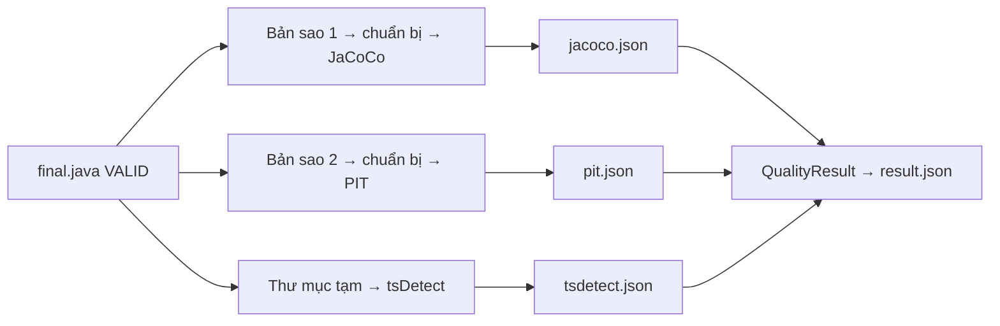

# P05. Khối 4: Đo chất lượng

**Mục đích:** đo chất lượng của bộ test **VALID** bằng ba công cụ:

| Công cụ | Đo |
|---|---|
| JaCoCo | Coverage theo dòng, nhánh và method của CUT |
| PIT | Mutation score của CUT |
| tsDetect | Test smell của file test |

Kết quả cho người dùng biết test tốt tới đâu, và được ghi vào `result.json`.

**Lớp:** `Arrow.Business/Quality`, gồm `SuitePreparer`, `JacocoTool`, `PitTool`, `TsDetectTool`, `ResultParsers`. Công cụ tải và kiểm tra qua `IToolStore` (P09 §6).

**Nguồn gốc:**
- R04 §1–5;
- code **viết mới** theo spec này (PLAN §2.1); phần đọc kết quả (CSV JaCoCo, `mutations.xml`, CSV tsDetect) và dựng classpath PIT tham khảo `ResultParsers`, `QualityTools` của `ARROW_Framework/src/Arrow.Service/Block4`.

Sản phẩm **bỏ** EvoSuite, báo cáo RQ1–RQ3, chọn N, độ nhạy P và ghép cặp (R04 §3, §6).



## 1. Phạm vi

| Có | Không |
|---|---|
| Chỉ đo bộ test VALID cuối cùng của mỗi CUT | Đo bộ chưa VALID, đo c0 khi chain còn chạy |
| Maven và Gradle; JUnit 4, JUnit 5, TestNG | Kotlin, test tích hợp |
| Phạm vi đo là **đúng CUT và các class lồng của nó** | Coverage của cả project (để dành cho `arrow suggest` sau v1) |
| `--no-metrics`, `quality.enabled`, `quality.tools` | EvoSuite, so sánh với hệ thống khác |

## 2. Đầu vào

| Đầu vào | Nguồn |
|---|---|
| `final.java`, `test_fqn` (chỉ khi `final_state = VALID`) | P04 §7 |
| M, `workspace.json`, `test_classpath.txt` | P01 |
| Công cụ: `jacoco-agent`, `jacoco-cli` 0.8.12; `pitest*` 1.17.4 cùng thư viện đi kèm; `pitest-junit5-plugin` 1.2.1; `pitest-testng-plugin` 1.0.0; `tsdetect` 2.2 | P09 §6 |
| `quality.tools`, `quality.pit_timeout_seconds` (1800), `quality.tsdetect_timeout_seconds` (300), `verification.step_timeout_seconds` (900) | P09 |

**Khi nào chạy:**
- chỉ khi `quality.enabled = true`, không có `--no-metrics`, và `final_state = VALID`;
- CUT khác trạng thái thì không có thư mục `block4/`, và `result.json` ghi `metrics: null`;
- người dùng tắt đo thì `result.json` ghi `metrics_skipped: "disabled"`.

## 3. Chuẩn bị chung (`SuitePreparer`)

1. **Mỗi công cụ chạy trên một bản sao mới** của `compiled_snapshot`. Lần chạy JaCoCo không để lại file ảnh hưởng tới PIT, và ngược lại.
2. Snapshot được tạo **trước khi** có bộ test, nên chưa có `.class` của bộ test. Mỗi bản sao vì vậy phải **chuẩn bị bộ test** trước khi đo:
   1. ghi `final.java` vào `test_path`;
   2. **biên dịch test và lấy classpath trong một lần gọi**, từ build root với bộ chọn module:
      - Maven: `-f pom.xml [sel] <cờ chung> -DskipTests test-compile org.apache.maven.plugins:maven-dependency-plugin:3.8.1:build-classpath -Dmdep.includeScope=test -Dmdep.outputFile=arrow-cp.txt`;
      - Gradle: `:<p>:testClasses`, rồi init script in classpath;
   3. biên dịch thất bại thì công cụ đó lỗi `B4_SUITE_COMPILE`. Bộ đã VALID thì không nên xảy ra; nếu xảy ra thì là lỗi môi trường, được thử lại tối đa 3 lần.
3. **tsDetect** chỉ đọc mã nguồn, nên không cần bản sao: chỉ cần thư mục tạm (Mục 6).
4. **Thư mục class:**
   - class production của module đích: `target/classes` (Maven) hoặc `build/classes/java/main` (Gradle);
   - class test: `target/test-classes` hoặc `build/classes/java/test`.
5. **Cờ build chung:** giống P01 §6, trong đó JaCoCo của chính project bị tắt (`-Djacoco.skip=true`) để không xung đột với agent của ARROW.

**Phạm vi đo:** dùng **hai mẫu chính xác** `<FQN>` và `<FQN>$*`. **Không** dùng `<FQN>*`: với CUT `com.myshop.Order`, mẫu `com.myshop.Order*` sẽ khớp nhầm cả `OrderService`, `OrderRepository`.

## 4. Coverage (`JacocoTool`)

1. **Chạy riêng bộ test** bằng lệnh bước 2 của P04 §3.2, với agent gắn qua biến môi trường. Gắn qua biến môi trường để không xung đột với cấu hình Surefire hay JaCoCo riêng của project:

```
JAVA_TOOL_OPTIONS += -javaagent:<jacocoagent.jar>=destfile=<exec>,append=true,includes=<FQN>:<FQN>$* -Djdk.attach.allowAttachSelf=true
```

   JaCoCo tách nhiều mẫu bằng dấu `:`.
2. **Tạo báo cáo:**

```
java -jar jacococli.jar report <exec> --classfiles <thư mục class production của module> --sourcefiles <source_root> --csv <file>
```

3. **Đọc CSV**, **chỉ lấy các dòng** có cột `PACKAGE` đúng package của CUT, và cột `CLASS` **bằng đúng** tên CUT hoặc bắt đầu bằng `<tên CUT>.` (JaCoCo ghi class lồng dạng `Outer.Inner`), rồi cộng các bộ đếm.
   - Ví dụ CUT `Order`: lấy `Order`, `Order.Item`; **không** lấy `OrderService`.
4. **Tỷ lệ** = covered / (covered + missed). Mẫu số bằng 0 (ví dụ CUT không có nhánh) thì là `null`, không ghi 0.
5. Không có file `.exec`, hoặc CUT không có trong báo cáo: `B4_JACOCO_FAILED`.

```json
{ "line": 0.78, "branch": 0.64, "method": 0.86,
  "counters": { "LINE_COVERED": 39, "LINE_MISSED": 11, "BRANCH_COVERED": 16, "BRANCH_MISSED": 9, "METHOD_COVERED": 12, "METHOD_MISSED": 2 },
  "tool": "jacoco 0.8.12", "seconds": 24.8 }
```

## 5. Mutation (`PitTool`)

1. **Chuẩn bị** như Mục 3. PIT không tự biên dịch, nên thiếu bước này PIT sẽ không thấy class test.
2. **JDK chạy PIT:** JDK của project nếu major ≥ 11, nếu không thì JDK nhỏ nhất ≥ 11 trên máy. Không có JDK ≥ 11 thì `B4_PIT_FAILED` với lý do `PIT cần JDK 11+`, gợi ý cài JDK 11 hoặc 17.
3. **Classpath** ghi vào file và truyền qua `--classPathFile`. Gồm:
   - class production và class test **vừa biên dịch** của module đích;
   - nội dung `arrow-cp.txt` (dependency, class của module anh em);
   - thư viện PIT: `pitest`, `pitest-entry`, `pitest-command-line`, `pitest-html-report`, `commons-text`, `commons-lang3`, `jopt-simple`;
   - **JUnit 5:** `pitest-junit5-plugin` 1.2.1 và `junit-platform-launcher` **đúng phiên bản JUnit Platform của module**. Nếu classpath chưa có `junit-platform-launcher` thì tải từ Maven Central theo phiên bản của `junit-platform-engine` trong classpath, lưu vào `tools/junit-platform/`. Kiểm tra bằng file `.sha1` mà Maven Central công bố kèm jar (không có trong `tools.lock.json` vì phiên bản thay đổi theo project), rồi giữ để dùng lại;
   - **TestNG:** `pitest-testng-plugin` 1.0.0.
4. **Lệnh:**

```
java -cp <thư viện PIT> org.pitest.mutationtest.commandline.MutationCoverageReport
     --reportDir <dir> --targetClasses <FQN>,<FQN>$* --targetTests <test_fqn>
     --classPathFile <file> --mutators DEFAULTS --threads 1 --timestampedReports=false
     --outputFormats XML --failWhenNoMutations=false --sourceDirs <source_root>
```

   Timeout: `quality.pit_timeout_seconds` (1800 s).
5. **Kiểm tra phạm vi:** mọi mutant trong `mutations.xml` phải thuộc `<FQN>` hoặc `<FQN>$…`. Có mutant của class khác thì báo `B4_PIT_SCOPE`. Đây là lỗi cấu hình, nên không ghi kết quả.
6. **Đếm theo trạng thái:** `KILLED`, `SURVIVED`, `NO_COVERAGE`, `TIMED_OUT`, `MEMORY_ERROR`, `RUN_ERROR`.
   - **Mutation score** = (`KILLED` + `TIMED_OUT` + `MEMORY_ERROR`) / tổng mutant, theo cách tính mặc định của PIT.
   - **`test_strength`** = killed / (tổng − `NO_COVERAGE`), đúng công thức R04 §4.3. Ví dụ dưới: 30 / (54 − 10) = 0.68.
   - Tổng mutant bằng 0 thì `score = null`.
7. PIT lỗi thì `B4_PIT_FAILED`, kèm 20 dòng cuối của log.

```json
{ "total": 54, "killed": 30, "survived": 12, "no_coverage": 10, "timed_out": 2, "memory_error": 0, "run_error": 0,
  "score": 0.59, "test_strength": 0.68,
  "survivors_sample": [ { "method": "totalPrice", "line": 31, "mutator": "ConditionalsBoundaryMutator" } ],
  "tool": "pit 1.17.4", "seconds": 132.0 }
```

`survivors_sample` gồm tối đa 10 mutant còn sống đầu tiên. `arrow show` in ra để người dùng biết chỗ nào test còn yếu. Đây là phần thêm của sản phẩm.

## 6. Test smell (`TsDetectTool`)

1. Tạo thư mục tạm chứa đúng hai file: file test và file CUT.
2. Tạo CSV đầu vào một dòng: `arrow,<đường dẫn tuyệt đối file test>,<đường dẫn tuyệt đối file CUT>`.
3. Chạy `java -jar TestSmellDetector.jar <csv>` bằng JDK 17 trở lên, timeout `quality.tsdetect_timeout_seconds` (300 s). Đọc CSV kết quả: một dòng cho file test, mỗi cột một loại smell.
4. **`density`** = tổng số smell / số test method. Số test method đếm bằng java-helper `list_test_methods`. Có 0 test method thì `density = null`.
5. tsDetect lỗi thì `B4_TSDETECT_FAILED`.

```json
{ "test_methods": 6, "smells": { "Assertion Roulette": 2, "Magic Number Test": 1, "Eager Test": 0 }, "total_smells": 3,
  "density": 0.50, "tool": "tsdetect 2.2", "seconds": 3.1 }
```

## 7. Thứ tự, lỗi và kết quả

- Ba công cụ chạy **lần lượt** cho một CUT: JaCoCo, rồi PIT, rồi tsDetect. Khi chạy `--jobs`, các CUT khác nhau đo song song.
- **Một công cụ lỗi không chặn công cụ khác.**
- **Lỗi môi trường** (timeout, công cụ không chạy) được chạy lại, tối đa 3 lần, chờ 30 s giữa hai lần. Vẫn lỗi thì ghi vào `block4/outcome.json`.
- **Công cụ chưa tải và không tải được** (P09 §6.2): công cụ đó có kết quả `skipped`, lý do `CFG_TOOL_MISSING`.
- **Lỗi đo không làm CUT thất bại:** bộ test vẫn VALID và vẫn được đề nghị ghi vào project (P06). Chỉ có chỉ số là thiếu.

**`block4/outcome.json`:**

```json
{ "jacoco":   { "status": "OK", "code": null },
  "pit":      { "status": "FAILED", "code": "B4_PIT_FAILED", "message": "…20 dòng cuối…", "attempts": 3 },
  "tsdetect": { "status": "SKIPPED", "code": "CFG_TOOL_MISSING" } }
```

**`QualityResult`**, được chép vào `result.json` (P07 §6):

```csharp
public sealed record QualityResult(
    double? Line, double? Branch, double? Method,        // JaCoCo
    double? MutationScore, double? TestStrength,         // PIT
    double? SmellDensity, IReadOnlyDictionary<string,int>? Smells,
    IReadOnlyDictionary<string, ToolOutcome> Tools);     // trạng thái từng công cụ
```

## 8. Mã lỗi

| Mã | Khi nào | Gợi ý |
|---|---|---|
| `B4_SUITE_COMPILE` | Không biên dịch được bộ test trong bản sao để đo (3 lần) | Lỗi môi trường; chạy lại. Nếu vẫn lỗi thì báo lỗi kèm log |
| `B4_JACOCO_FAILED` | Không có dữ liệu coverage của CUT | Project có thể chạy test bằng JVM riêng không nhận `JAVA_TOOL_OPTIONS`. Xem log |
| `B4_PIT_FAILED` | PIT lỗi, hoặc không có JDK ≥ 11 | Cài JDK 11+; xem 20 dòng cuối log |
| `B4_PIT_SCOPE` | PIT tạo mutant ngoài CUT và class lồng | Lỗi cấu hình của ARROW. Báo lỗi kèm log |
| `B4_TSDETECT_FAILED` | tsDetect lỗi | Xem log |

## 9. Interface

```csharp
public interface IQualityTool            // JacocoTool, PitTool, TsDetectTool
{
    string Name { get; }                 // "jacoco" | "pit" | "tsdetect"
    Task<ToolResult> MeasureAsync(SuiteToMeasure suite, TaskContext task, CancellationToken ct);
}

public interface IQualityService         // gọi lần lượt các công cụ, gom kết quả, ghi block4/
{
    Task<QualityResult> MeasureAsync(SuiteToMeasure suite, TaskContext task, IReadOnlySet<string> tools, CancellationToken ct);
}
```

**Sự kiện tiến độ:** `B4.ToolStart` (tên), `B4.ToolDone` (tên, chỉ số chính, thời gian), `B4.ToolFailed` (tên, mã), `B4.Done`.

## 10. Kiểm thử

**Unit:**
- Đọc CSV của JaCoCo có class lồng và class tên gần giống (`Order` / `OrderService`); mẫu số bằng 0 cho `null`.
- Đếm `mutations.xml`: score, `test_strength`, tổng bằng 0; phát hiện mutant ngoài phạm vi (`B4_PIT_SCOPE`).
- Dựng classpath của PIT cho JUnit 4, JUnit 5 (có và không có `junit-platform-launcher`), TestNG.
- Chọn JDK cho PIT.
- Đọc CSV của tsDetect; `density` khi có 0 test method.
- Một công cụ lỗi thì công cụ khác vẫn chạy.

**Integration**, với bộ test mẫu VALID của fixture (P11 §2):

| Fixture | Kỳ vọng |
|---|---|
| `maven-verify-junit4` | Cả 3 chỉ số, giá trị nằm trong khoảng ghi ở `README` |
| `maven-multi-junit5` | PIT có `junit-platform-launcher` đúng phiên bản; JaCoCo chỉ đo `shop-core` |
| `gradle-junit5` | Cả 3 chỉ số với Gradle |
| `maven-testng` | PIT chạy với plugin TestNG |

Mọi lần đo không làm đổi thư mục fixture gốc (so hash).

**Nghiệm thu:** trên 4 fixture trên, `arrow gen <cut> --yes`, dùng `FakeLlmClient` trả bộ test mẫu, in đủ line, branch, mutation và smell. `arrow show` in ra danh sách mutant còn sống.
