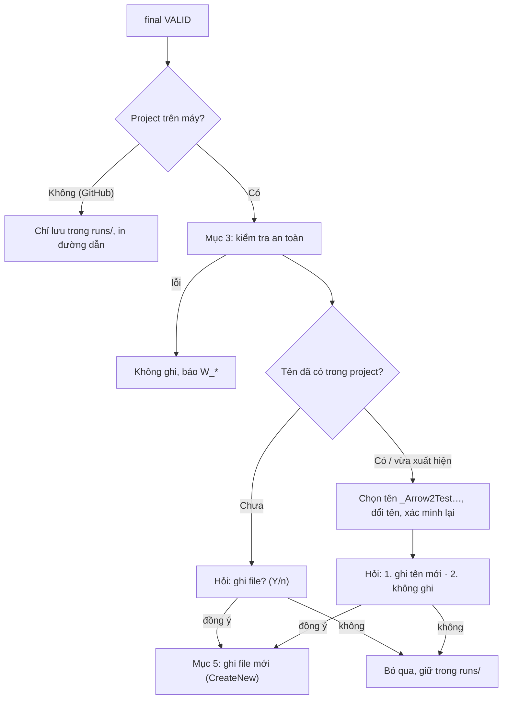

# P06. Ghi file test vào project

**Mục đích:** đưa bộ test **VALID** vào project của người dùng một cách an toàn:
- chỉ ghi khi người dùng đồng ý;
- không bao giờ ghi đè;
- không bao giờ ghi ra ngoài project;
- không bao giờ sửa file nào khác.

Đây là **chỗ duy nhất** trong hệ thống được ghi vào thư mục của người dùng.

**Lớp:**
- `Arrow.Business/Apply/TestWritePolicy`: quyết định;
- `Arrow.DataAccess/ProjectFileWriter`: ghi file;
- `Arrow.Cli`: hỏi người dùng, qua `IConfirmation` (P08 §9).

**Nguồn gốc:** không có trong spec của nhóm (thực nghiệm không ghi vào repo). Quy tắc đặt tên theo P01 §4.7, đã chốt ngày 10/11/2026.



## 1. Phạm vi

| Có | Không |
|---|---|
| Ghi **một file mới** cho mỗi CUT VALID, vào `test_root` của module | Ghi đè, sửa hay xoá bất kỳ file nào |
| Tạo thư mục package còn thiếu **bên trong `test_root`** | Tạo thư mục ngoài `test_root` |
| Hỏi một lần cho nhiều class | `git add`, `git commit` |
| Cảnh báo khi `mvn test` sẽ không chạy file | Sửa cấu hình Surefire hay Gradle |

## 2. Đầu vào

| Đầu vào | Nguồn |
|---|---|
| `final.json` (`final_state`), `final.java`, `test_fqn`, `test_path` | P04 §7 |
| `metadata.json`: `paths.generated_test_path`, `name_index`, `name_matches_test_includes`, `cut.source_sha256`, `build_tool.test_includes` | P01 |
| `verify.json` cuối: `generated_test_ran_in_module` | P04 §3.5 |
| Gốc project (`ProjectTarget.Location` đã phân giải), kiểu nguồn (local hay git) | P01 §3 |
| Tuỳ chọn: `--yes`, `--dry-run`, `apply.confirm` | P08, P09 |

## 3. Kiểm tra an toàn (`TestWritePolicy`)

Kiểm tra theo thứ tự, ngay trước khi hỏi người dùng. Điều kiện nào không đạt thì **không ghi**, ghi lý do vào `apply.json`, rồi chuyển sang CUT tiếp theo.

| # | Kiểm tra | Không đạt |
|---|---|---|
| 1 | `final_state = VALID` | `decision = "not_valid"`. Không hỏi |
| 2 | Project là thư mục trên máy, không phải `--repo` | `decision = "remote_project"`. Không hỏi; in đường dẫn `final.java` trong `runs/` |
| 3 | Có `--dry-run` | `decision = "dry_run"`. Không hỏi; in đường dẫn sẽ ghi và đường dẫn file trong `runs/` |
| 4 | **Đường dẫn đích nằm trong project:** `Path.GetFullPath(root + test_path)` bắt đầu bằng `GetFullPath(root) + separator`, không có `..` sau khi chuẩn hoá. Không thư mục cha nào (từ đích lên tới gốc) là symlink hay junction trỏ ra ngoài project. Đích nằm dưới `test_root` của M | `W_TARGET_OUTSIDE_PROJECT`. Đây là lỗi nghiêm trọng, phải ghi log đầy đủ |
| 5 | **CUT chưa đổi** kể từ khi chép vào `base`: SHA-256 của file CUT hiện tại = `cut.source_sha256` | `W_PROJECT_CHANGED`. Có bàn phím thì hỏi `CUT đã thay đổi sau khi ARROW đọc nó; test được xác minh trên bản cũ. Vẫn ghi? (y/N)`, mặc định **không**. Có `--yes` hoặc không có bàn phím thì **không ghi** |
| 6 | **Tên chưa có trong project**, kiểm tra lại ngay lúc này | Đã có: sang Mục 4.2 |

Hỏi người dùng (Mục 4) **sau** bước 6. Ngay trước khi ghi thật thì kiểm tra lại bước 4 và bước 6 một lần nữa, để tránh trường hợp có thay đổi trong lúc chờ người dùng trả lời.

## 4. Chọn tên và hỏi người dùng

### 4.1 Tên chưa có (`name_index = 1`, file chưa tồn tại)

```
? Ghi shop-core/src/test/java/com/myshop/service/OrderService_ArrowTest.java (6 test · line 78% · mutation 61%)? (Y/n)
```

- Mặc định **Y**.
- `--yes` hoặc `apply.confirm = false` thì đồng ý luôn, không hỏi.
- Không có bàn phím và không có `--yes` thì **không ghi** (P08 §4.3).

### 4.2 Tên đã có trong project

Có hai trường hợp:
- **(a)** khối 1 đã phát hiện trùng, nên `name_index > 1` ngay từ đầu, và test đã được sinh, xác minh với tên `_Arrow<k>Test`;
- **(b)** tên `<CUT>_ArrowTest` còn trống lúc chạy khối 1, nhưng **vừa xuất hiện** trong lúc run chạy. Khi đó:
  1. tìm `k` nhỏ nhất ≥ 2 sao cho `<CUT>_Arrow<k>Test.java` chưa có và tên ngắn không trùng test class nào trong reactor;
  2. đổi tên class bằng java-helper `rename_class` (P10 §4.3);
  3. **xác minh lại một lần** (P04 §8). Không VALID thì `W_REVERIFY_FAILED`, không ghi, giữ cả hai bản trong `runs/`.

Sau đó hỏi:

```
? Đã có OrderService_ArrowTest.java trong project. Ghi bản mới thành:
  ❯ 1. OrderService_Arrow2Test.java (giữ nguyên file cũ)
    2. Không ghi, chỉ lưu trong runs/
```

- Mặc định là phương án 1.
- `--yes` thì chọn phương án 1.
- Không có bàn phím và không có `--yes` thì chọn phương án 2.
- Tới `k = 99` vẫn trùng thì `B1_TEST_NAME_EXHAUSTED` (P01), không ghi.

### 4.3 Nhiều class

Sau bảng tổng (P08 §3.2), hỏi **một lần** bằng danh sách chọn nhiều:

```
? Chọn file test để ghi vào project (phím cách để chọn, Enter để xác nhận)
  ◉ OrderService_ArrowTest.java      6 test · line 78% · mutation 61%
  ◉ Cart_Arrow2Test.java             4 test · line 91% · mutation 70%   (đã có Cart_ArrowTest.java)
  ◯ PriceFormatter_ArrowTest.java    3 test · line 55%                  [!] CUT đã thay đổi
```

- **Chọn sẵn:** mọi class qua được Mục 3, trừ class có `W_PROJECT_CHANGED`.
- `--yes`: ghi mọi class được chọn sẵn.
- Class không VALID không có trong danh sách. Chúng đã có trong bảng tổng.

### 4.4 Cảnh báo kèm theo

In ngay dưới câu hỏi, hoặc sau khi ghi với `--yes`:

| Điều kiện | Cảnh báo |
|---|---|
| `name_matches_test_includes = false` hoặc `generated_test_ran_in_module = false` | `[!] mvn test của project sẽ không tự chạy file này (mẫu tên test: <mẫu>). Hãy thêm mẫu vào cấu hình Surefire, hoặc chạy riêng bằng -Dtest=<Tên>` |
| `dropped_methods` khác rỗng | `[!] <n> test method đã bị bỏ trong lúc sửa: <tên>` |
| Một công cụ đo lỗi | `[!] Chưa đo được <công cụ>; xem arrow show <run> <class>` |

## 5. Ghi file (`ProjectFileWriter`)

1. **Tạo thư mục** package còn thiếu, chỉ bên trong `test_root`. Kiểm tra từng thư mục vừa tạo vẫn nằm trong project.
2. **Nội dung:**
   - `final.java` của tên đã chọn, mã hoá UTF-8 không BOM;
   - **kiểu xuống dòng theo file CUT**: CUT dùng CRLF thì ghi CRLF, ngược lại ghi LF;
   - kết thúc bằng đúng một dòng trống.
3. **Ghi:**
   - ghi vào file tạm cùng thư mục: `.<tên>.java.arrow-tmp`, mở với `FileMode.CreateNew`;
   - flush rồi đổi tên bằng `File.Move(tmp, dest, overwrite: false)`. Đích đã tồn tại thì `Move` ném lỗi: xoá file tạm, rồi xử lý như Mục 4.2 (b) **một lần**; lần thứ hai vẫn trùng thì `W_TARGET_EXISTS`;
   - lỗi I/O khác (quyền, đĩa, file bị khoá) thì xoá file tạm và báo `W_IO`.
4. **Không làm thêm việc gì khác:** không chạy formatter, không sửa import, không thêm dependency, không `git add`.
5. **Sau khi ghi:** in `✓ Đã ghi <đường dẫn tương đối>` kèm gợi ý `git add <đường dẫn>`.

## 6. `apply.json`

Ghi cho **mọi** CUT, kể cả khi không ghi file:

```json
{
  "decision": "written",
  "path": "shop-core/src/test/java/com/myshop/service/OrderService_Arrow2Test.java",
  "test_fqn": "com.myshop.service.OrderService_Arrow2Test",
  "name_index": 2, "renamed_after_run": false, "reverified": false,
  "line_endings": "crlf",
  "warnings": ["surefire_includes_mismatch"],
  "error": null,
  "at": "2026-11-10T07:41:00Z"
}
```

Giá trị của `decision`:

| Giá trị | Nghĩa |
|---|---|
| `written` | Đã ghi file |
| `declined` | Người dùng không đồng ý |
| `not_valid` | Bộ test không VALID |
| `remote_project` | Project lấy từ GitHub, không có chỗ để ghi |
| `dry_run` | Chạy với `--dry-run` |
| `skipped_non_interactive` | Không có bàn phím và không có `--yes` |
| `blocked` | Bị chặn bởi một mã lỗi `W_*` hoặc `B1_TEST_NAME_EXHAUSTED` |

## 7. Mã lỗi

| Mã | Khi nào | Gợi ý |
|---|---|---|
| `W_TARGET_OUTSIDE_PROJECT` | Đường dẫn đích ra ngoài project hoặc ngoài `test_root` (symlink, junction, `..`) | Lỗi nghiêm trọng. Kiểm tra symlink trong project; báo lỗi kèm log |
| `W_PROJECT_CHANGED` | File CUT đã đổi kể từ lúc chạy | Chạy lại `arrow gen` cho class đó |
| `W_REVERIFY_FAILED` | Bản đổi tên `_Arrow<k>Test` không còn VALID | Bản gốc vẫn ở `runs/`. Chạy lại `arrow gen` |
| `W_TARGET_EXISTS` | File đích xuất hiện hai lần liền trong lúc ghi | Chạy lại |
| `W_IO` | Không ghi được (quyền, đĩa, file bị khoá) | Kiểm tra quyền ghi thư mục test, hoặc đóng IDE đang khoá file |

## 8. Interface

```csharp
public interface ITestWritePolicy          // Business
{
    Task<ApplyPlan> PlanAsync(TargetOutcome target, ProjectContext project, CancellationToken ct);       // Mục 3–4.2, chưa hỏi
    Task<ApplyResult> ApplyAsync(ApplyPlan plan, ApplyChoice choice, CancellationToken ct);             // Mục 5–6
}

public interface IProjectFileWriter        // DataAccess
{
    // Ném WriteException(code) với W_TARGET_OUTSIDE_PROJECT / W_TARGET_EXISTS / W_IO. Không bao giờ ghi đè.
    Task WriteNewAsync(string projectRoot, string relativePath, string content, LineEndings eol, CancellationToken ct);
}
```

**Sự kiện tiến độ:** `APPLY.Planned`, `APPLY.Renamed` (k mới), `APPLY.Reverified` (kết quả), `APPLY.Written`, `APPLY.Skipped` (lý do).

## 9. Kiểm thử

**Unit** (`ProjectFileWriter` chạy trên thư mục tạm thật):
- Ghi file mới: nội dung đúng, UTF-8 không BOM, CRLF hoặc LF theo CUT.
- **Không ghi đè:** đích đã có, thì nội dung cũ không đổi một byte nào và có ngoại lệ đúng mã.
- **Chặn ra ngoài:** `../`, đường dẫn tuyệt đối, symlink (Linux) hoặc junction (Windows) trỏ ra ngoài project. Kết quả `W_TARGET_OUTSIDE_PROJECT`, không file nào được tạo ở ngoài.
- Đích xuất hiện giữa lúc ghi (giả lập): xoá file tạm, chuyển sang `k` kế tiếp.
- Lỗi quyền ghi: `W_IO`, không sót file tạm.

**Unit** (`TestWritePolicy`, với confirmation giả):
- Ma trận `--yes`, `--dry-run`, có hoặc không có bàn phím, `apply.confirm` ứng với đúng `decision` ở Mục 6.
- Tên đã có lúc chạy khối 1 thì hỏi theo Mục 4.2 (a). Tên vừa xuất hiện thì đổi tên và xác minh lại (b).
- CUT đã đổi: hỏi với mặc định **không**; có `--yes` thì không ghi.
- Cảnh báo mẫu tên test của Surefire.

**E2E** (fixture `maven-existing-arrowtest` và `maven-verify-junit4`, `FakeLlmClient`):
- `arrow gen PriceCalculator --yes`: có `PriceCalculator_ArrowTest.java`, và `mvn test` của fixture chạy file đó (có trong báo cáo Surefire).
- Chạy lại lần hai với `--yes`: có `PriceCalculator_Arrow2Test.java`; file lần một không đổi (so hash).
- Stdin bị chuyển hướng, không có `--yes`: không có file mới, `decision = skipped_non_interactive`.
- `--dry-run`: không có file mới.
- **So hash toàn bộ fixture trước và sau:** chỉ khác đúng file test vừa ghi.

**Nghiệm thu:** mọi test ở trên xanh trên cả Windows và Ubuntu.
