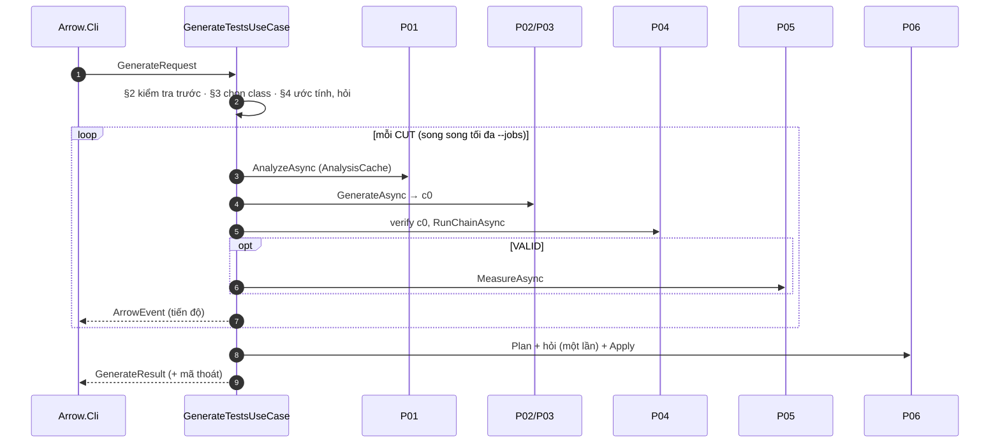

# P07. Use case: sinh test cho một hoặc nhiều class

**Mục đích:** P07 điều phối 4 khối thành một lần chạy `arrow gen`:
- kiểm tra trước khi chạy;
- chọn class;
- ước tính chi phí;
- chạy từng class, có thể song song, dùng chung khối 1 khi cùng module;
- phát sự kiện tiến độ;
- dừng an toàn, chạy tiếp sau khi bị ngắt;
- ghi file vào project (P06);
- tổng hợp kết quả và mã thoát.

Spec này cũng định nghĩa `ArrowEvent` và `result.json`.

**Lớp:** `Arrow.Business/UseCases`, gồm `GenerateTestsUseCase` và `InspectUseCase`. Các use case nhỏ (`Setup`, `Doctor`, `Models`, `History`, `ShowRun`, `Config`, `Secrets`, `Tools`, `Clean`) đã mô tả ở P08 và P09.

**Nguồn gốc:** viết mới; không dùng `RunExecutor`, `ResumePlanner` và `ControlGate` của `ARROW_Framework/src/Arrow.Service/Pipeline`. Không còn ledger, job và hàng đợi theo khối như R00 §5; đơn vị điều phối giờ là **một CUT**.



## 1. Đầu vào

```csharp
public sealed record GenerateRequest(
    ProjectSourceKind Kind, string Location, string? GitRef,
    IReadOnlyList<string> CutQueries,          // có thể rỗng nếu có Package
    string? Package,
    GenerateOptions Options);

public sealed record GenerateOptions(
    string? Model, int? Rounds, bool NoRepair, bool NoMetrics,
    bool Yes, bool DryRun, int? Jobs, long? MaxTokens, string? ResumeRunId,
    IReadOnlyDictionary<string, string?> ConfigOverrides);
```

Use case nhận thêm:
- `IProgress<ArrowEvent>`: CLI hiển thị sự kiện;
- `IConfirmation`: CLI hỏi người dùng (P08 §9);
- `CancellationToken`: gắn với Ctrl+C.

## 2. Kiểm tra trước khi chạy

Kiểm tra theo thứ tự. Lỗi ở bước nào thì dừng ngay ở bước đó, **chưa tạo run**, và trả mã thoát 2.

| # | Kiểm tra | Lỗi |
|---|---|---|
| 1 | Tham số hợp lệ (P08 §2.2) | `CLI_ARGS` |
| 2 | Đọc được cấu hình (P09 §3.3) | `CFG_*` |
| 3 | Có model (`--model` hoặc `llm.default_model`); provider có khoá nếu cần | `CFG_NO_MODEL`, `CFG_SECRET_MISSING` |
| 4 | Có git (chỉ khi `--repo`); có ít nhất một JDK; có JDK ≥ 17 cho java-helper | `B1_JDK_MISSING`, `JH_JDK_MISSING` |
| 5 | `ARROW_HOME` hợp lệ, còn ≥ 2 GB trống | `CFG_HOME_PATH`, `CFG_DISK_FULL` |
| 6 | java-helper khởi động được (`ping`) | `JH_START_FAILED` |
| 7 | Công cụ đo có đủ (nếu đo). Thiếu thì tự tải (P09 §6.2); không tải được thì **không dừng**, chỉ ghi cảnh báo, và khối 4 bỏ công cụ đó | — |
| 8 | Template prompt hợp lệ (P02 §3.1) | `B2_TEMPLATE_INVALID` |

Bước 3–6 dùng lại phần kiểm tra của `arrow doctor`. Bước 6 cũng giữ tiến trình java-helper đó để chạy tiếp.

## 3. Tạo run và chọn class

1. **Chạy tiếp?** Có `--resume <run>`, hoặc phát hiện run dở của cùng project (Mục 5.1), thì chuyển sang Mục 5.
2. **Tạo run:**
   - `run_id` mới;
   - `runs/<run_id>/run.json` với `status = RUNNING` (P09 §5.3);
   - thư mục `work/<run_id>/`.
3. **Lấy mã:** khối 1 bước 3.1–3.2 (P01) **một lần** cho cả run, ra `base`.
4. **Chọn class:**
   - với mỗi `CutQuery`, gọi `ClassLocator` (P01 §3.3). Trùng tên thì hỏi qua `IConfirmation.ChooseOne`;
   - với `--package`, liệt kê các class (P01 §3.3 bước 6);
   - gộp lại, bỏ trùng, giữ thứ tự người dùng gõ.
5. **Lỗi khi chọn:**
   - query không ra class nào: ghi target đó với kết quả `BLOCKED` (`B1_CUT_MISSING`), **không dừng** cả run;
   - không còn class nào để chạy: `GEN_NO_TARGETS`, mã thoát 2.
6. Ghi `targets[]` vào `run.json` với `state = PENDING`.

## 4. Ước tính chi phí và hỏi

1. **Ước tính** theo P03 §7. Khi đó chưa có M, nên kích thước prompt tính bằng:
   - độ dài file CUT (sau `shrink_source` nếu > 48.000);
   - cộng độ dài template;
   - cộng 1.500 ký tự cho khối M.
2. **Hỏi khi** một trong hai điều kiện đúng:
   - số class ≥ `run.confirm_cost_from_classes` (5);
   - ước tính **tối đa** > `--max-tokens`.

```
Ước tính cho 8 class (gpt-x, N=5): ~45k token (~0.03 USD), tối đa ~120k token (~0.08 USD).
? Tiếp tục? (Y/n)
```

3. **Trả lời:**
   - `--yes`: đồng ý;
   - không có bàn phím: không đồng ý, kết quả `CANCELLED`, mã thoát 3;
   - người dùng từ chối: run `CANCELLED`, mã thoát 3.

## 5. Chạy tiếp

### 5.1 Phát hiện run dở

Khi bắt đầu `arrow gen` mà không có `--resume`, tìm trong `history.jsonl` và `runs/*/run.json` run gần nhất thoả cả ba điều kiện:
- `status` ∈ {`RUNNING` (tiến trình không còn sống), `CANCELLED`, `FAILED`};
- cùng `project.root` (hoặc cùng `url` và `commit`);
- trong vòng 7 ngày.

Có thì hỏi `Run <id> chưa xong (3/8 class). Chạy tiếp? (Y/n)`. Có `--yes` thì chạy tiếp. Trả lời không thì tạo run mới.

### 5.2 Điều kiện chạy tiếp

Chạy tiếp **dùng lại `run_id` cũ**, nhưng chỉ khi project **không đổi**:
- **thư mục trên máy:** chép lại cây làm việc vào `work/<run_id>/base`, rồi so `source_tree_hash` với lần trước;
- **repo GitHub:** so `commit`.

Khác thì báo `GEN_RESUME_MISMATCH` (`Project đã thay đổi kể từ run <id>`), gợi ý chạy run mới, và **không** chạy tiếp.

Tham số ảnh hưởng tới kết quả (model, N, `early_stop_p`, có sửa hay không, có đo hay không) **lấy theo `run.json` cũ**. Người dùng truyền giá trị khác thì in `[!] Dùng cấu hình của run cũ: …`.

### 5.3 Làm lại những gì

`state` của target trong `run.json` là `PENDING`, `RUNNING` hoặc `DONE` (P09 §5.3); `result` nằm trong `result.json` (Mục 6).

| Target | Xử lý |
|---|---|
| `DONE`, `result` khác `BLOCKED` và `INFRA` | Giữ nguyên, không chạy lại. Chưa có `apply.json` thì vẫn đưa vào bước ghi file |
| `DONE`, `result` là `BLOCKED` hoặc `INFRA` | Chạy lại từ đầu, vì lỗi có thể đã được sửa |
| `PENDING` | Chạy từ đầu |
| `RUNNING` (bị ngắt bởi Ctrl+C hoặc P03 dừng run) | Xoá `block2/`, `block3/`, `block4/` của target rồi chạy lại từ khối 2. Khối 1 dùng lại nếu đã có `block1/outcome.json` và snapshot còn; không thì làm lại khối 1. Các lượt gọi model đã có trong `llm_cache/` được **phát lại, không tốn tiền** (P03 §5) |

## 6. Chạy một CUT

```
TargetPipeline(cut):
    state ← RUNNING; ghi run.json
    a  ← AnalysisCache.GetOrRun(module của cut) → P01.AnalyzeAsync           # BLOCKED/INFRA → kết thúc target
    c0 ← P02.GenerateAsync                                                  # INVALID_OUTPUT → kết thúc target
    v0 ← P04.Verify(c0)                                                     # ghi verify_c0.json
    final ← v0 VALID ? c0 : (repair bật ? P04.RunChainAsync(c0, v0) : c0)
    if final_state = VALID and đo bật: q ← P05.MeasureAsync
    ghi result.json; state ← DONE; ghi run.json
```

**`result.json`** (mỗi CUT; P08 `--json` và `arrow show` đọc file này):

```json
{
  "cut_fqn": "com.myshop.service.OrderService",
  "result": "VALID",
  "c0_state": "COMPILE", "rounds_run": 4, "success_round": 4, "stop_reason": "valid",
  "test_fqn": "com.myshop.service.OrderService_ArrowTest",
  "test_path": "shop-core/src/test/java/com/myshop/service/OrderService_ArrowTest.java",
  "final_code": "block3/final.java",
  "metrics": { "line": 0.78, "branch": 0.64, "method": 0.86, "mutation": 0.61, "test_strength": 0.73, "smell_density": 0.5 },
  "metrics_skipped": null,
  "tools": { "jacoco": "OK", "pit": "OK", "tsdetect": "OK" },
  "tokens": { "in": 9800, "out": 2600 }, "cost_usd": 0.006, "llm_calls": 5,
  "seconds": { "block1": 61.2, "block2": 6.2, "block3": 96.3, "block4": 150.0, "total": 313.7 },
  "error": null,
  "warnings": ["dropped_methods: 1"],
  "apply": { "decision": "written", "path": "…" }
}
```

**Giá trị của `result`:**

| Giá trị | Khi nào |
|---|---|
| `VALID` | Bộ test cuối đạt VALID |
| `COMPILE` … `REGRESSION` | `final_state` khi hết vòng hoặc dừng sớm |
| `INVALID_OUTPUT` | c0 không có mã dùng được |
| `INFRA` | Khối 1, 2 hoặc 3 gặp lỗi hạ tầng (`error.code`) |
| `BLOCKED` | Khối 1 không dùng được project hay class (`error.code`) |
| `CANCELLED` | Người dùng huỷ, hoặc run bị dừng (P03) khi target đang chạy |

`error` là `{ "code", "message", "hint", "log" }`, lấy từ `ErrorCatalog`.

## 7. Song song

- **`--jobs n`** (1–8): tối đa n target chạy cùng lúc, qua `SemaphoreSlim(n)`. Thứ tự **bắt đầu** theo thứ tự trong `targets[]`.
- **Khối 1:** dùng chung theo module (P01 §7). Các target cùng module chờ target đầu tiên của module đó làm xong khối 1.
- **LLM:** một `LlmGateway` chung cho cả run, nên `max_concurrent` và `rpm_limit` áp cho tổng cộng (P03 §6).
- **java-helper:** mỗi target đang chạy dùng một tiến trình java-helper riêng, lấy từ pool kích thước n (P10 §5).
- **Lệnh build:** mỗi target chỉ chạy một lệnh build tại một thời điểm, nên có tối đa n lệnh Maven/Gradle cùng lúc. Mỗi lệnh dùng bản sao riêng.
- **Bộ nhớ:** đặt `MAVEN_OPTS` và `GRADLE_OPTS` `-Xmx1g` cho mỗi lệnh, nếu người dùng chưa đặt. `doctor` cảnh báo khi `jobs × 1.5 GB` vượt RAM trống.

## 8. Dừng

| Nguyên nhân | Xử lý |
|---|---|
| **Ctrl+C** (`CancellationToken`) | Huỷ mọi target đang chạy: giết cây tiến trình, xoá bản sao. Target đang chạy giữ `state = RUNNING` trong `run.json` để chạy tiếp được. Run `status = CANCELLED`. Không hỏi ghi file. Mã thoát 3 |
| **P03 dừng run** (`B2_LLM_CONFIG`, `B2_WRONG_MODEL`, `B2_TOKEN_BUDGET`) | Không bắt đầu lượt gọi mới nào. Target đang chạy dừng lại: trong kết quả trả về cho CLI là `result = CANCELLED`, `error` là mã đó; trong `run.json` vẫn giữ `state = RUNNING` để chạy tiếp được (Mục 5.3). Target chưa chạy giữ `PENDING`. Run `status = FAILED`. **Vẫn** hỏi ghi file cho các target đã VALID. CLI in lỗi và lệnh `arrow gen --resume <run>`. Mã thoát 2 |
| **Exception không lường trước** ở một target | Target đó có `result = INFRA`, `error.code = CLI_INTERNAL` (P08 §10), ghi stack trace vào log. Các target khác chạy tiếp |

**Khi run kết thúc** (bất kể lý do):
- ghi `finished_at` và `totals` vào `run.json`;
- thêm một dòng vào `history.jsonl`;
- xoá `work/<run_id>/`, trừ khi bật `run.keep_workspaces`;
- dừng java-helper.

## 9. Ghi file và kết thúc

1. Mọi target xong, hoặc run dừng vì P03, thì gọi P06 cho các target `VALID`. Hỏi một lần theo P06 §4.3, rồi ghi.
2. **Mã thoát** (P08 §8):

| Điều kiện | Mã |
|---|---|
| Mọi target `VALID` | 0 |
| Có target không VALID (trạng thái lỗi, `INVALID_OUTPUT`, `INFRA`), và có ít nhất một target không `BLOCKED` | 1 |
| Mọi target `BLOCKED`; hoặc lỗi kiểm tra trước (Mục 2); hoặc run `FAILED` vì P03 | 2 |
| Người dùng huỷ | 3 |

3. **Kết quả trả về cho CLI:**

```csharp
public sealed record GenerateResult(
    string RunId, RunStatus Status, int ExitCode,
    IReadOnlyList<TargetResult> Targets,      // nội dung result.json + apply
    RunTotals Totals);
```

## 10. `ArrowEvent`

```csharp
public sealed record ArrowEvent(
    DateTimeOffset At, string Type,           // "B1.Compile", "B3.Round", …
    string? CutFqn, int? Index, int? Total,   // vị trí target trong run: [2/5]
    EventLevel Level,                         // Info | Warning | Error
    string Message,                           // câu ngắn tiếng Việt cho chế độ plain
    IReadOnlyDictionary<string, object?> Data);
```

| Nhóm | Sự kiện | Spec |
|---|---|---|
| Run | `RUN.Started`, `RUN.TargetsResolved`, `RUN.Estimate`, `RUN.TargetStarted`, `RUN.TargetDone`, `RUN.Stopping`, `RUN.Finished` | P07 |
| Khối 1 | `B1.Checkout`, `B1.Locate`, `B1.Plan`, `B1.Compile`, `B1.Baseline`, `B1.Done`, `B1.Blocked` | P01 §8 |
| Khối 2 | `B2.Prompt`, `B2.SourceTruncated`, `B2.Calling`, `B2.Response`, `B2.Candidate`, `B2.Truncated` | P02 §8 |
| LLM | `LLM.Retry`, `LLM.Replayed`, `LLM.BudgetWarning` | P03 §12 |
| Khối 3 | `B3.VerifyStep`, `B3.Verified`, `B3.InfraRetry`, `B3.Round`, `B3.Final` | P04 §9 |
| Khối 4 | `B4.ToolStart`, `B4.ToolDone`, `B4.ToolFailed`, `B4.Done` | P05 §9 |
| Ghi file | `APPLY.Planned`, `APPLY.Renamed`, `APPLY.Reverified`, `APPLY.Written`, `APPLY.Skipped` | P06 §8 |

**Quy tắc:**
- Sự kiện được phát **từ luồng làm việc**. CLI có trách nhiệm chuyển sang luồng hiển thị.
- `IProgress` không được chặn. CLI dùng `Channel` có giới hạn và bỏ bớt sự kiện mức Info nếu bị dồn.
- Mọi sự kiện cũng được ghi vào `runs/<run_id>/events.jsonl` để `arrow show` dựng lại tiến trình chạy.

## 11. `InspectUseCase`

1. Kiểm tra trước, theo Mục 2 bước 1, 2, 4, 5, 6 (không cần model).
2. Tạo run với `command = inspect`.
3. Chạy khối 1 cho đúng một CUT.
4. Trả `ProjectAnalysis` (P01 §8) và thời gian từng bước. Không gọi LLM, không ghi gì vào project.
5. Mã thoát 0 nếu `OK`, 2 nếu `BLOCKED` hay `INFRA`.

## 12. Mã lỗi

| Mã | Khi nào | Gợi ý |
|---|---|---|
| `GEN_NO_TARGETS` | Không còn class nào để chạy | Kiểm tra tên class hoặc package |
| `GEN_RESUME_MISMATCH` | Project đã đổi so với run cần chạy tiếp | Chạy `arrow gen` mới, không dùng `--resume` |
| `GEN_RESUME_NOT_FOUND` | `--resume <run>` không tồn tại, hoặc là run của project khác | `arrow history` để xem các run |

## 13. Kiểm thử

**Unit** (các khối là bản giả):
- Thứ tự kiểm tra trước; lỗi ở bước nào thì không tạo run.
- Chọn class: nhiều query, trùng lặp, `--package`, một query không ra class (target `BLOCKED`, các target khác vẫn chạy).
- Ước tính chi phí và hỏi: ngưỡng số class, vượt `--max-tokens`, `--yes`, không có bàn phím.
- `TargetPipeline`: mọi nhánh kết thúc (BLOCKED, INVALID_OUTPUT, INFRA, VALID ở c0, VALID sau chain, hết vòng, `--no-repair`, `--no-metrics`).
- Song song: `--jobs 3` với 5 target; hai target cùng module thì khối 1 chạy đúng một lần.
- Dừng: Ctrl+C giữa khối 3; P03 dừng run khi 2/5 target đã VALID (vẫn hỏi ghi 2 file đó; mã thoát 2).
- Chạy tiếp: target `DONE` được giữ; `RUNNING` chạy lại khối 2–4 mà các lượt gọi model được phát lại; project đổi thì `GEN_RESUME_MISMATCH`; tham số ảnh hưởng kết quả lấy theo run cũ.
- Bảng mã thoát (Mục 9).

**E2E** (P11, `FakeLlmClient`):
- `maven-multi-junit5`, 3 class, `--jobs 2`: baseline của `shop-core` chạy một lần; 3 file `result.json`; mã thoát đúng.
- Huỷ (gửi Ctrl+C sau sự kiện `B3.Round` đầu tiên), rồi `arrow gen --resume <run> --yes`: kết quả cuối giống lần chạy không bị huỷ; số lượt gọi model thật không tăng ở phần đã chạy (`replayed: true`).
- `arrow inspect` không gọi LLM: `FakeLlmClient` không có luật nào được dùng.

**Nghiệm thu:** trên một repo thật của bộ kiểm chứng (P11 §6), `arrow gen --package <pkg> --jobs 2 --yes` chạy hết, bảng tổng và `result.json` khớp nhau, `history` có dòng của run.
